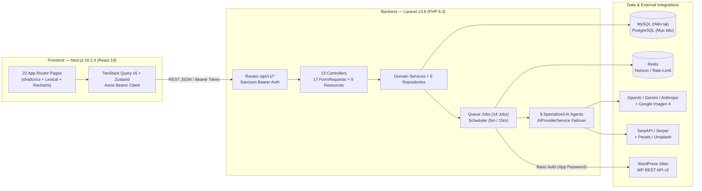
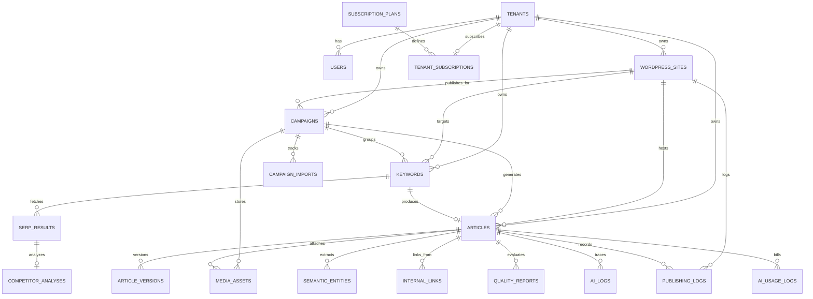
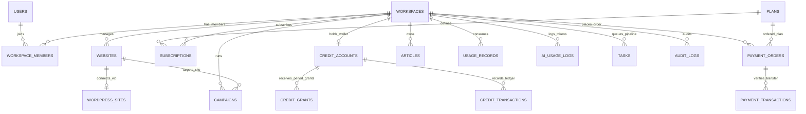

# PHASE_1_AUDIT.md — Báo Cáo Kiểm Toán Toàn Diện Mã Nguồn & Cơ Sở Dữ Liệu (Đợt 1 / TASK-01)

> **Dự án:** Hệ thống SaaS Viết Bài SEO Tự Động (Multi-Tenant Auto-SEO Content SaaS)  
> **Tech Stack thực tế:** Backend Laravel `v13.8.0` (PHP `^8.3`) + Frontend Next.js `16.2.4` (React `19.2.4`, TypeScript `^5`, Tailwind CSS `^4`)  
> **Khung điều phối:** QLPK Multi-Agent Safe Autonomous Framework  
> **Ngày thực hiện:** `2026-11-02`  
> **Chế độ thực hiện:** **100% Read-Only Audit** — Không xóa bảng, không reset database, không chỉnh sửa bất kỳ file code cũ nào trong `backend/` và `frontend/`.

---

## MỤC LỤC 7 PHẦN BẮT BUỘC

1. [Kiến trúc hệ thống hiện tại](#1-kiến-trúc-hệ-thống-hiện-tại)
2. [Danh sách bảng database và quan hệ](#2-danh-sách-bảng-database-và-quan-hệ)
3. [Danh sách chức năng đã có](#3-danh-sách-chức-năng-đã-có)
4. [Danh sách lỗi và rủi ro bảo mật](#4-danh-sách-lỗi-và-rủi-ro-bảo-mật)
5. [Đề xuất cấu trúc database mới](#5-đề-xuất-cấu-trúc-database-mới)
6. [Danh sách file cần sửa, tạo mới hoặc giữ nguyên](#6-danh-sách-file-cần-sửa-tạo-mới-hoặc-giữ-nguyên)
7. [Danh sách migration cần thực hiện và ảnh hưởng dự kiến](#7-danh-sách-migration-cần-thực-hiện-và-ảnh-hưởng-dự-kiến)

---

## 1. Kiến trúc hệ thống hiện tại

### 1.1. Tổng quan cấu trúc Monorepo

Dự án được tổ chức theo mô hình Monorepo tách biệt hoàn toàn giữa RESTful API Backend (`backend/`), SPA/SSR Frontend (`frontend/`) và khung điều phối tự hành đa Agent (`qlpk-autonomous-framework/`):

```text
SaasAutoSeo/
├── AGENTS.md                           # Quy chuẩn kỹ thuật cốt lõi của dự án
├── HANDOVER_CONTEXT.md                 # Ngữ cảnh bàn giao & định tuyến Model đa Agent
├── qlpk-autonomous-framework/          # Bộ điều phối QLPK Safe Autonomous Framework
│   ├── run-agy.sh                      # Orchestrator bash (caffeinate, CPU/RAM guard, Anti-Fake-Done gate)
│   ├── AGENTS.md / PLANNER.md / REVIEWER.md / ROADMAP.md / PROGRESS.md
│   ├── skills/                         # laravel-backend, nextjs-frontend, api-contract
│   └── templates/                      # audit-report, task-test, task-review templates
├── backend/                            # Laravel v13.8.0 REST API + Queue Workers + Multi-Agent AI
│   ├── app/
│   │   ├── Actions/Publishing/         # PushToWordPressAction (1 class)
│   │   ├── Agents/                     # 9 AI Agents kế thừa BaseAgent + AgentInterface
│   │   ├── Console/Commands/           # ProcessScheduledArticles, CheckStalledJobs (+ legacy Kernel.php)
│   │   ├── DTOs/                       # 9 Spatie Data / PHP DTO classes
│   │   ├── Enums/                      # UserRole, KeywordStatus, ArticleStatus, CampaignStatus, AgentType...
│   │   ├── Events/ & Listeners/        # ArticleGenerated, ArticleApproved, ArticlePublished
│   │   ├── Exceptions/                 # AI, Article, SEO, WordPress typed exceptions
│   │   ├── Http/Controllers/Api/V1/    # 13 API Controllers (Auth, Campaign, Keyword, Article, WP, Queue...)
│   │   ├── Http/Middleware/            # ApiRateLimiter (1 middleware duy nhất)
│   │   ├── Http/Requests/              # 17 FormRequest classes
│   │   ├── Http/Resources/             # 9 JsonResource classes
│   │   ├── Jobs/                       # 14 Queue Job classes (Keywords, SERP, Crawl, AI, Media, Publishing, Notification)
│   │   ├── Models/                     # 23 Eloquent Models
│   │   ├── Providers/                  # App, Horizon, Repository, AI (OpenAI, Anthropic, Gemini), Route, Event
│   │   ├── Repositories/               # 6 Repository Interfaces + 6 Implementations
│   │   ├── Services/                   # AI, SEO, Article, Campaign, Keyword, Media, WordPress, Cost, Queue, Analytics, Notifications
│   │   └── Traits/                     # BelongsToTenant, HasVersions
│   ├── config/                         # 19 file cấu hình (thiếu cors.php & permission.php)
│   ├── database/                       # migrations/, seeders/ (3 files), factories/ (1 file)
│   ├── routes/                         # api.php (/api/v1/*), web.php, console.php
│   └── tests/                          # Pest v4.7 skeleton (chỉ có ExampleTest mặc định)
└── frontend/                           # Next.js 16.2.4 (App Router, không dùng thư mục src/)
    ├── app/                            # 3 Layouts + 22 Pages: (auth)/login, (dashboard)/*, review/[token]
    ├── components/                     # ui/ (shadcn base-nova), layouts/ (Header, Sidebar), features/, shared/
    ├── hooks/                          # TanStack Query hooks (useAuth, useCampaigns, useKeywords, useArticles...)
    ├── lib/                            # api/client.ts (Axios + interceptors), endpoints.ts, constants/routes.ts
    ├── stores/                         # authStore.ts (Zustand v5)
    ├── types/                          # 8 file khai báo kiểu ambient (.d.ts)
    └── middleware.ts                   # Kiểm tra cookie token / laravel_session cơ bản
```

### 1.2. Sơ đồ luồng kiến trúc tổng thể hiện tại



### 1.3. Chi tiết Tech Stack & Sai lệch Cấu hình Thực tế

#### A. Tầng Backend (`backend/composer.json` & `backend/.env`)
- **Framework & Packages đã cài đặt:**
  - `laravel/framework`: `v13.8.0` (`^13.7` — lưu ý `AGENTS.md` gốc ghi Laravel 12 nhưng runtime thực tế đã lên Laravel 13 với Symfony `8.0.x`).
  - `laravel/sanctum`: `v4.3.2`, `laravel/horizon`: `v5.46.0`, `spatie/laravel-data`: `4.23.0`, `phpoffice/phpspreadsheet`: `2.4.5`, `predis/predis`: `v2.4.1`, `openai-php/laravel`: `v0.19.1` (khai báo `"*"` tại `composer.json:19`), `lorisleiva/laravel-actions`: `v2.10.1`.
  - `spatie/laravel-permission`: `6.25.0` — **đã cài nhưng hoàn toàn chưa sử dụng** (chưa publish `config/permission.php`, chưa có migrations bảng quyền, `User` không gắn `HasRoles`, đang phân quyền tạm bằng cột `users.role` kiểu `enum('super_admin','admin','editor','viewer')`).
  - Testing: `pestphp/pest` `v4.7.0` + `laravel/pint` `v1.29.1`.
- **Sai lệch môi trường thực tế (`backend/.env` vs Đặc tả SaaS):**
  1. **Database Engine & Tên DB:** `AGENTS.md` yêu cầu PostgreSQL và `ROADMAP.md` (`TASK-02.1`) nhắc đến `DBAURASEO`, nhưng cả `backend/.env.example:24` và `backend/.env:27-30` đang cấu hình `DB_CONNECTION=mysql` trỏ tới một máy chủ MySQL từ xa với `DB_DATABASE=sxr8j6cfqy75_db_auto_seo` (log `storage/logs/laravel.log` ghi nhận nhiều lỗi kết nối `Operation not permitted` / `Access denied` và lệch schema thiếu cột `pipeline_status`).
  2. **Xung đột Queue & Horizon:** `backend/.env:45` đặt `QUEUE_CONNECTION=database`, làm vô hiệu hóa hoàn toàn `laravel/horizon` (vốn chỉ chạy trên `redis`). Đồng thời trong `config/queue.php:70`, queue mặc định của kết nối `redis` được đặt tên là `'seo'`, nhưng không có bất kỳ supervisor nào trong `config/horizon.php:216-299` lắng nghe queue `'seo'` hay queue `'notifications'`.
  3. **Xung đột Cache & Redis trong AI Failover:** `backend/.env:47` đặt `CACHE_STORE=database`, nhưng `AIProviderService.php:131-167` lại gọi cứng `Redis::connection('cache')` để theo dõi rate-limit từng AI provider — nếu Redis chưa bật sẽ làm sập mọi lời gọi AI.
  4. **Timezone bị hardcode:** `.env:13` đặt `APP_TIMEZONE=Asia/Ho_Chi_Minh`, nhưng `config/app.php:68` hardcode `'timezone' => 'UTC'`, khiến mọi lịch hẹn bài viết và thống kê ngày bị lệch 7 tiếng.
  5. **Composer Autoload bị cũ (`stale`):** `backend/vendor/composer/autoload_classmap.php` vẫn lưu đường dẫn tới các class Zalo cũ đã bị xóa (`App\Models\ZaloNotification`) và chưa cập nhật các controller mới (`CampaignController`, `MediaAssetController`, `NotificationController`). Cần chạy `composer dump-autoload`.
  6. **Hạ tầng DevOps & Git Branch:** Chưa có `Dockerfile` hay `docker-compose.yml`. Nhánh Git hiện tại là `codex/feature` (trong khi `run-agy.sh` mặc định kiểm tra `ALLOWED_BRANCHES=dev` trừ khi bật `FORCE_RUN=1`).

#### B. Tầng Frontend (`frontend/package.json`)
- **Framework & Thư viện:**
  - `next`: `16.2.4`, `react`: `19.2.4`, `typescript`: `^5` (`strict: true`, `noImplicitAny: true` — không có từ khóa `any` nào trong code viết tay).
  - UI: `tailwindcss`: `^4`, `shadcn`: `^4.7.0` (style `"base-nova"` dùng `@base-ui/react: ^1.4.1`), `lucide-react`: `^1.14.0`, `sonner`: `^2.0.7`.
  - State & Fetching: `@tanstack/react-query`: `^5.100.9`, `axios`: `^1.16.0`, `zustand`: `^5.0.13`.
  - Forms & Editor & Charts: `react-hook-form`: `^7.75.0`, `zod`: `^3.25.76`, `lexical`: `^0.44.0`, `recharts`: `^3.8.1`, `xlsx`: `^0.18.5`, `react-dropzone`: `^14.4.1`.
- **Cấu trúc hiện tại:** Đặt trực tiếp tại `frontend/app/` (không dùng `src/`), có **22 pages** thuộc `(auth)/login`, `(dashboard)/*` và `review/[token]`. Hoàn toàn **chưa có route group `(admin)`** và chưa có trang `/register`.

---

## 2. Danh sách bảng database và quan hệ

### 2.1. Tổng hợp toàn bộ 28 bảng hiện có trong hệ thống

Hệ thống hiện có **27 bảng đã có file migration** trong `backend/database/migrations/` (cộng thêm **1 bảng `personal_access_tokens` của Sanctum chưa được publish migration** = **28 bảng**), tương ứng với **23 Eloquent Models** trong `backend/app/Models/`:

#### Nhóm A — Bảng hạ tầng Laravel & Sanctum (8 bảng)

| STT | Tên bảng | File Migration | Mục đích | Ghi chú kiểm toán |
| :---: | :--- | :--- | :--- | :--- |
| 01 | `password_reset_tokens` | `0001_01_01_000000_create_users_table.php` (`L14-18`) | Token đặt lại mật khẩu | PK là `email`; mâu thuẫn với bảng `users` cho phép trùng `email` khác `tenant_id`! |
| 02 | `sessions` | `0001_01_01_000000_create_users_table.php` (`L20-27`) | Lưu session web | `user_id` có index, không gắn FK cứng. |
| 03 | `cache` | `0001_01_01_000001_create_cache_table.php` (`L14-18`) | Database cache store | Chuẩn Laravel. |
| 04 | `cache_locks` | `0001_01_01_000001_create_cache_table.php` (`L20-24`) | Atomic lock qua DB | Chuẩn Laravel. |
| 05 | `jobs` | `0001_01_01_000002_create_jobs_table.php` (`L14-22`) | Hàng đợi DB fallback | Đang được dùng do `.env` để `QUEUE_CONNECTION=database`. |
| 06 | `job_batches` | `0001_01_01_000002_create_jobs_table.php` (`L24-35`) | Theo dõi Laravel Bus Batch | Sẵn sàng dùng cho Campaign Batch ở `TASK-06`. |
| 07 | `failed_jobs` | `0001_01_01_000002_create_jobs_table.php` (`L37-45`) | Dead Letter Queue | Đang bị `QueueStatusController` lộ toàn sàn cho user thường! |
| 08 | `personal_access_tokens` | **CHƯA PUBLISH!** (nằm trong `vendor/laravel/sanctum/...`) | Lưu Bearer Token Sanctum | **LỖI P0:** Sanctum v4 không tự nạp migration từ `vendor/`. Chạy `migrate` trên DB mới sẽ thiếu bảng này! |

#### Nhóm B — Bảng nghiệp vụ Multi-Tenant, SEO, AI & Billing hiện tại (20 bảng)

| STT | Tên bảng | Model (`app/Models/`) | Tenant Trait | Khóa ngoại (Foreign Keys) | Indexes / Unique chính | Đánh giá & Vấn đề phát hiện |
| :---: | :--- | :--- | :---: | :--- | :--- | :--- |
| 09 | `tenants` | `Tenant.php` | *(Gốc)* | Không | `UNIQUE(slug)` | Cột `plan` là `enum('starter','pro','enterprise')` lệch với `SubscriptionPlanSeeder` (`professional`, `agency`) và lệch chuẩn SaaS mới (`free`,`basic`,`pro`,`business`). `Tenant` gọi `HasFactory` nhưng thiếu `TenantFactory`. |
| 10 | `users` | `User.php` | `BelongsToTenant` | `tenant_id -> tenants(id)` (RESTRICT) | `UNIQUE(email, tenant_id)`, `INDEX(tenant_id, zalo_user_id)` | `tenant_id` NOT NULL cản trở tạo `super_admin` cấp sàn; thiếu `email_verified_at`, `remember_token`; `'role'` nằm trong `$fillable` (nguy cơ leo thang đặc quyền). |
| 11 | `wordpress_sites` | `WordPressSite.php` | `BelongsToTenant` | `tenant_id -> tenants(id)` | `INDEX(tenant_id)` | `app_password` (`varchar(500)`) có cast `'encrypted'` nhưng **thiếu `$hidden = ['app_password']`**! Nên đổi cột sang `text` để an toàn độ dài ciphertext. |
| 12 | `campaigns` | `Campaign.php` | `BelongsToTenant`, `SoftDeletes` | `tenant_id -> tenants`, `wordpress_site_id -> wordpress_sites` (`SET NULL`), `created_by -> users` (`SET NULL`) | `UNIQUE(tenant_id, slug)`, `INDEX(tenant_id, status)`, `INDEX(wordpress_site_id)` | Thiết kế tốt, đầy đủ cấu hình chiến dịch (`brand_voice`, `target_audience`, `approval_required`, `settings`). Lưu ý `UNIQUE(tenant_id, slug)` sẽ vướng khi tạo lại campaign trùng tên đã soft-delete. |
| 13 | `campaign_imports` | `CampaignImport.php` | `BelongsToTenant` | `tenant_id -> tenants`, `campaign_id -> campaigns` (`SET NULL`), `uploaded_by -> users` (`SET NULL`) | `INDEX(tenant_id, campaign_id)`, `INDEX(tenant_id, status)` | Schema tốt nhưng `KeywordImportService` hiện quên chưa ghi lịch sử vào bảng này! |
| 14 | `keywords` | `Keyword.php` | `BelongsToTenant` | `tenant_id -> tenants`, `user_id -> users`, `wordpress_site_id -> wordpress_sites` (`SET NULL`), `campaign_id -> campaigns` (`SET NULL`) | `INDEX(tenant_id, status)`, `INDEX(tenant_id, keyword)`, `INDEX(batch_id)`, `INDEX(scheduled_at)` | Giàu thông tin SEO (`pillar_topic`, `content_cluster`, `funnel_stage`, `must_include_points`, `competitor_urls_override`). **Cần bảo toàn 100%.** |
| 15 | `serp_results` | `SerpResult.php` | `BelongsToTenant` | `keyword_id -> keywords` (`CASCADE`); **`tenant_id` THIẾU FK!** | `INDEX(keyword_id)`, `INDEX(tenant_id, keyword_id)` | `tenant_id` khai báo `unsignedBigInteger` rời, không gắn FK tới `tenants(id)`. |
| 16 | `serp_cache` | `SerpCache.php` | *(Global cache)* | Không | Tra cứu theo `(keyword, language, country, provider, expires_at)` | Lưu cache SERP dùng chung 24h để tiết kiệm phí API. Đang có bug lưu nhầm kết quả mock khi thiếu `SERP_API_KEY`. |
| 17 | `competitor_analyses` | `CompetitorAnalysis.php` | `BelongsToTenant` | `serp_result_id -> serp_results` (`CASCADE`), `keyword_id -> keywords` (`CASCADE`); **`tenant_id` THIẾU FK!** | `INDEX(keyword_id)`, `INDEX(serp_result_id)` (**THIẾU index `tenant_id`!**) | Thiếu cả FK lẫn Index trên `tenant_id` dù Global Scope luôn lọc `WHERE tenant_id = ?`. |
| 18 | `articles` | `Article.php` | `BelongsToTenant`, `HasVersions` | `tenant_id -> tenants`, `keyword_id -> keywords` (RESTRICT), `wordpress_site_id -> wordpress_sites` (`SET NULL`), `campaign_id -> campaigns` (`SET NULL`), `user_id/reviewed_by/published_by -> users` | `UNIQUE(review_token)`, `INDEX(tenant_id, status)`, `INDEX(keyword_id)`, `INDEX(tenant_id, scheduled_publish_at)`, `INDEX(duplicate_check_hash)` | Bảng trung tâm (45+ cột, hỗ trợ đầy đủ nội dung, SEO meta, Yoast/RankMath, `pipeline_status`, `quality_report`). `keyword_id` đang NOT NULL + RESTRICT (chặn xóa keyword và chặn viết bài lẻ không qua keyword); `review_token` chưa đưa vào `$hidden`. |
| 19 | `article_versions` | `ArticleVersion.php` | **THIẾU Trait!** | `article_id -> articles` (`CASCADE`), `changed_by -> users`; **`tenant_id` THIẾU FK!** | `UNIQUE(article_id, version_number)` (**THIẾU index `tenant_id`!**) | Model thiếu `BelongsToTenant`; hàm `createVersion()` hiện chưa được gọi ở đâu trong luồng sửa bài. |
| 20 | `semantic_entities` | `SemanticEntity.php` | **THIẾU Trait!** | `article_id -> articles` (`CASCADE`); **`tenant_id` THIẾU FK!** | `INDEX(article_id)`, `INDEX(entity_type)` (**THIẾU index `tenant_id`!**) | Chưa được nối vào pipeline viết bài thực tế. |
| 21 | `internal_links` | `InternalLink.php` | **THIẾU Trait!** | `wordpress_site_id -> wordpress_sites`, `source_article_id -> articles` (RESTRICT); **`tenant_id` THIẾU FK!** | `INDEX(source_article_id)`, `INDEX(tenant_id, wordpress_site_id)` | FK `source_article_id` không có `cascadeOnDelete()` sẽ chặn xóa bài viết. |
| 22 | `media_assets` | `MediaAsset.php` | `BelongsToTenant` | `tenant_id -> tenants`, `campaign_id -> campaigns` (`SET NULL`), `article_id -> articles` (`SET NULL`) | `INDEX(tenant_id, campaign_id)`, `INDEX(article_id, status)`, `INDEX(wordpress_media_id)` | Schema tốt cho pipeline tải ảnh, sinh ảnh AI và upload lên WP Media Library. |
| 23 | `quality_reports` | `QualityReport.php` | **THIẾU cột & Trait!** | `article_id -> articles` (`CASCADE`) | `INDEX(article_id, generated_at)`, `INDEX(total_score)` | **Bảng duy nhất trong miền dữ liệu khách hàng thiếu hoàn toàn cột `tenant_id`!** |
| 24 | `publishing_logs` | `PublishingLog.php` | **THIẾU Trait!** | `article_id -> articles` (RESTRICT), `wordpress_site_id -> wordpress_sites` (RESTRICT); **`tenant_id` THIẾU FK!** | `INDEX(article_id)`, `INDEX(tenant_id, created_at)` | FK không cascade làm chặn xóa `articles` và `wordpress_sites`. |
| 25 | `ai_prompt_versions` | `AIPromptVersion.php` | *(Nullable `tenant_id`)* | `tenant_id -> tenants` (`CASCADE`), `created_by -> users` (`SET NULL`) | `INDEX(agent_type, is_active)`, `INDEX(tenant_id, agent_type)` | Hỗ trợ prompt mặc định toàn hệ thống (`tenant_id = null`) và prompt tùy biến theo tenant + A/B testing. |
| 26 | `ai_logs` & `ai_usage_logs` *(2 bảng trùng lặp!)* | `AILog.php` & `AiUsageLog.php` | **Cả 2 THIẾU Trait!** | `article_id`, `keyword_id` (`SET NULL`), `ai_usage_logs` có thêm `campaign_id` và FK `tenant_id` (`ai_logs` thiếu FK `tenant_id`) | `INDEX(tenant_id, created_at)` | **Bất cập thiết kế:** `AIProviderService` đang ghi kép vào cả 2 bảng, nhưng `CostTrackingService` đọc `ai_usage_logs` còn `AnalyticsService::aiCosts()` lại đọc `ai_logs` gây lệch số liệu! |
| 27 | `notifications` *(+ bảng mồ côi `zalo_notifications`)* | `Notification.php` *(Model Zalo đã xóa)* | `BelongsToTenant` | `tenant_id -> tenants`, `user_id -> users` (`SET NULL`) | `INDEX(tenant_id, read_at)`, `INDEX(tenant_id, type)`, `INDEX(channel, status)` | `notifications` hoạt động tốt (dùng ID số nguyên riêng). Bảng cũ `zalo_notifications` đã xóa Model nhưng còn migration với FK `article_id` RESTRICT chặn xóa `articles`! |
| 28 | `schedules` + `subscription_plans` + `tenant_subscriptions` | `Schedule.php`, `SubscriptionPlan.php`, `TenantSubscription.php` | Chỉ `Schedule` có Trait | `tenant_id -> tenants`, `plan_id -> subscription_plans` | `UNIQUE(name)` trên `subscription_plans` | **2 lỗi lớn:** (1) Migration `schedules` (`000015`) chỉ tạo 5 cột, **thiếu 8 cột + timestamps** so với `Schedule.php` $\rightarrow$ crash SQL ngay khi ghi! (2) Hai bảng `subscription_plans` & `tenant_subscriptions` đang thiết kế theo USD & đếm bài đơn giản, chưa có hệ thống Workspace, Website, Đơn thanh toán VND và Sổ cái Credit theo tháng. |

### 2.2. Sơ đồ Quan hệ Thực thể (ERD) Hiện Tại



---

## 3. Danh sách chức năng đã có

Bảng dưới đây đối chiếu toàn bộ các phân hệ Backend và Frontend hiện có theo **3 trạng thái** (*Hoạt động tốt*, *Cần sửa*, *Chưa có*) và định hướng kiến trúc (*Giữ lại*, *Tái sử dụng & Nâng cấp*, *Thay thế*):

### 3.1. Phân hệ Backend (`backend/`)

| Nhóm chức năng | Module / Class chính | Trạng thái | Quyết định | Nhận xét thực tế từ mã nguồn |
| :--- | :--- | :---: | :---: | :--- |
| **Xác thực cơ bản** | `LogoutController`, `MeController` | **Hoạt động tốt** | **Giữ lại** | Đăng xuất xóa token hiện tại và trả thông tin user kèm tenant chuẩn xác. |
| **Đăng nhập & Token** | `LoginController`, `config/sanctum.php` | **Cần sửa** | **Tái sử dụng & Nâng cấp** | Chưa kiểm tra `user->is_active` / `tenant->is_active`, thiếu throttle chống brute-force riêng, Sanctum `expiration => null` không hết hạn. |
| **Đăng ký, Quên mật khẩu & Auto-Workspace** | `Auth/RegisterController`, `ForgotPassword` | **Chưa có** | **Tạo mới (`TASK-03`)** | Hoàn toàn chưa có API đăng ký khách hàng mới, tự động khởi tạo Workspace & cấp gói Free mặc định. |
| **Đa khách hàng (Multi-Tenant / Workspace)** | `Tenant`, `BelongsToTenant` | **Cần sửa** | **Tái sử dụng & Mở rộng (`TASK-02, 03`)** | Hiện mới dừng ở `tenant_id` đơn lẻ; `TenantScope` bị tắt hoàn toàn trong Queue/CLI (`auth()->check() == false`), 9 models thiếu scope, nhiều FormRequest dính Cross-Tenant IDOR. Chưa có `workspaces`, `workspace_members`, `websites`. |
| **Phân quyền Admin vs Customer** | `UserRole` enum, `spatie/laravel-permission`, `app/Policies/` | **Chưa có / Cần sửa** | **Tái sử dụng & Nâng cấp (`TASK-03`)** | Chưa có thư mục `app/Policies/`, chưa có Middleware kiểm tra quyền Admin cho `/queue/*` hay `/admin/*`, `viewer` vẫn tạo/sửa/xóa được tài nguyên ở nhiều endpoint. |
| **Quản lý WordPress Sites** | `WordPressSiteController`, `WordPressSiteService`, `WordPressPreflightCheckService`, `WordPressMediaService` | **Cần sửa** | **Tái sử dụng & Sửa lỗi (`TASK-03, 06`)** | Test kết nối & upload media hoạt động tốt, **nhưng** `WordPressSiteRepository::update()` dùng `Builder::update()` làm lưu plaintext `app_password` và crash `DecryptException`! Cần gắn thêm với `website_id`. |
| **Đăng bài WordPress REST API** | `WordPressPublishService`, `PublishToWordPressJob` | **Cần sửa** | **Tái sử dụng & Sửa lỗi (`TASK-06`)** | Đã hỗ trợ đẩy bài + Yoast/RankMath meta, nhưng nối cứng `"/wp/v2/{$postType}s"`, chưa nhúng `FAQPage` JSON-LD schema, gọi `$this->fail()` làm mất 5 lần retry và thiếu `lockForUpdate()` chống đăng trùng khi upload nhiều ảnh. |
| **Quản lý Chiến dịch (Campaigns)** | `CampaignController`, `CampaignService`, `CampaignStatsService` | **Cần sửa** | **Tái sử dụng & Sửa lỗi (`TASK-06`)** | `CampaignStatsService` tính thống kê rất tốt (không N+1), nhưng `start()`, `pause()`, `resume()` chỉ là **stub đổi cờ DB**, không dispatch batch jobs; `CampaignRepository::update()` crash khi lưu cột mảng JSON. |
| **Import Keyword từ Excel/CSV** | `KeywordParserService`, `KeywordImportPreviewService`, `KeywordImportService` | **Cần sửa** | **Tái sử dụng & Sửa lỗi (`TASK-06`)** | Luồng đọc `.xlsx/.csv` và preview ước tính chi phí rất tốt. Cần bọc `DB::transaction()`, sửa lỗi đọc ngày Excel serial ra `1970-01-01`, check IDOR `campaign_id`/`wordpress_site_id` và lưu bảng `campaign_imports`. |
| **Nghiên cứu SERP & Đối thủ** | `SerpResearchService`, `SerpCacheService`, `CompetitorCrawlService`, `SerpResearchAgent`, `CompetitorAnalysisAgent` | **Cần sửa** | **Tái sử dụng & Sửa lỗi (`TASK-06`)** | Có cache SERP 24h và bóc tách cấu trúc đối thủ, nhưng `SerpResearchJob` bị cụt ngọn (không gọi `CrawlCompetitorJob`), `CompetitorCrawlService` dính SSRF + sai `str_word_count` tiếng Việt, endpoint `POST /keywords/{id}/serp` nổ 500 vì thiếu hàm `serp()`. |
| **Đa nhà cung cấp AI & Prompt Versioning** | `AIProviderService`, `PromptBuilderService`, `JsonResponseParser`, `OpenAI/Anthropic/GeminiProvider` | **Cần sửa** | **Tái sử dụng & Sửa lỗi (`TASK-06`)** | Kiến trúc multi-provider + prompt versioning tốt, **nhưng** `RateLimitException` nổ `TypeError` khi 429 làm vỡ failover, hardcode `Redis::connection('cache')`, tên model mặc định (`gpt-4`, `claude-3-opus`, `gpt-4o-mini` truyền sang Gemini) gây lỗi 400/404. |
| **Viết bài AI, Internal Links & Chấm điểm SEO** | `OutlineAgent`, `WritingAgent`, `InternalLinkingAgent`, `SEOOptimizationAgent`, `ArticleContentFormatter`, `SEOAutoFixService` | **Cần sửa** | **Tái sử dụng & Sửa lỗi (`TASK-06`)** | `OutlineAgent`, `ArticleContentFormatter` và `SEOAutoFixService` chạy tốt. Cần sửa lỗi **100% crash `DecryptException`** ở `InternalLinkingService:15`, lỗi cắt cụt bài viết >15.000 ký tự ở `InternalLinkingAgent:30`, và lỗi lộ tiêu đề bài viết xuyên tenant ở `DuplicateDetectionService`. |
| **Xử lý Ảnh (Stock + Google Imagen 4)** | `StockImageSearchService`, `ImageOptimizationService`, `GeminiImageGenerationService`, `ImageDownloadService` | **Cần sửa** | **Tái sử dụng & Sửa lỗi (`TASK-06`)** | Tối ưu nén GD WebP/JPEG và tìm ảnh Pexels/Unsplash + sinh ảnh Imagen 4 hoạt động thật; cần chặn SSRF ở `ImageDownloadService`, giới hạn stream memory và tích hợp kiểm tra/trừ credit trước khi gọi Imagen 4. |
| **Lập lịch & Điều phối Hàng đợi** | `JobDispatcherService`, `QueueStatusController`, `ScheduleController` | **Cần sửa nặng** | **Thay thế một phần (`TASK-06`)** | `dispatchScheduledKeywords()` đang bốc nhầm cả keyword `scheduled_at = null` của campaign nháp tạo vòng lặp SerpAPI 15 phút/lần; bảng `schedules` hỏng migration và chưa nối vào Scheduler; `QueueStatusController` lộ dữ liệu toàn sàn. |
| **Gói cước, Ví Credit theo tháng & Thanh toán thủ công** | `CostTrackingService`, `SubscriptionPlan`, `TenantSubscription` | **Chưa có / Không khớp** | **Thay thế bằng kiến trúc Credit Ledger (`TASK-04, 05`)** | Hiện chỉ có đếm bài & ngân sách USD tự tạo gói `starter` (không có reset chu kỳ tháng, không có VND, không có 4 gói Free/Basic/Pro/Business, không có sổ cái Credit, không có đơn chuyển khoản & Admin duyệt). |
| **Thống kê Analytics** | `AnalyticsController`, `AnalyticsService` | **Hoạt động tốt (cần đồng bộ bảng log)** | **Giữ lại & Mở rộng (`TASK-07`)** | Đã cung cấp số liệu thật từ DB; cần hợp nhất nguồn đọc chi phí giữa `ai_logs` và `ai_usage_logs` và bổ sung biểu đồ tiêu thụ credit theo ngày/tháng. |
| **Kiểm thử tự động (Automated Tests)** | `backend/tests/` | **Chưa có** | **Tạo mới toàn bộ (`TASK-03..08`)** | Độ phủ test nghiệp vụ = **0%** (chỉ có 2 file `ExampleTest.php` mặc định). |

### 3.2. Phân hệ Frontend (`frontend/`)

| Nhóm màn hình | Route / Đường dẫn file | Trạng thái | Quyết định | Nhận xét thực tế từ mã nguồn |
| :--- | :--- | :---: | :---: | :--- |
| **Analytics & AI Usage** | `/analytics`, `/analytics/usage`, `/campaigns/[id]/internal-links` | **Hoạt động tốt** | **Giữ lại & Tinh chỉnh (`TASK-07`)** | Kết nối API thật, có loading/empty state. Chỉ cần tách 2 trục `YAxis` (chi phí vs lượt gọi) ở `AIUsageChart.tsx:71` và bổ sung biểu đồ Credit. |
| **Trang chủ & Đăng nhập** | `/` (`app/page.tsx`), `/login` (`app/(auth)/login/page.tsx`) | **Cần sửa** | **Sửa lỗi (`TASK-03, 07`)** | `/` đang là trang mẫu Vercel boilerplate; `/login` dùng RHF + Zod tốt nhưng thiếu `<Suspense>` quanh `useSearchParams()` (vỡ `next build`) và dính Open Redirect. |
| **Đăng ký & Quên mật khẩu** | `/register`, `/forgot-password` | **Chưa có** | **Tạo mới (`TASK-03, 07`)** | `middleware.ts` có mở `/register` nhưng hoàn toàn chưa có trang UI. |
| **Khung Layout (Header & Sidebar)** | `components/layouts/Header`, `Sidebar`, `app/providers.tsx` | **Cần sửa** | **Sửa lỗi (`TASK-07`)** | Lỗi HTML hydration lồng `<button>` trong `<button>` ở `Header`; 4 link trên Sidebar (`/schedules`, `/logs`, `/users`, `/settings`) dẫn tới **404**; thiếu `ThemeProvider` cho `Sonner`; thiếu Workspace/Website switcher. |
| **Dashboard Tổng quan** | `/dashboard` (`app/(dashboard)/dashboard/page.tsx`) | **Cần sửa** | **Tái sử dụng & Nâng cấp (`TASK-07`)** | KPI lấy API thật nhưng khối "Trạng thái hệ thống" (`L268-304`) đang **hardcode HTML giả**; thiếu skeleton và hiển thị số dư Credit / Gói hiện tại. |
| **Quản lý Chiến dịch & Media** | `/campaigns`, `/campaigns/create`, `/campaigns/[id]`, `/campaigns/[id]/media` | **Cần sửa** | **Tái sử dụng & Nâng cấp (`TASK-07`)** | Trang tạo campaign thiếu chọn WordPress site, thiếu RHF + Zod, không invalidate query; trang chi tiết hiện đồng thời Start/Pause/Resume không theo trạng thái. |
| **Quản lý & Import Keywords** | `/keywords`, `/keywords/[id]`, `/keywords/import`, `/import/wizard` | **Cần sửa** | **Tái sử dụng & Sửa lỗi (`TASK-07`)** | `/keywords` thiếu `<Suspense>`, nút "+ Thêm mới" là nút chết; `/keywords/import` thiếu chọn `campaign_id` và thiếu `overflow-x-auto` cho bảng preview; `/import/wizard` chỉ là 7 thẻ tĩnh bọc ngoài trang import. |
| **Quản lý, Duyệt & Sửa Bài viết (Lexical)** | `/articles`, `/articles/[id]`, `/articles/[id]/edit`, `/review/[token]` | **Cần sửa** | **Tái sử dụng & Sửa lỗi bảo mật (`TASK-07`)** | **XSS nghiêm trọng** tại `ArticlePreview.tsx:40` (`dangerouslySetInnerHTML`); thiếu `@lexical/html` & `@lexical/table` trong `package.json`; mock cứng `timelineEvents` ở trang edit; nút "+ Tạo bài viết mới" chết; lỗi interceptor trên trang public `/review/[token]`. |
| **WordPress Sites, Queue & Notifications** | `/wordpress`, `/queue`, `/notifications` | **Cần sửa** | **Tái sử dụng & Sửa lỗi (`TASK-07`)** | `/wordpress` thiếu sửa (Edit) site và xóa không hỏi xác nhận; `/queue` dùng `placeholderData` che mất lỗi API; `/notifications` thiếu `disabled` khi bấm `Mark read`. |
| **Gói cước, Credit & Thanh toán chuyển khoản** | `/settings/subscription` | **Cần sửa / Chưa có** | **Xây dựng hoàn chỉnh (`TASK-05, 07`)** | Hiện chỉ là trang 55 dòng đọc tạm `/analytics/usage`, chưa có bảng giá 4 gói, tạo đơn mã tham chiếu, hiển thị QR/STK chuyển khoản, tải ảnh minh chứng và lịch sử giao dịch Credit. |
| **Trang Quản trị Admin (`(admin)`)** | `frontend/app/(admin)/*` | **Chưa có** | **Tạo mới toàn bộ (`TASK-05, 07`)** | Hoàn toàn chưa có giao diện Admin để quản lý khách hàng/workspaces, duyệt/từ chối đơn thanh toán chuyển khoản, điều chỉnh credit thủ công và giám sát chi phí AI toàn sàn. |

---

## 4. Danh sách lỗi và rủi ro bảo mật

Dưới đây là toàn bộ các lỗi kỹ thuật và lỗ hổng bảo mật được phát hiện kèm tọa độ dòng code chính xác, sắp xếp theo mức độ nghiêm trọng:

### 4.1. Lỗ hổng Bảo mật & Cô lập Multi-Tenant (P0 — Critical Security)

1. **[P0 - Cross-Tenant IDOR đẩy bài/ảnh sang WordPress của khách hàng khác]:**
   - **Vị trí:** `backend/app/Http/Controllers/Api/V1/MediaAssetController.php:50-67,101-111`, `GenerateArticleRequest.php:18-23`, `UpdateArticleRequest.php:27`, `StoreCampaignRequest.php:20`, `UpdateCampaignRequest.php:20`, `StoreKeywordRequest.php:23-24`, `UpdateKeywordRequest.php:23-24`, `ImportKeywordsRequest.php:22`, `KeywordImportService.php:51,59`, `UploadToWordPressMediaJob.php:34-35`, `PublishToWordPressJob.php:63`.
   - **Chi tiết:** Các rule validate chỉ kiểm tra `exists:wordpress_sites,id`, `exists:campaigns,id`, `exists:articles,id` trên toàn bảng mà **không lọc theo `tenant_id` / `workspace_id` của người dùng hiện tại**. Kẻ tấn công ở Tenant A có thể truyền `wordpress_site_id` của Tenant B để upload media hoặc xuất bản bài viết thẳng lên website WordPress của Tenant B!

2. **[P0 - Lộ dữ liệu hàng đợi toàn sàn & Leo thang đặc quyền]:**
   - **Vị trí:** `backend/app/Http/Controllers/Api/V1/QueueStatusController.php:27-49` & `backend/routes/api.php:74-75`.
   - **Chi tiết:** Endpoint `GET /api/v1/queue/status` và `POST /api/v1/queue/retry/{jobId}` chỉ yêu cầu `auth:sanctum` mà không kiểm tra quyền `super_admin`. Mọi khách hàng đăng nhập đều xem được 50 bản ghi `failed_jobs` (chứa full payload JSON của các khách hàng khác) và chạy được `Artisan::call('queue:retry')` lên job bất kỳ.

3. **[P0 - Tắt Global Scope cô lập dữ liệu trong Queue Worker, Scheduler & Public Routes]:**
   - **Vị trí:** `backend/app/Traits/BelongsToTenant.php:14-16` & 9 Models thiếu trait (`ArticleVersion`, `SemanticEntity`, `InternalLink`, `AILog`, `AiUsageLog`, `AIPromptVersion`, `PublishingLog`, `TenantSubscription`, cùng `QualityReport` thiếu hẳn cột `tenant_id`).
   - **Chi tiết:** `TenantScope::apply()` chỉ kích hoạt khi `auth()->check() && auth()->user()->tenant_id`. Khi chạy trong Queue Worker hoặc Console Command (`auth()->check() === false`), Global Scope tự động biến mất! Hệ quả trực tiếp: `DuplicateDetectionService.php:29-42` quét trùng lặp xuyên toàn bộ các tenant và ném thông báo lỗi làm **lộ ID + Tiêu đề bài viết của khách hàng khác**.

4. **[P0 - Hỏng mã hóa & Rò rỉ mật khẩu WordPress Application Password]:**
   - **Vị trí:** `backend/app/Repositories/WordPressSiteRepository.php:43-46` & `backend/app/Models/WordPressSite.php:15-35`.
   - **Chi tiết:** (a) `WordPressSiteRepository::update()` dùng `WordPressSite::where('id', $id)->update($data)` (Query Builder), bỏ qua Eloquent `$casts = ['app_password' => 'encrypted']`, khiến mật khẩu mới bị **lưu dạng plaintext** vào DB và làm hỏng mọi lần giải mã sau đó! (b) Model `WordPressSite` không khai báo `protected $hidden = ['app_password']`, nên bất kỳ chỗ nào serialize trực tiếp Model sẽ giải mã và phơi bày mật khẩu WordPress ra ngoài.

5. **[P0 - Stored XSS kết hợp đánh cắp Bearer Token trên Frontend]:**
   - **Vị trí:** `frontend/components/features/articles/ArticlePreview.tsx:40` & `frontend/stores/authStore.ts:15-17,61`.
   - **Chi tiết:** Nội dung HTML do AI sinh hoặc do crawler thu thập (`article.content`) được render trực tiếp qua `dangerouslySetInnerHTML` không qua `DOMPurify`. Đồng thời Bearer token đang lưu trong `localStorage` (`seo_auth_token`) và cookie JS không có cờ `HttpOnly`/`Secure`, cho phép mã độc XSS đọc trực tiếp token phiên đăng nhập.

6. **[P0 - Lỗ hổng Xác thực, Token không hết hạn & Vượt khóa tài khoản]:**
   - **Vị trí:** `backend/config/sanctum.php:53`, `backend/app/Http/Controllers/Api/V1/Auth/LoginController.php:15-30`, `backend/app/Models/User.php:21`.
   - **Chi tiết:** (a) Sanctum `'expiration' => null` khiến Bearer token có hiệu lực vĩnh viễn; (b) `LoginController` không kiểm tra `$user->is_active` và `$user->tenant?->is_active` (tài khoản hoặc workspace bị khóa vẫn đăng nhập lấy token và gọi API bình thường); (c) Thiếu rate limiter riêng cho `/auth/login` (đang cho phép 60 lần thử/phút); (d) `'role'` nằm trong `User::$fillable` và `AIPromptController::updatePerformance` (`L113-124`) cho phép tenant admin sửa điểm của global prompt.

7. **[P1 - Server-Side Request Forgery (SSRF) & Tắt xác thực SSL]:**
   - **Vị trí:** `backend/app/Services/SEO/CompetitorCrawlService.php:24-28`, `backend/app/Services/Media/ImageDownloadService.php:22-24`, `StoreWordPressSiteRequest.php:22-23`, `backend/.env:9,77`.
   - **Chi tiết:** Server tải trực tiếp URL bất kỳ do người dùng nhập (`competitor_urls_override`, `source_url`, `api_url`) mà không chặn dải IP nội bộ/loopback/cloud metadata (`127.0.0.1`, `10.0.0.0/8`, `169.254.169.254`). Ngoài ra `backend/.env` đang tắt kiểm tra chứng chỉ TLS (`WP_HTTP_VERIFY_SSL=false`, `AI_HTTP_VERIFY_SSL=false`).

### 4.2. Lỗi Crash Runtime 500 & Lỗi Build (P0/P1 — Reliability)

1. **`POST /api/v1/keywords/{id}/serp` nổ 500 `BadMethodCallException`:** `backend/routes/api.php:63` trỏ tới `KeywordController@serp`, nhưng method `serp()` hoàn toàn không tồn tại trong `KeywordController.php`.
2. **`GET /api/v1/articles/review/{token}` nổ 500 `TypeError` 100% số lần gọi:** `ArticleController.php:181-187` khai báo kiểu trả về `: JsonResponse` nhưng lại `return new ArticleResource($article);`.
3. **`PUT /api/v1/articles/{id}` và `PUT /api/v1/campaigns/{id}` nổ 500 `Array to string conversion`:** `ArticleRepository.php:101-104` và `CampaignRepository.php:45-48` gọi Query Builder `->update($data)` bỏ qua toàn bộ `$casts` mảng JSON (`faqs`, `wp_category_ids`, `media_plan`, `settings`...).
4. **`InternalLinkingService::fetchRelatedPosts()` nổ `DecryptException` 100% số lần chạy:** `InternalLinkingService.php:15` gọi `Crypt::decryptString($site->app_password)` trên thuộc tính đã được Eloquent tự động giải mã qua cast `'encrypted'`.
5. **Sập chuỗi AI Failover đúng lúc gặp Rate Limit 429:** `OpenAIProvider.php:56` và `GeminiProvider.php:42` gọi `new RateLimitException('...', 429, ...)` truyền số nguyên `429` vào tham số thứ 2 `?\Throwable $previous` của `RateLimitException::__construct()` (`RateLimitException.php:9`), gây nổ `TypeError` thay vì chuyển tiếp sang AI provider dự phòng!
6. **Thiếu migration `personal_access_tokens` & Hỏng migration `schedules`:** Chưa publish migration Sanctum vào `backend/database/migrations/`; migration `2024_01_01_000015_create_schedules_table.php` thiếu 8 cột + `timestamps()` so với `Schedule.php`.
7. **Lỗi hỏng `npm run build` trên Next.js 16 & Hydration Error:**
   - `frontend/app/(auth)/login/page.tsx:36`, `app/(dashboard)/keywords/page.tsx:11`, `app/(dashboard)/articles/page.tsx:10` dùng `useSearchParams()` mà không bọc `<Suspense>`.
   - `ArticleEditor/index.tsx:13,19` import `@lexical/table` và `@lexical/html` nhưng cả 2 gói này thiếu trong `frontend/package.json`.
   - `Header/index.tsx:36-41,56-62` lồng `<Button>` bên trong `<SheetTrigger>` / `<DropdownMenuTrigger>` của `@base-ui/react` tạo thẻ `<button>` lồng trong `<button>`.

### 4.3. Lỗi Logic Nghiệp vụ AI Pipeline, Queue & Tính Phí (P1)

1. **Đứt gãy Pipeline AI & Vòng lặp đốt tiền SerpAPI mỗi 15 phút:**
   - `CampaignController@start/pause/resume` chỉ đổi cột `status` trên bảng `campaigns`, không đẩy keyword vào queue.
   - Cron 5 phút `seo:process-scheduled` (`JobDispatcherService.php:16-43`) lấy mọi keyword `status = pending` có `scheduled_at IS NULL` (tức bốc luôn cả keyword vừa tạo của các chiến dịch đang ở trạng thái `DRAFT` hoặc `PAUSED`!), đẩy vào `SerpResearchJob`.
   - `SerpResearchJob.php:48-52` chạy xong SERP thì dừng hẳn (chưa nối sang `CrawlCompetitorJob` hay `GenerateOutlineJob`), để keyword treo ở `PROCESSING`. 15 phút sau `seo:check-stalled` reset keyword về `PENDING`, tạo thành **vòng lặp gọi SerpAPI vô tận**!
2. **Tự hủy cơ chế Retry của Queue & Thiếu Unique Lock:** `SerpResearchJob`, `GenerateArticleJob`, `GenerateSeoMetadataJob`, `PublishToWordPressJob` bắt ngoại lệ rồi gọi `$this->fail($e)` — đánh dấu job failed vĩnh viễn ngay lần đầu và vô hiệu hóa toàn bộ `$tries` / `$backoff`. Ngoài ra **0/14 jobs** dùng `ShouldBeUnique`, và `ArticlePipelineService::writeStep()` bị race condition mất cập nhật JSON khi nhánh tạo ảnh và nhánh chèn link chạy song song.
3. **Cắt cụt bài viết dài ở bước Internal Link:** `InternalLinkingAgent.php:30,56` cắt `mb_substr($articleContent, 0, 15000)` gửi cho LLM rồi ghi đè kết quả trả về lên toàn bộ `$article->content`, làm bay mất phần kết của các bài viết dài >2.500 từ!
4. **Sai lệch tính phí AI & Không kiểm soát Quota:** `AIResponseDTO.php:31` dùng `str_contains($model, 'gpt-4o')` khớp nhầm cả `'gpt-4o-mini'`, tính giá cao gấp **33 lần** thực tế; `GeminiImageGenerationService` (Imagen 4) và `ArticleController::autoFix` gọi AI trả phí mà không kiểm tra hay ghi nhận quota; `CostTrackingService` không có logic reset chu kỳ sang tháng mới.
5. **Lỗi mất Metadata phân trang API:** `ScheduleController::index` (`L30`) và `AIPromptController::index` (`L35`) bọc `Resource::collection($paginator)` bên trong `response()->json(...)`, làm mất toàn bộ `meta` và `links` phân trang.

---

## 5. Đề xuất cấu trúc database mới

### 5.1. Nguyên tắc kiến trúc Database SaaS Giai đoạn 1

1. **Tuyệt đối không xóa hay phá hủy bảng cũ:** Giữ nguyên toàn bộ dữ liệu và cấu trúc các bảng nghiệp vụ SEO đang có (`tenants`, `users`, `wordpress_sites`, `campaigns`, `campaign_imports`, `keywords`, `serp_results`, `serp_cache`, `competitor_analyses`, `articles`, `article_versions`, `semantic_entities`, `internal_links`, `media_assets`, `quality_reports`, `publishing_logs`, `ai_prompt_versions`, `notifications`).
2. **Chiến lược cầu nối tương thích ngược (`Tenant` $\leftrightarrow$ `Workspace` & `WordPressSite` $\leftrightarrow$ `Website`):**
   - Khởi tạo hệ thống đa không gian làm việc (`workspaces`, `workspace_members`, `websites`) chuẩn SaaS: **1 Khách hàng (User) sở hữu hoặc tham gia nhiều Workspaces; 1 Workspace quản lý nhiều Websites**.
   - Bảng `workspaces` có cột `legacy_tenant_id` (nullable, unique FK $\rightarrow$ `tenants.id`) và khi migrate dữ liệu hiện có sẽ đồng bộ 1-1 từ `tenants` sang `workspaces` (mỗi Workspace mới tạo cũng tự động đồng bộ/ánh xạ `tenant_id` tương ứng trong giai đoạn chuyển tiếp), đồng thời bổ sung cột `workspace_id` và `website_id` (nullable FK có đánh index) vào `campaigns`, `keywords`, `articles`, `wordpress_sites`, `media_assets`, `ai_usage_logs`. Nhờ vậy **100% quan hệ cũ chạy tiếp mượt mà không bị vỡ khóa ngoại**, trong khi toàn bộ luồng SaaS mới vận hành chuẩn trên `workspace_id` và `website_id`.
3. **Sổ cái Credit theo tháng (Immutable Monthly Credit Ledger):**
   - Mọi biến động số dư credit đều đi qua `credit_accounts` (có khóa dòng `SELECT ... FOR UPDATE`), `credit_grants` (theo dõi từng lô cấp theo chu kỳ gói có `expires_at`, **không cộng dồn sang tháng sau**) và `credit_transactions` (sổ cái bất biến có `idempotency_key` chống cấp trùng / trừ trùng).

### 5.2. Sơ đồ ERD Đề xuất cho Kiến trúc Multi-Tenant SaaS Mới



### 5.3. Đặc tả chi tiết 14 Bảng Mới & Chuẩn hóa Bảng Hiện Có (`TASK-02` & `TASK-04`)

#### Phân hệ 1: Người dùng, Tổ chức & Website (`users`, `workspaces`, `workspace_members`, `websites`)

1. **Mở rộng bảng `users` (Alter an toàn, không xóa cột cũ):**
   - Chuyển `tenant_id` thành `nullable` (cho phép tài khoản `super_admin` cấp nền tảng không bị ép vào 1 tenant giả), thêm `default_workspace_id` (`nullable foreignId`), `is_platform_admin` (`boolean`, default `false`), `email_verified_at` (`timestamp`, nullable), `remember_token` (`string(100)`, nullable). Đánh index tìm kiếm trên `email`.
2. **Bảng mới `workspaces`:**
   - `id` (`bigIncrements` PK), `owner_id` (`foreignId -> users.id`, RESTRICT), `legacy_tenant_id` (`nullable foreignId -> tenants.id`, UNIQUE, `nullOnDelete`), `name` (`string(255)`), `slug` (`string(120)`, UNIQUE), `status` (`enum('active','suspended','archived')`, default `'active'`), `settings` (`json`, nullable), `suspended_at` (`timestamp`, nullable), `suspension_reason` (`string(500)`, nullable), `timestamps()`, `softDeletes()`.
   - **Indexes:** `INDEX(owner_id)`, `INDEX(status)`.
3. **Bảng mới `workspace_members`:**
   - `id` (`bigIncrements` PK), `workspace_id` (`foreignId -> workspaces.id`, `cascadeOnDelete`), `user_id` (`foreignId -> users.id`, `cascadeOnDelete`), `role` (`enum('owner','admin','editor','viewer')`, default `'editor'`), `invited_by` (`nullable foreignId -> users.id`, `nullOnDelete`), `joined_at` (`timestamp`, nullable), `is_active` (`boolean`, default `true`), `timestamps()`.
   - **Unique / Indexes:** `UNIQUE(workspace_id, user_id)`, `INDEX(user_id, is_active)`.
4. **Bảng mới `websites`:**
   - `id` (`bigIncrements` PK), `workspace_id` (`foreignId -> workspaces.id`, `cascadeOnDelete`), `wordpress_site_id` (`nullable foreignId -> wordpress_sites.id`, `nullOnDelete`), `name` (`string(255)`), `domain` (`string(255)`), `url` (`string(500)`), `default_language` (`string(10)`, default `'vi'`), `niche` (`string(255)`, nullable), `status` (`enum('active','disconnected','paused')`, default `'active'`), `settings` (`json`, nullable), `timestamps()`, `softDeletes()`.
   - **Unique / Indexes:** `UNIQUE(workspace_id, domain)`, `INDEX(workspace_id, status)`.

#### Phân hệ 2: Gói dịch vụ & Chu kỳ Đăng ký (`plans`, `subscriptions`)

5. **Bảng mới `plans` (Chuẩn hóa 4 gói VND & Credit theo `TASK-04.1`):**
   - `id` (`bigIncrements` PK), `code` (`string(50)`, UNIQUE: `'free'`, `'basic'`, `'pro'`, `'business'`), `name` (`string(100)`), `description` (`text`, nullable), `price_monthly_vnd` (`unsignedBigInteger`, default `0`: `0`, `450000`, `1250000`, `2500000`), `billing_interval` (`enum('daily','monthly')`: `'daily'` cho Free 24h, `'monthly'` cho Basic/Pro/Business), `credits_per_cycle` (`unsignedInteger`: `100`, `2000`, `7000`, `20000`), `articles_limit_per_cycle` (`unsignedInteger`: `5` bài/ngày cho Free; `100`, `350`, `1000` bài/tháng), `websites_limit` (`unsignedInteger`, default `1`), `max_concurrent_tasks` (`unsignedSmallInteger`, default `2`), `max_retries_per_task` (`unsignedTinyInteger`, default `2`), `max_images_per_article` (`unsignedTinyInteger`, default `3`), `Carryover` = `false` (không cộng dồn), `features` (`json`, nullable), `is_active` (`boolean`, default `true`), `sort_order` (`unsignedTinyInteger`, default `0`), `timestamps()`.
6. **Bảng mới `subscriptions`:**
   - `id` (`bigIncrements` PK), `workspace_id` (`foreignId -> workspaces.id`, `cascadeOnDelete`), `plan_id` (`foreignId -> plans.id`, RESTRICT), `status` (`enum('active','past_due','cancelled','expired')`, default `'active'`), `current_period_start` (`timestamp`), `current_period_end` (`timestamp`), `last_credit_granted_at` (`timestamp`, nullable), `next_credit_grant_at` (`timestamp`, nullable), `activated_by_order_id` (`unsignedBigInteger`, nullable), `cancelled_at` (`timestamp`, nullable), `metadata` (`json`, nullable), `timestamps()`.
   - **Indexes:** `INDEX(workspace_id, status)`, `INDEX(next_credit_grant_at, status)`.

#### Phân hệ 3: Thanh toán chuyển khoản thủ công (`payment_orders`, `payment_transactions`)

7. **Bảng mới `payment_orders` (`TASK-05`):**
   - `id` (`bigIncrements` PK), `workspace_id` (`foreignId -> workspaces.id`, RESTRICT), `user_id` (`foreignId -> users.id`, RESTRICT), `plan_id` (`foreignId -> plans.id`, RESTRICT), `reference_code` (`string(64)`, UNIQUE — VD `SEOPRO_10293`), `amount_vnd` (`unsignedBigInteger`), `currency` (`char(3)`, default `'VND'`), `payment_method` (`string(50)`, default `'bank_transfer'`), `status` (`enum('pending_payment','pending_verification','approved','rejected','cancelled','expired')`, default `'pending_payment'`), `bank_info_snapshot` (`json`, nullable — lưu STK, tên NH, chủ TK, cú pháp lúc tạo đơn), `proof_image_path` (`string(2000)`, nullable), `customer_note` (`text`, nullable), `proof_submitted_at` (`timestamp`, nullable), `reviewed_by` (`nullable foreignId -> users.id`, `nullOnDelete`), `reviewed_at` (`timestamp`, nullable), `admin_note` (`text`, nullable), `rejection_reason` (`text`, nullable), `idempotency_key` (`string(100)`, UNIQUE — khóa cứng chống duyệt kích hoạt 2 lần), `expires_at` (`timestamp`, nullable), `timestamps()`.
   - **Indexes:** `INDEX(workspace_id, status)`, `INDEX(status, created_at)`, `INDEX(reviewed_by)`.
8. **Bảng mới `payment_transactions`:**
   - `id` (`bigIncrements` PK), `payment_order_id` (`foreignId -> payment_orders.id`, RESTRICT), `workspace_id` (`foreignId -> workspaces.id`, RESTRICT), `transaction_code` (`string(100)`, nullable, INDEX), `amount_vnd` (`unsignedBigInteger`), `direction` (`enum('inbound','refund')`, default `'inbound'`), `status` (`enum('recorded','verified','voided')`, default `'verified'`), `verified_by` (`nullable foreignId -> users.id`, `nullOnDelete`), `paid_at` (`timestamp`, nullable), `raw_payload` (`json`, nullable), `timestamps()`.

#### Phân hệ 4: Ví Credit & Sổ cái theo tháng (`credit_accounts`, `credit_grants`, `credit_transactions`)

9. **Bảng mới `credit_accounts`:**
   - `id` (`bigIncrements` PK), `workspace_id` (`foreignId -> workspaces.id`, UNIQUE, `cascadeOnDelete`), `available_credits` (`integer`, default `0` — luôn kiểm tra `>= 0` qua row lock), `reserved_credits` (`integer`, default `0` — credit đang tạm giữ cho job đang chạy), `cycle_granted_credits` (`unsignedInteger`, default `0`), `cycle_used_credits` (`unsignedInteger`, default `0`), `period_start` (`timestamp`, nullable), `period_end` (`timestamp`, nullable), `version` (`unsignedBigInteger`, default `1`), `timestamps()`.
10. **Bảng mới `credit_grants`:**
    - `id` (`bigIncrements` PK), `credit_account_id` (`foreignId -> credit_accounts.id`, `cascadeOnDelete`), `workspace_id` (`foreignId -> workspaces.id`, `cascadeOnDelete`), `subscription_id` (`nullable foreignId -> subscriptions.id`, `nullOnDelete`), `payment_order_id` (`nullable foreignId -> payment_orders.id`, `nullOnDelete`), `source_type` (`enum('free_daily','subscription_cycle','manual_admin','promo')`), `credits_granted` (`unsignedInteger`), `credits_remaining` (`unsignedInteger`), `granted_at` (`timestamp`), `expires_at` (`timestamp` — hết chu kỳ tự động expire, không cộng dồn!), `expired_processed_at` (`timestamp`, nullable), `granted_by` (`nullable foreignId -> users.id`, `nullOnDelete`), `idempotency_key` (`string(120)`, UNIQUE — chống cấp trùng credit khi job/webhook chạy lại), `note` (`string(500)`, nullable), `timestamps()`.
    - **Indexes:** `INDEX(workspace_id, expires_at)`, `INDEX(expired_processed_at, expires_at)`.
11. **Bảng mới `credit_transactions` (Immutable Ledger):**
    - `id` (`bigIncrements` PK), `credit_account_id` (`foreignId -> credit_accounts.id`, RESTRICT), `workspace_id` (`foreignId -> workspaces.id`, RESTRICT), `credit_grant_id` (`nullable foreignId -> credit_grants.id`, `nullOnDelete`), `type` (`enum('grant','reserve','deduct','release_refund','expire','admin_adjust')`), `amount` (`integer` — dương khi cộng/hoàn, âm khi trừ/hết hạn), `balance_before` (`integer`), `balance_after` (`integer`), `reference_type` (`string(100)`, nullable — VD `'article'`, `'task'`, `'payment_order'`), `reference_id` (`unsignedBigInteger`, nullable), `actor_id` (`nullable foreignId -> users.id`, `nullOnDelete`), `idempotency_key` (`string(120)`, UNIQUE), `description` (`string(500)`, nullable), `metadata` (`json`, nullable), `created_at` (`timestamp`, `useCurrent()`).
    - **Indexes:** `INDEX(workspace_id, created_at)`, `INDEX(reference_type, reference_id)`, `INDEX(workspace_id, type)`.

#### Phân hệ 5 & 6: Sử dụng, Tác vụ nền & Nhật ký kiểm toán (`usage_records`, `ai_usage_logs`, `tasks`, `audit_logs`)

12. **Bảng mới `usage_records`:**
    - `id` (`bigIncrements` PK), `workspace_id` (`foreignId -> workspaces.id`, `cascadeOnDelete`), `website_id` (`nullable foreignId -> websites.id`, `nullOnDelete`), `campaign_id` (`nullable foreignId -> campaigns.id`, `nullOnDelete`), `article_id` (`nullable foreignId -> articles.id`, `nullOnDelete`), `task_id` (`unsignedBigInteger`, nullable), `credit_transaction_id` (`nullable foreignId -> credit_transactions.id`, `nullOnDelete`), `action_type` (`string(80)` — `'article_generation'`, `'serp_research'`, `'image_generation'`, `'seo_autofix'`), `credits_charged` (`unsignedInteger`, default `0`), `tokens_used` (`unsignedInteger`, default `0`), `provider_cost_usd` (`decimal(12,8)`, default `0`), `status` (`enum('reserved','settled','refunded')`, default `'settled'`), `usage_date` (`date`), `timestamps()`.
    - **Indexes:** `INDEX(workspace_id, usage_date)`, `INDEX(workspace_id, website_id, usage_date)`, `INDEX(action_type, usage_date)`.
13. **Chuẩn hóa bảng `ai_usage_logs` (Alter bổ sung cột):**
    - Thêm `workspace_id` (`nullable foreignId -> workspaces.id`, `cascadeOnDelete`), `website_id` (`nullable foreignId -> websites.id`, `nullOnDelete`), `task_id` (`unsignedBigInteger`, nullable), `credits_charged` (`unsignedInteger`, default `0`), `request_hash` (`char(64)`, nullable), đánh `INDEX(workspace_id, created_at)`.
14. **Bảng mới `tasks` (`TASK-06` Pipeline & Concurrency Control):**
    - `id` (`bigIncrements` PK), `uuid` (`uuid`, UNIQUE), `workspace_id` (`foreignId -> workspaces.id`, `cascadeOnDelete`), `website_id` (`nullable foreignId -> websites.id`, `nullOnDelete`), `campaign_id` (`nullable foreignId -> campaigns.id`, `nullOnDelete`), `keyword_id` (`nullable foreignId -> keywords.id`, `nullOnDelete`), `article_id` (`nullable foreignId -> articles.id`, `nullOnDelete`), `triggered_by` (`nullable foreignId -> users.id`, `nullOnDelete`), `type` (`string(80)` — `'full_article_pipeline'`, `'campaign_batch'`, `'wp_publish'`, `'keyword_import'`), `current_step` (`string(80)`, nullable), `status` (`enum('pending','running','success','failed','cancelled')`, default `'pending'`), `progress` (`unsignedTinyInteger`, default `0`), `credits_reserved` (`unsignedInteger`, default `0`), `credits_settled` (`unsignedInteger`, default `0`), `attempts` (`unsignedTinyInteger`, default `0`), `max_attempts` (`unsignedTinyInteger`, default `3`), `unique_lock_key` (`string(191)`, nullable, INDEX), `error_code` (`string(80)`, nullable), `error_message` (`text`, nullable), `payload` (`json`, nullable), `started_at` (`timestamp`, nullable), `finished_at` (`timestamp`, nullable), `cancelled_at` (`timestamp`, nullable), `timestamps()`.
    - **Indexes:** `INDEX(workspace_id, status)`, `INDEX(campaign_id, status)`.
15. **Bảng mới `audit_logs` (`TASK-03.10` & `TASK-05.3`):**
    - `id` (`bigIncrements` PK), `workspace_id` (`nullable foreignId -> workspaces.id`, `nullOnDelete`), `actor_id` (`nullable foreignId -> users.id`, `nullOnDelete`), `actor_role` (`string(50)`, nullable), `action` (`string(120)` — VD `'auth.login'`, `'wp_site.credentials_updated'`, `'billing.order_approved'`, `'credit.manual_adjusted'`, `'workspace.suspended'`), `auditable_type` (`string(150)`, nullable), `auditable_id` (`unsignedBigInteger`, nullable), `old_values` (`json`, nullable — tự lọc bỏ secrets), `new_values` (`json`, nullable — tự lọc bỏ secrets), `ip_address` (`string(45)`, nullable), `user_agent` (`string(500)`, nullable), `notes` (`text`, nullable), `created_at` (`timestamp`, `useCurrent()`).
    - **Indexes:** `INDEX(workspace_id, created_at)`, `INDEX(actor_id, created_at)`, `INDEX(action, created_at)`, `INDEX(auditable_type, auditable_id)`.

---

## 6. Danh sách file cần sửa, tạo mới hoặc giữ nguyên

### 6.1. Danh sách File Giữ Nguyên (Đang hoạt động tốt — Bảo toàn 100%)

- **Backend (`backend/`):**
  - `app/Http/Controllers/Api/V1/Auth/LogoutController.php`, `MeController.php` (chỉ mở rộng nhẹ `UserResource` khi gắn thêm `workspaces`)
  - `app/Providers/AI/Contracts/AIProviderInterface.php`, `app/Agents/Contracts/AgentInterface.php`, `app/Agents/BaseAgent.php`
  - `app/Agents/OutlineAgent.php`, `app/Agents/SEOOptimizationAgent.php`, `app/Agents/SerpResearchAgent.php`, `app/Agents/CompetitorAnalysisAgent.php`
  - `app/Services/AI/JsonResponseParser.php`, `app/Services/Article/ArticleContentFormatter.php`, `app/Services/SEO/SEOAutoFixService.php`, `app/Services/SEO/SerpCacheService.php`
  - `app/Services/Campaign/CampaignStatsService.php`, `app/Services/Keyword/KeywordImportPreviewService.php`
  - `app/Services/Media/ImageOptimizationService.php`, `app/Services/Media/StockImageSearchService.php`
  - `app/Services/WordPress/WordPressSiteService.php`, `WordPressMediaService.php`, `WordPressPreflightCheckService.php`, `Concerns/ConfiguresWordPressHttp.php`
  - `app/Repositories/AIPromptVersionRepository.php`, `ScheduleRepository.php`
  - `app/Http/Resources/WordPressSiteResource.php`, `CampaignResource.php`, `KeywordResource.php`, `MediaAssetResource.php`, `NotificationResource.php`, `ScheduleResource.php`, `AIPromptVersionResource.php`
  - `app/DTOs/AIRequestDTO.php`, `AgentResultDTO.php`, `SerpResultDTO.php`, `QuotaCheckResultDTO.php`
  - `database/seeders/AIPromptSeeder.php`
- **Frontend (`frontend/`):**
  - Toàn bộ UI Primitives chuẩn trong `frontend/components/ui/*` (trừ tinh chỉnh `sonner.tsx` / `ThemeProvider`)
  - `frontend/components/features/analytics/PublishingStats.tsx`
  - `frontend/tsconfig.json`, `frontend/postcss.config.mjs`

### 6.2. Danh sách File Cần Sửa (Theo từng Đợt trong `ROADMAP.md`)

| Đợt | File cần sửa | Nội dung sửa cụ thể |
| :---: | :--- | :--- |
| **TASK-02** | `backend/config/app.php`, `config/queue.php`, `config/horizon.php`, `backend/.env.example` | Đọc `env('APP_TIMEZONE')`, thêm queue `'notifications'` vào Horizon, đổi default Redis queue về `'default'`, bật `'after_commit' => true`, cập nhật mẫu `.env.example` chuẩn `DBAURASEO`. |
| **TASK-02** | `backend/app/Models/User.php`, `WordPressSite.php`, `Article.php`, `Campaign.php`, `Keyword.php`, `MediaAsset.php`, `AiUsageLog.php`, `ArticleVersion.php`, `PublishingLog.php`, `InternalLink.php`, `QualityReport.php` | Bổ sung `$hidden = ['app_password']` (`WordPressSite`) & `['review_token']` (`Article`), gỡ `'role'` khỏi `User::$fillable`, gắn quan hệ `workspace()` / `website()` và trait cô lập dữ liệu đồng nhất. |
| **TASK-02** | `backend/database/seeders/DatabaseSeeder.php`, `backend/database/factories/UserFactory.php` | Làm idempotent (`updateOrCreate`), seed 4 gói `Free/Basic/Pro/Business` VND + tài khoản Super Admin & Customer mẫu, sửa `UserFactory` không bị lỗi thiếu `tenant_id`. |
| **TASK-03** | `backend/config/sanctum.php`, `backend/routes/api.php`, `backend/bootstrap/app.php` | Đặt hạn sử dụng token Sanctum (VD `1440` phút = 24h hoặc `10080` = 7 ngày, không để `null`), gắn throttle chống brute-force cho `/auth/login`, đăng ký Middleware kiểm tra Workspace active & Admin RBAC. |
| **TASK-03** | `backend/app/Http/Controllers/Api/V1/Auth/LoginController.php` | Kiểm tra `user->is_active` & workspace `status === 'active'`, ghi `audit_logs`, trả kèm danh sách `workspaces` & `default_workspace_id`. |
| **TASK-03** | Toàn bộ FormRequests có khóa ngoại (`Store/UpdateCampaignRequest`, `Store/UpdateKeywordRequest`, `ImportKeywordsRequest`, `GenerateArticleRequest`, `UpdateArticleRequest`, `Store/UpdateWordPressSiteRequest`) + `MediaAssetController.php`, `QueueStatusController.php`, `AIPromptController.php` | Vá triệt để **Cross-Tenant IDOR** bằng `Rule::exists(...)->where('workspace_id', ...)` / `where('tenant_id', ...)`; khóa `QueueStatusController` chỉ cho `super_admin` và đọc chuẩn từ Redis/Horizon; chặn SSRF IP nội bộ cho URL; sửa `WordPressSiteRepository::update`, `ArticleRepository::update`, `CampaignRepository::update` dùng Eloquent model instance để chạy đúng `$casts` và `'encrypted'`. |
| **TASK-04** | `backend/app/Services/Cost/CostTrackingService.php`, `backend/app/DTOs/AIResponseDTO.php`, `backend/config/ai_costs.php` | Sửa lỗi tính nhầm giá `gpt-4o-mini`, nối `CostTrackingService` vào `CreditLedgerService` (kiểm tra hạn mức gói, trừ/hoàn credit bọc `DB::transaction` + `lockForUpdate()`, không cộng dồn sang tháng sau). |
| **TASK-06** | `backend/app/Exceptions/AI/RateLimitException.php`, `ProviderException.php`, `OpenAIProvider.php`, `AnthropicProvider.php`, `GeminiProvider.php`, `AIProviderService.php` | Vá lỗi `TypeError` constructor `RateLimitException` khi gặp 429, dùng `Cache::store()` thay vì ép cứng `Redis::connection('cache')`, chuẩn hóa ánh xạ tên model giữa các AI providers. |
| **TASK-06** | `backend/app/Services/SEO/InternalLinkingService.php`, `CompetitorCrawlService.php`, `DuplicateDetectionService.php`, `KeywordParserService.php`, `KeywordImportService.php`, `CampaignService.php`, `WordPressPublishService.php`, `ArticlePipelineService.php`, `JobDispatcherService.php` | Bỏ giải mã kép `Crypt::decryptString()`, chống cắt cụt bài ở `InternalLinkingAgent`, scope `DuplicateDetectionService` theo workspace, sửa ngày serial Excel, bọc transaction khi import, nối `CampaignService::start()` dispatch batch thật, bỏ bốc nhầm `scheduled_at IS NULL` ở `JobDispatcherService`, thêm `lockForUpdate` cho `pipeline_status`, nhúng `FAQPage` JSON-LD schema khi đẩy WordPress, sửa `ArticleController::reviewByToken` 500 TypeError và thêm `KeywordController::serp`. |
| **TASK-06** | Toàn bộ Jobs trong `backend/app/Jobs/{Keywords,SERP,Crawl,AI,Media,Publishing,Notification}/*.php` | Nối liền mạch *SERP $\rightarrow$ Crawl $\rightarrow$ Outline $\rightarrow$ Write $\rightarrow$ Image + Internal Links $\rightarrow$ SEO Meta $\rightarrow$ WP Publish*; bỏ `$this->fail()` sai cách để bảo toàn retry/backoff; gắn `ShouldBeUnique`, `$timeout`, kiểm tra `task->status !== 'cancelled'` và kiểm tra/trừ/hoàn credit trước-sau khi chạy. |
| **TASK-07** | `frontend/package.json`, `app/page.tsx`, `app/providers.tsx`, `middleware.ts`, `lib/api/client.ts`, `stores/authStore.ts` | Thêm `@lexical/html`, `@lexical/table`, `dompurify` (`@types/dompurify`); đồng bộ `/auth/me` & `activeWorkspaceId`; chặn Open Redirect & lỗi redirect 401 trên trang public `/review/[token]`. |
| **TASK-07** | Các trang trong `frontend/app/(auth)/login/page.tsx`, `frontend/app/(dashboard)/**/*.tsx`, `Header/index.tsx`, `Sidebar/index.tsx`, `ArticlePreview.tsx`, `AIUsageChart.tsx` | Bọc `<Suspense>` cho `useSearchParams()`, sanitize HTML bằng `DOMPurify`, sửa nested `<button>`, xóa dữ liệu mock cứng trên `/dashboard` và `/articles/[id]/edit`, chuẩn hóa RHF + Zod, responsive `overflow-x-auto` và `disabled` chống bấm đúp. |

### 6.3. Danh sách File Cần Tạo Mới

1. **Backend — Migrations & Models (`TASK-02`):**
   - Publish `create_personal_access_tokens_table.php` + 15 migrations mới/alter chuẩn hóa cho `workspaces`, `workspace_members`, `websites`, `plans`, `subscriptions`, `payment_orders`, `payment_transactions`, `credit_accounts`, `credit_grants`, `credit_transactions`, `usage_records`, `tasks`, `audit_logs`, vá bảng `schedules` & `quality_reports`.
   - Models mới trong `backend/app/Models/`: `Workspace.php`, `WorkspaceMember.php`, `Website.php`, `Plan.php`, `Subscription.php`, `PaymentOrder.php`, `PaymentTransaction.php`, `CreditAccount.php`, `CreditGrant.php`, `CreditTransaction.php`, `UsageRecord.php`, `Task.php`, `AuditLog.php`.
   - Seeders & Factories: `PlanSeeder.php` (4 gói Free/Basic/Pro/Business VND), `WorkspaceFactory.php`, `PlanFactory.php`, `WebsiteFactory.php`, `CampaignFactory.php`, `KeywordFactory.php`, `ArticleFactory.php`.
2. **Backend — Auth, Workspace Security, Billing & Admin (`TASK-03`, `TASK-04`, `TASK-05`):**
   - `app/Traits/BelongsToWorkspace.php` (hỗ trợ cả HTTP context lẫn Queue/CLI context tường minh, không bị hở khi `auth()->check() === false`).
   - `app/Http/Middleware/EnsureWorkspaceAccess.php`, `EnsureActiveAccount.php`, `EnsurePlatformAdmin.php`, `config/cors.php`.
   - `app/Policies/`: `WorkspacePolicy.php`, `WebsitePolicy.php`, `CampaignPolicy.php`, `ArticlePolicy.php`, `PaymentOrderPolicy.php`.
   - `app/Http/Controllers/Api/V1/Auth/`: `RegisterController.php`, `ForgotPasswordController.php`, `ResetPasswordController.php`.
   - `app/Services/Workspace/WorkspaceService.php`, `WebsiteService.php`, `app/Services/Security/AuditLogService.php`, `UrlSafetyValidator.php` (chặn SSRF).
   - `app/Services/Billing/`: `PlanService.php`, `SubscriptionService.php`, `CreditLedgerService.php` (trừ/giữ/hoàn/reset credit bọc `DB::transaction` + `lockForUpdate`), `ManualPaymentService.php` (tạo đơn, tải minh chứng, Admin duyệt idempotent).
   - `app/Http/Controllers/Api/V1/Billing/`: `PlanController.php`, `SubscriptionController.php`, `CreditController.php`, `PaymentOrderController.php`.
   - `app/Http/Controllers/Api/V1/Admin/`: `AdminDashboardController.php`, `AdminWorkspaceController.php`, `AdminPaymentOrderController.php`, `AdminCreditAdjustmentController.php`, `AdminAiCostController.php`.
3. **Frontend — Auth, Customer Billing & Admin Portal (`TASK-05`, `TASK-07`):**
   - `frontend/.env.example`.
   - `frontend/app/(auth)/register/page.tsx`, `forgot-password/page.tsx`.
   - `frontend/app/(dashboard)/websites/page.tsx` (hoặc nâng cấp hợp nhất với `/wordpress`), `frontend/app/(dashboard)/settings/page.tsx`, `frontend/app/(dashboard)/settings/subscription/page.tsx` (bảng giá 4 gói, tạo đơn chuyển khoản QR/STK, upload ảnh biên lai, sổ phụ credit).
   - `frontend/app/(admin)/layout.tsx` (Admin Guard), `frontend/app/(admin)/dashboard/page.tsx`, `frontend/app/(admin)/workspaces/page.tsx`, `frontend/app/(admin)/billing/page.tsx` (duyệt/từ chối thanh toán, điều chỉnh credit thủ công), `frontend/app/(admin)/ai-costs/page.tsx`.
4. **Automated Test Suite (`TASK-03..08` — `backend/tests/Feature/`):**
   - `AuthTest.php`, `TenantIsolationTest.php` (chống IDOR trên HTTP + Queue), `CreditTest.php` (kiểm thử trừ credit đồng thời chống âm, không cộng dồn chu kỳ sau, gói Free 24h), `PaymentOrderTest.php` (luồng chuyển khoản $\rightarrow$ Admin duyệt idempotent), `PipelineTest.php` (chuỗi SERP $\rightarrow$ Crawl $\rightarrow$ Outline $\rightarrow$ Write $\rightarrow$ Image $\rightarrow$ WP).

---

## 7. Danh sách migration cần thực hiện và ảnh hưởng dự kiến

### 7.1. Bảng Thứ Tự Thực Thi 17 Migrations Mới (Đảm bảo thứ tự khóa ngoại & Không mất dữ liệu)

> **Cam kết an toàn tuyệt đối:** Tất cả 17 migrations dưới đây đều thuộc loại **Additive / Non-Destructive** (chỉ tạo bảng mới hoặc thêm cột `nullable` / thêm index). **Tuyệt đối KHÔNG dùng `DROP TABLE`, `TRUNCATE`, `migrate:fresh` hay `migrate:refresh`.** Mọi file đều có hàm `up()` và `down()` đối xứng 100%.

| Thứ tự | Tên Migration Đề Xuất (`TASK-02`) | Tác động Schema | Ảnh hưởng dự kiến & Mức rủi ro |
| :---: | :--- | :--- | :--- |
| **01** | `2026_11_02_000001_create_personal_access_tokens_table.php` | Tạo bảng `personal_access_tokens` chuẩn Sanctum v4 (dùng `if (!Schema::hasTable(...))` để an toàn trên DB đã tạo tay). | **Không ảnh hưởng dữ liệu cũ.** Khắc phục lỗi thiếu bảng token khi khởi tạo DB mới `DBAURASEO`. |
| **02** | `2026_11_02_000002_fix_schedules_and_quality_reports_schema.php` | Bổ sung các cột còn thiếu trên bảng `schedules` (`scheduled_at`, `is_recurring`, `status`, `config`, `last_run_at`, `next_run_at`, `run_count`, `created_by`, `timestamps`) và thêm cột `tenant_id` (nullable + index) cho `quality_reports`. | **Thấp (An toàn 100%).** Kiểm tra `Schema::hasColumn` trước khi thêm; vá lỗi crash SQL trên `Schedule`. |
| **03** | `2026_11_02_000003_alter_users_for_saas_workspaces.php` | Cho phép `users.tenant_id` nullable, thêm `is_platform_admin`, `default_workspace_id` (nullable), `email_verified_at`, `remember_token`, index `email`; mở rộng `wordpress_sites.app_password` lên `text`. | **Thấp.** Các bản ghi `users` hiện có giữ nguyên `tenant_id` và mật khẩu; `super_admin` mới không bị ràng buộc cứng vào tenant khách hàng. |
| **04** | `2026_11_02_000004_create_workspaces_table.php` | Tạo bảng `workspaces` (có `owner_id -> users`, `legacy_tenant_id -> tenants`). | **Không ảnh hưởng bảng cũ.** Tạo bảng độc lập mới. |
| **05** | `2026_11_02_000005_create_workspace_members_table.php` | Tạo bảng `workspace_members` (`UNIQUE(workspace_id, user_id)`). | **Không ảnh hưởng bảng cũ.** Hỗ trợ phân quyền đa thành viên trong từng workspace. |
| **06** | `2026_11_02_000006_create_websites_table.php` | Tạo bảng `websites` (`workspace_id -> workspaces`, `wordpress_site_id -> wordpress_sites`). | **Không ảnh hưởng bảng cũ.** Cho phép 1 workspace quản lý nhiều website và liên kết mềm với `wordpress_sites` hiện hữu. |
| **07** | `2026_11_02_000007_add_workspace_and_website_refs_to_domain_tables.php` | Thêm cột `workspace_id` (nullable FK + index) và `website_id` (nullable FK + index) vào `wordpress_sites`, `campaigns`, `campaign_imports`, `keywords`, `articles`, `media_assets`, `schedules`, `notifications`, `publishing_logs`, `quality_reports` + thêm index `tenant_id` còn thiếu cho `competitor_analyses`, `article_versions`, `semantic_entities`. | **Trung bình - Thấp.** Vì cột mới là `nullable`, MySQL 8 / PostgreSQL thực hiện `ADD COLUMN` nhanh không phải viết lại dữ liệu nghiệp vụ cũ; code cũ đọc `tenant_id` vẫn hoạt động nguyên vẹn. |
| **08** | `2026_11_02_000008_create_plans_table.php` | Tạo bảng `plans` (lưu cấu hình 4 gói Free, Basic, Pro, Business bằng VND + hạn mức Credit & giới hạn kỹ thuật). | **Không ảnh hưởng bảng cũ** (`subscription_plans` cũ vẫn giữ nguyên, không xóa). |
| **09** | `2026_11_02_000009_create_subscriptions_table.php` | Tạo bảng `subscriptions` gắn với `workspaces` và `plans`. | **Không ảnh hưởng bảng cũ** (`tenant_subscriptions` cũ không bị xóa). |
| **10** | `2026_11_02_000010_create_credit_accounts_table.php` | Tạo bảng ví `credit_accounts` (1-1 với `workspaces`). | **Không ảnh hưởng bảng cũ.** Nền tảng cho khóa pessimistic `lockForUpdate()`. |
| **11** | `2026_11_02_000011_create_payment_orders_table.php` | Tạo bảng đơn thanh toán chuyển khoản `payment_orders` (có `reference_code` UNIQUE & `idempotency_key` UNIQUE). | **Không ảnh hưởng bảng cũ.** |
| **12** | `2026_11_02_000012_create_payment_transactions_table.php` | Tạo bảng giao dịch thanh toán `payment_transactions` (`payment_order_id -> payment_orders`). | **Không ảnh hưởng bảng cũ.** |
| **13** | `2026_11_02_000013_create_credit_grants_table.php` | Tạo bảng lô cấp credit `credit_grants` (`credit_account_id`, `subscription_id`, `payment_order_id`, `expires_at`, `idempotency_key` UNIQUE). | **Không ảnh hưởng bảng cũ.** Phải chạy sau cả `subscriptions` và `payment_orders` để đủ khóa ngoại. |
| **14** | `2026_11_02_000014_create_credit_transactions_table.php` | Tạo bảng sổ cái bất biến `credit_transactions` (`credit_account_id`, `credit_grant_id`, `idempotency_key` UNIQUE). | **Không ảnh hưởng bảng cũ.** |
| **15** | `2026_11_02_000015_create_tasks_table.php` | Tạo bảng điều phối tác vụ `tasks` (`workspace_id`, `website_id`, `campaign_id`, `keyword_id`, `article_id`). | **Không ảnh hưởng bảng cũ.** Quản lý vòng đời job, hủy tác vụ và đối soát tạm giữ credit. |
| **16** | `2026_11_02_000016_create_usage_records_and_extend_ai_usage_logs.php` | Tạo bảng `usage_records` (FK tới `workspaces`, `websites`, `articles`, `tasks`, `credit_transactions`) và thêm `workspace_id`, `website_id`, `task_id`, `credits_charged` vào `ai_usage_logs`. | **Thấp.** Bảng mới + thêm cột `nullable` vào bảng log. |
| **17** | `2026_11_02_000017_create_audit_logs_and_backfill_workspaces.php` | Tạo bảng `audit_logs`; đồng thời chạy data-migration idempotent (trong `DB::transaction`) chuyển đổi an toàn các bản ghi `tenants` + `users` + `wordpress_sites` hiện có sang `workspaces` + `workspace_members` + `websites` và điền `workspace_id` cho các bản ghi cũ. | **Trung bình (Cần kiểm thử kỹ).** Giúp toàn bộ bài viết, từ khóa, chiến dịch và WordPress sites đã có trước đó xuất hiện đầy đủ ngay trong Workspace của khách hàng mà không mất bất kỳ bản ghi nào. |

### 7.2. Đánh giá Rủi ro & Kế hoạch Giảm thiểu khi Migrate sang `TASK-02`

1. **Rủi ro lệch kết nối Database hiện tại (`.env` trỏ MySQL từ xa thay vì `DBAURASEO`):**
   - *Giảm thiểu ở `TASK-02.1`:* Kiểm tra kết nối DB thực tế qua `.env`, xác nhận cấu hình `DBAURASEO` (MySQL/PostgreSQL theo môi trường máy đích), chạy thử `php artisan migrate --pretend` để rà soát toàn bộ câu lệnh SQL sinh ra trước khi thực thi thật.
2. **Rủi ro xung đột dữ liệu bảng `tenants` cũ và `workspaces` mới:**
   - *Giảm thiểu:* Giữ nguyên bảng `tenants` và cột `tenant_id` trong suốt Giai đoạn 1; `WorkspaceService` khi tạo mới Workspace sẽ đảm bảo tương thích kép để các Agent/Repository hiện hữu không bị gãy trong khi nâng cấp tuần tự từ `TASK-03` đến `TASK-06`.
3. **Khả năng Rollback an toàn (`php artisan migrate:rollback`):**
   - Mỗi migration từ `01` đến `17` đều gỡ khóa ngoại (`dropConstrainedForeignId` / `dropForeign`) trước khi xóa cột mới hoặc xóa bảng mới theo đúng thứ tự ngược từ `17` về `01`, đảm bảo rollback sạch 100% mà không chạm vào bất kỳ bảng hay cột dữ liệu gốc nào của hệ thống cũ.

---

> **KẾT LUẬN NGHIỆM THU ĐỢT 1 (`TASK-01`):**  
> Toàn bộ mã nguồn `backend/` (Laravel 13), `frontend/` (Next.js 16) và lược đồ cơ sở dữ liệu hiện tại đã được kiểm toán độc lập, chỉ đọc 100%, không xóa bảng và không sửa code cũ. Hệ thống đã có nền tảng AI Agents, Excel Keyword Import, Lexical Editor và WordPress REST Publishing rất giá trị cần được **giữ lại và tái sử dụng**, đồng thời đã khoanh vùng chính xác toàn bộ các lỗ hổng Cross-Tenant IDOR, lỗi crash 500, đứt gãy Queue Pipeline và khoảng trống kiến trúc Billing/Credit để sẵn sàng bước sang **Đợt 2 — `TASK-02`: Thiết Kế & Khởi Tạo Database SaaS Mới**.
