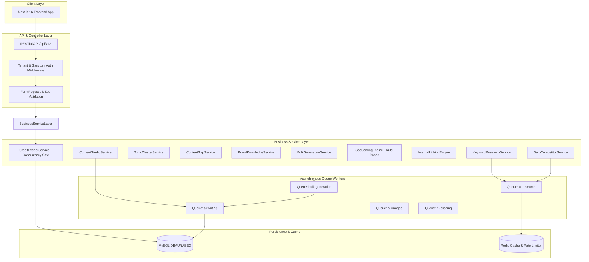
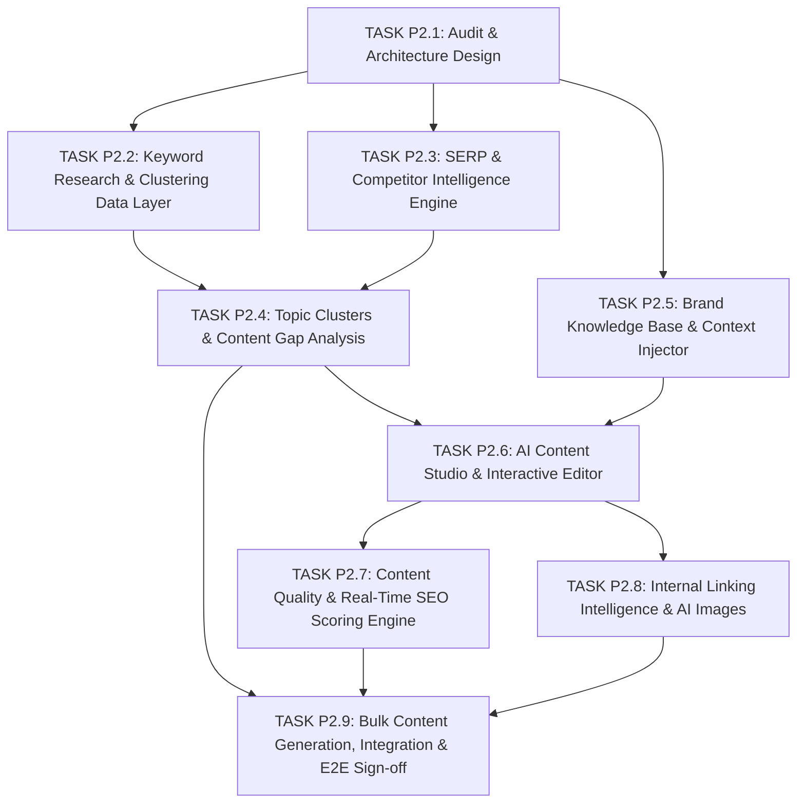

# PHASE_2_ARCHITECTURE_AUDIT.md — Báo Cáo Kiểm Toán & Thiết Kế Kiến Trúc Phase 2
## ADVANCED SEO AI & CONTENT INTELLIGENCE

> **Dự án:** SaaS Viết Bài SEO Tự Động (Multi-Tenant Auto-SEO Content SaaS)  
> **Phiên bản:** Phase 2 Architecture Blueprint  
> **Tech Stack chuẩn:**  
> - **Backend:** Laravel 13 (PHP 8.3), MySQL 8 (Database `DBAURASEO`), Redis, Horizon / Queue Workers  
> - **Frontend:** Next.js 16 (React 19, TypeScript strict, Tailwind CSS v4, shadcn/ui, TanStack Query v5)  
> - **Khung điều phối:** QLPK Multi-Agent Safe Autonomous Framework (Anti-Fake-Done Gate)  
> - **Quy tắc thực hiện:** **100% READ-ONLY AUDIT** — Tuyệt đối không sửa code cũ, không sửa migration, không thay đổi database, không tạo migration mới trong task này.

---

## MỤC LỤC 15 NỘI DUNG BẮT BUỘC

1. [Current Architecture (Kiến trúc hệ thống hiện tại sau Phase 1)](#1-current-architecture)
2. [Existing Features Reusable (Các tính năng hiện có có thể tái sử dụng)](#2-existing-features-reusable)
3. [Missing Features (Các tính năng còn thiếu cho Phase 2)](#3-missing-features)
4. [Proposed Database Changes (Đề xuất thay đổi CSDL cho Phase 2)](#4-proposed-database-changes)
5. [Proposed Backend Architecture (Kiến trúc Backend chi tiết)](#5-proposed-backend-architecture)
6. [Proposed Frontend Architecture (Kiến trúc Frontend chi tiết)](#6-proposed-frontend-architecture)
7. [AI Provider & API Strategy (Chiến lược AI & API bên ngoài)](#7-ai-provider--api-strategy)
8. [Credit & Cost Strategy (Chiến lược Credit, Phí & Chống thâm hụt)](#8-credit--cost-strategy)
9. [Security & Multi-Tenant Risks (Bảo mật & Rủi ro cách ly dữ liệu)](#9-security--multi-tenant-risks)
10. [Performance & Scalability (Hiệu năng, Tải cao & Mở rộng)](#10-performance--scalability)
11. [Task Dependency Map (Sơ đồ phụ thuộc các task Phase 2)](#11-task-dependency-map)
12. [Proposed P2.1–P2.9 Implementation Plan (Lộ trình triển khai chi tiết)](#12-proposed-p21p29-implementation-plan)
13. [Allowed Files dự kiến cho từng task (Ranh giới file cho Coder)](#13-allowed-files-dự-kiến-cho-từng-task)
14. [Acceptance Criteria cho từng task (Tiêu chuẩn nghiệm thu Anti-Fake-Done)](#14-acceptance-criteria-cho-từng-task)
15. [Estimated Technical Complexity (Ước lượng độ phức tạp kỹ thuật)](#15-estimated-technical-complexity)

---

## 1. Current Architecture

### 1.1. Hiện trạng Backend (Laravel 13 & PHP 8.3)

Sau khi hoàn thành 8 task Phase 1, hệ thống backend đã đạt độ ổn định cao với 111 automated tests (872 assertions) đạt 100% PASS:

```text
backend/
├── app/
│   ├── Actions/Publishing/PushToWordPressAction.php
│   ├── Agents/                 # 9 AI Agents kế thừa BaseAgent (SerpResearch, CompetitorAnalysis,
│   │                           # Outline, Writing, SEOOptimization, InternalLinking, QAValidation...)
│   ├── DTOs/                   # Spatie / Strict PHP DTOs (AIRequest, AIResponse, AgentResult,
│   │                           # CreditBalance, SerpResult, KeywordImport, PaymentOrder...)
│   ├── Enums/                  # UserRole, PlanCode, SubscriptionStatus, CreditTransactionType,
│   │                           # TaskStatus, ArticleStatus, KeywordStatus, PaymentOrderStatus...
│   ├── Http/Controllers/Api/V1/# RESTful API Controllers:
│   │   ├── Auth/ (Login, Logout, Register, Me)
│   │   ├── WorkspaceController.php, WebsiteController.php
│   │   ├── CampaignController.php, KeywordController.php, ArticleController.php
│   │   ├── WordPressSiteController.php, TaskController.php, QueueStatusController.php
│   │   ├── Billing/ (SubscriptionController, PaymentOrderController)
│   │   ├── AnalyticsController.php
│   │   └── Admin/ (AdminPaymentOrderController, AdminWorkspaceController, AdminPlanController)
│   ├── Jobs/                   # Asynchronous Queue Jobs:
│   │   ├── AI/ (GenerateOutlineJob, GenerateArticleContentJob, OptimizeSeoMetadataJob)
│   │   ├── SEO/ (SerpResearchJob, CrawlCompetitorJob)
│   │   ├── Media/ (DownloadStockImageJob, GenerateAiImageJob, UploadMediaToWordPressJob)
│   │   ├── Publishing/ (PublishToWordPressJob, ProcessScheduledArticlesJob)
│   │   └── Billing/ (ProcessMonthlyCreditRenewalJob, ExpireStaleGrantsJob)
│   ├── Models/                 # 26 Eloquent Models có trait BelongsToWorkspace / BelongsToTenant
│   ├── Providers/              # AI providers: OpenAI, Anthropic, Gemini, Horizon, RepositoryServiceProvider
│   ├── Services/
│   │   ├── AI/ (AIProviderService, PromptBuilderService, TokenUsageService, JsonResponseParser)
│   │   ├── Article/ (ArticlePipelineService, ArticleContentFormatter, DuplicateDetectionService)
│   │   ├── Billing/ (CreditLedgerService, SubscriptionService, PaymentOrderService)
│   │   ├── SEO/ (SerpResearchService, SerpCacheService, CompetitorCrawlService, InternalLinkingService)
│   │   ├── Queue/ (TaskService, JobDispatcherService)
│   │   └── WordPress/ (WordPressPublishService, WordPressPreflightCheckService, WordPressMediaService)
│   └── Traits/                 # BelongsToTenant, BelongsToWorkspace, HasVersions
```

### 1.2. Hiện trạng Frontend (Next.js 16, React 19, Tailwind CSS v4)

Giao diện người dùng đã hoàn thành toàn bộ 27 routes tĩnh và động, build sạch 100%:

```text
frontend/
├── app/
│   ├── (auth)/login, register, forgot-password
│   ├── (dashboard)/
│   │   ├── dashboard/           # KPI metrics, quick actions, credit widget
│   │   ├── campaigns/           # List, create, detail, media gallery, internal-links
│   │   ├── keywords/            # List, import, stats, detail
│   │   ├── import/wizard/       # 7-step guided Excel/CSV import flow
│   │   ├── articles/            # Filterable data table, review, detail preview
│   │   ├── wordpress/           # WP sites list, connection modal, preflight check
│   │   ├── queue/               # Real-time background task monitoring
│   │   ├── analytics/           # AI cost, token usage, keyword/article charts
│   │   └── settings/subscription# Plan picker, VietQR payment dialog, order history
│   ├── (admin)/                 # Super Admin portal: Order approval, Workspace management
│   └── review/[token]/          # Public review portal for clients
├── components/
│   ├── ui/                      # 30+ atomic shadcn/ui components (button, dialog, table, badge, tabs...)
│   ├── layouts/                 # Header with Workspace switcher, Sidebar, AdminLayout
│   └── features/                # Domain-specific components (ArticlePreview, CreditBadge, PaymentModal...)
├── hooks/                       # TanStack Query custom hooks (useArticles, useKeywords, useBilling...)
└── stores/                      # Zustand state stores (authStore, workspaceStore)
```

### 1.3. Hiện trạng Cơ sở dữ liệu (Database DBAURASEO)

Cơ sở dữ liệu đang có 26 bảng vận hành chuẩn:
1. `users`, `tenants`, `workspaces`, `workspace_members`, `websites`
2. `plans`, `subscriptions`, `credit_accounts`, `credit_grants`, `credit_transactions`, `payment_orders`, `payment_transactions`
3. `tasks`, `usage_records`, `audit_logs`, `ai_usage_logs`, `ai_logs`
4. `wordpress_sites`, `campaigns`, `campaign_imports`, `keywords`, `articles`, `article_versions`, `media_assets`, `quality_reports`, `schedules`

---

## 2. Existing Features Reusable

Hệ thống Phase 1 đã được xây dựng theo kiến trúc module hóa rất cao. Phase 2 có thể **tái sử dụng trực tiếp** các nền tảng sau mà không cần viết lại từ đầu:

| Phân hệ / Service | Khả năng tái sử dụng cho Phase 2 | Phương thức kế thừa |
| :--- | :--- | :--- |
| **`CreditLedgerService`** | **Tái sử dụng 100%**: Cơ chế giữ trước (`reserveCredits`), trừ thật (`commitReservation`), hoàn credit (`releaseReservation`) và nạp credit chu kỳ theo tháng đã có sẵn transaction và khóa bi quan (`lockForUpdate`). | Mọi tính năng AI mới (Keyword Research, Competitor Crawl, Image Generation, Content Studio AI) đều chỉ cần định nghĩa mã credit cost trong `config/ai_costs.php` và gọi qua `CreditLedgerService`. |
| **`AIProviderService`** | **Tái sử dụng 100%**: Đã hỗ trợ đa nhà cung cấp (OpenAI, Anthropic, Gemini) với cơ chế tự động chuyển vùng failover, chống lỗi 429 qua Redis rate-limiter và tính phí USD theo token thực tế. | Sử dụng trực tiếp để cung cấp LLM engine cho Content Studio, Keyword Extractor, SEO Scoring và Prompt Builder. |
| **`SerpResearchService` & `SerpCacheService`** | **Tái sử dụng 90%**: Đã có module gọi SerpAPI/Serper và cơ chế cache kết quả tìm kiếm 24h trong bảng `serp_cache`. | Mở rộng thêm parser bóc tách `People Also Ask`, `Related Searches` và xếp hạng đối thủ top 10 cho module Keyword Research & SERP Analysis. |
| **`CompetitorCrawlService`** | **Tái sử dụng 85%**: Đã có logic tải HTML đối thủ, bóc tách cấu trúc thẻ Heading (H1, H2, H3), số từ và semantic entities với cơ chế timeout 15s. | Bổ sung thêm bóc tách Schema Markup (`FAQPage`, `Article`), tỷ lệ mật độ từ khóa và phát hiện Content Gap. |
| **`ArticlePipelineService`** | **Tái sử dụng 90%**: State machine quản lý các bước viết bài (`queued -> outline -> writing -> seo_metadata -> quality_check -> media_download -> media_upload -> publishing -> done`). | Mở rộng thêm 2 step mới: `internal_linking` và `scoring_audit` để hoàn thiện pipeline tự động. |
| **`TaskService` & Bảng `tasks`** | **Tái sử dụng 100%**: Quản lý UUID tiến trình, phần trăm hoàn thành (0–100%), credits giữ chân, số lần thử và thông báo lỗi. | Áp dụng trực tiếp cho Bulk Content Generation và Long-running AI Studio Tasks. |
| **`PublishToWordPressJob`** | **Tái sử dụng 100%**: Đã xử lý xác thực WordPress App Password (mã hóa), tải bài viết, thiết lập danh mục, thẻ, Featured Image và RankMath/Yoast SEO meta. | Tái sử dụng trọn vẹn cho việc xuất bản bài viết từ Content Studio hoặc Bulk Generator. |
| **UI Components (Next.js)** | **Tái sử dụng 95%**: Toàn bộ thư viện shadcn/ui (`DataTable`, `Badge`, `Dialog`, `Sheet`, `Tabs`, `Alert`, `Tooltip`, `Card`) và các layout `Header`, `Sidebar`. | Tái sử dụng để xây dựng giao diện Content Studio, Topic Cluster Map và Content Gap Explorer. |

---

## 3. Missing Features (Khoảng trống cần xây dựng trong Phase 2)

Dù nền tảng Phase 1 rất vững chắc, để đạt chuẩn **Advanced SEO AI & Content Intelligence**, hệ thống đang còn thiếu các tính năng chuyên sâu sau:

### 3.1. Keyword Research & Clustering
- Hiện tại: `KeywordController` chỉ hỗ trợ thêm thủ công từng từ khóa hoặc import Excel/CSV theo chiến dịch.
- Còn thiếu:
  - Công cụ tìm kiếm ý tưởng từ khóa (Keyword Discovery) sinh ra hàng trăm từ khóa liên quan từ một "seed keyword".
  - Phân loại Search Intent tự động bằng AI (Informational, Navigational, Commercial, Transactional).
  - Nhóm từ khóa theo thuật toán Semantic Clustering (nhóm các từ có cùng search intent vào 1 bài viết).

### 3.2. SERP & Competitor Intelligence
- Hiện tại: `SerpResearchService` chỉ lấy top 10 link cơ bản, `CompetitorCrawlService` crawl đơn giản.
- Còn thiếu:
  - Bảng ma trận so sánh đối thủ (Competitor Benchmark Matrix): So sánh số từ, số heading, số lượng ảnh, định dạng schema và tốc độ phản hồi của top 10 trang đang lên top Google.
  - Phân tích từ khóa ngữ nghĩa LSI (Latent Semantic Indexing) mà đối thủ đang dùng nhưng website mình chưa có.

### 3.3. Topic Clusters & Content Gap Analysis
- Hiện tại: Bảng `keywords` có cột `pillar_topic` và `content_cluster` dạng chuỗi rời rạc, chưa có bảng liên kết thực thể (Relational Entities).
- Còn thiếu:
  - Quản lý mô hình Cụm chủ đề (Pillar Page và Cluster Supporting Articles).
  - Bản đồ cấu trúc Topic Cluster trực quan trên giao diện Frontend.
  - Phân tích khoảng trống nội dung (Content Gap Analysis): So sánh website của khách hàng với 3 đối thủ trực tiếp để phát hiện các chủ đề đối thủ đã lên top nhưng website mình bị thiếu.

### 3.4. Brand Knowledge Base
- Hiện tại: Cấu hình `brand_voice` nằm rải rác trong `campaigns.settings` dưới dạng text tự do.
- Còn thiếu:
  - Kho tri thức thương hiệu chuyên biệt (Brand Knowledge Base) theo từng `website_id`:
    - Tuyên ngôn giá trị thương hiệu (USP - Unique Selling Proposition).
    - Khách hàng mục tiêu (Target Personas) & Phong cách hành văn (Tone of Voice: Chuyên gia, Thân thiện, Thuyết phục, v.v.).
    - Danh mục sản phẩm/dịch vụ cốt lõi để AI tự động chèn ngữ cảnh bán hàng.
    - Danh sách từ ngữ cấm kỵ (Taboo Words) và từ ngữ ưu tiên (Preferred Terms).
    - Bộ quy tắc viết bài riêng biệt (Custom Writing Instructions).

### 3.5. AI Content Studio
- Hiện tại: Trang `/articles/[id]` chỉ là bản xem trước tĩnh (`ArticlePreview.tsx`) bọc HTML sanitize, người dùng không thể biên tập nội dung trực tiếp.
- Còn thiếu:
  - Bộ soạn thảo văn bản giàu tính năng (Rich-Text Editor) tích hợp sẵn hỗ trợ Markdown và HTML.
  - Trợ lý AI đồng hành (In-line AI Copilot): Bôi đen đoạn văn để yêu cầu AI: "Viết lại hấp dẫn hơn", "Mở rộng ý", "Rút gọn", "Chuyển giọng văn chuyên gia", "Thêm ví dụ thực tế".
  - Chức năng tự động lưu nháp (Autosave & Version History) chống mất dữ liệu khi đang viết.

### 3.6. Content Quality & SEO Scoring Engine
- Hiện tại: Điểm `seo_score` chỉ được tính một lần bởi `QAValidationAgent` qua một prompt đơn giản của OpenAI.
- Còn thiếu:
  - Bộ công cụ chấm điểm SEO thời gian thực (Real-time 100-Point SEO Engine) theo luật xác định (Deterministic Rule Engine) chạy song song với AI:
    - Tiêu đề H1: Độ dài 40–60 ký tự, chứa từ khóa chính ở đầu câu.
    - Meta Description: 120–160 ký tự, có lời kêu gọi hành động (CTA).
    - Cấu trúc Heading: Tỷ lệ phân bổ H2, H3 hợp lý, chứa biến thể từ khóa.
    - Mật độ từ khóa chính (Keyword Density): Duy trì 1.0% – 2.0%, cảnh báo Keyword Stuffing.
    - Độ dễ đọc (Readability Score): Đo lường theo công thức Flesch-Kincaid / tiếng Việt.
    - Checklist tối ưu 1-Click Auto-Fix trực tiếp trên trình soạn thảo.

### 3.7. Internal Linking Intelligence
- Hiện tại: `InternalLinkingService` chỉ tìm kiếm bài viết cũ qua WordPress REST API đơn giản.
- Còn thiếu:
  - Đồ thị liên kết nội bộ (Internal Link Knowledge Graph) theo dõi bài viết nào đang trỏ link tới bài viết nào trong cùng Website.
  - Gợi ý cơ hội đặt liên kết (Link Opportunity Detection): Phát hiện từ khóa trong bài mới trùng với từ khóa mục tiêu của bài cũ và tự động đề xuất câu chứa anchor text tự nhiên.
  - Cảnh báo bài viết mồ côi (Orphan Articles) không có bất kỳ liên kết nội bộ nào trỏ về.

### 3.8. AI Image Generation & Management
- Hiện tại: Đã có `StockImageSearchService` và `GeminiImageGenerationService` cơ bản.
- Còn thiếu:
  - Trình tạo ảnh AI theo ngữ cảnh bài viết (Context-Aware Prompt Generator): Tự động đọc nội dung H2 để sinh câu prompt vẽ hình minh họa chân thực.
  - Hỗ trợ đa mô hình sinh ảnh: Google Imagen 3 / Imagen 4 và DALL-E 3.
  - Tự động nén WebP và chèn thuộc tính SEO `alt` chứa từ khóa trước khi tải lên WordPress.

### 3.9. Bulk Content Generation Pipeline
- Hiện tại: Pipeline xử lý từng bài viết một hoặc chạy ngầm từng keyword riêng lẻ.
- Còn thiếu:
  - Điều phối hàng loạt (Bulk Batch Orchestrator): Tạo 10, 50, 100 bài viết cùng lúc từ danh sách từ khóa chỉ với 1 cú click.
  - Cơ chế bóp nghẹt tốc độ (Rate-limit Throttling) thông minh, giữ chân credit theo lô lớn và tự động hoàn trả khi có bài viết lỗi.
  - Bảng theo dõi tiến độ tổng thể của toàn bộ lô bài viết trên thời gian thực.

---

## 4. Proposed Database Changes (Chi tiết CSDL Phase 2)

> **Lưu ý tuân thủ:** Không chạy migration hoặc sửa CSDL trong Task P2.1. Dưới đây là thiết kế kiến trúc kỹ thuật chuẩn để áp dụng cho các task P2.2 – P2.9.

### 4.1. Bảng mở rộng (Schema Alterations)

| Bảng hiện tại | Cột cần bổ sung | Kiểu dữ liệu | Mục đích nghiệp vụ |
| :--- | :--- | :--- | :--- |
| `keywords` | `topic_cluster_id` | `unsignedBigInteger nullable` | Gắn từ khóa vào một Topic Cluster cụ thể (`FK -> topic_clusters.id`). |
| `keywords` | `search_intent` | `enum('informational','navigational','commercial','transactional')` | Lưu trữ ý định tìm kiếm chuẩn hóa thay vì text tự do. |
| `keywords` | `lsi_keywords` | `json nullable` | Lưu danh sách từ khóa ngữ nghĩa LSI tìm thấy từ phân tích SERP. |
| `articles` | `brand_knowledge_id` | `unsignedBigInteger nullable` | Gắn bài viết với phiên bản tri thức thương hiệu được áp dụng. |
| `articles` | `seo_analysis_detail` | `json nullable` | Lưu kết quả chi tiết từng tiêu chí chấm điểm SEO (H1, Meta, Density, Readability). |
| `websites` | `brand_voice_summary` | `text nullable` | Tóm tắt nhanh phong cách thương hiệu cho website. |

### 4.2. Các bảng tạo mới (New Entities)

#### 1. Bảng `topic_clusters` (Quản lý Cụm chủ đề SEO)
```sql
CREATE TABLE `topic_clusters` (
  `id` bigint unsigned NOT NULL AUTO_INCREMENT,
  `workspace_id` bigint unsigned NOT NULL,
  `website_id` bigint unsigned NOT NULL,
  `pillar_keyword_id` bigint unsigned DEFAULT NULL,
  `pillar_article_id` bigint unsigned DEFAULT NULL,
  `name` varchar(255) NOT NULL,
  `slug` varchar(255) NOT NULL,
  `description` text DEFAULT NULL,
  `target_audience` varchar(255) DEFAULT NULL,
  `total_search_volume` int unsigned DEFAULT 0,
  `avg_difficulty` decimal(5,2) DEFAULT 0.00,
  `status` varchar(50) NOT NULL DEFAULT 'planning', -- planning, in_progress, completed
  `created_at` timestamp NULL DEFAULT NULL,
  `updated_at` timestamp NULL DEFAULT NULL,
  PRIMARY KEY (`id`),
  UNIQUE KEY `unique_cluster_slug` (`workspace_id`, `website_id`, `slug`),
  KEY `idx_clusters_tenant` (`workspace_id`, `website_id`),
  CONSTRAINT `fk_clusters_workspace` FOREIGN KEY (`workspace_id`) REFERENCES `workspaces` (`id`) ON DELETE CASCADE,
  CONSTRAINT `fk_clusters_website` FOREIGN KEY (`website_id`) REFERENCES `websites` (`id`) ON DELETE CASCADE,
  CONSTRAINT `fk_clusters_pillar_kw` FOREIGN KEY (`pillar_keyword_id`) REFERENCES `keywords` (`id`) ON DELETE SET NULL,
  CONSTRAINT `fk_clusters_pillar_art` FOREIGN KEY (`pillar_article_id`) REFERENCES `articles` (`id`) ON DELETE SET NULL
) ENGINE=InnoDB DEFAULT CHARSET=utf8mb4 COLLATE=utf8mb4_unicode_ci;
```

#### 2. Bảng `content_gaps` (Phân tích khoảng trống nội dung đối thủ)
```sql
CREATE TABLE `content_gaps` (
  `id` bigint unsigned NOT NULL AUTO_INCREMENT,
  `workspace_id` bigint unsigned NOT NULL,
  `website_id` bigint unsigned NOT NULL,
  `competitor_domain` varchar(255) NOT NULL,
  `target_keyword` varchar(255) NOT NULL,
  `search_volume` int unsigned DEFAULT 0,
  `keyword_difficulty` smallint unsigned DEFAULT 0,
  `competitor_rank` smallint unsigned DEFAULT 0,
  `our_rank` smallint unsigned DEFAULT NULL,
  `opportunity_score` decimal(5,2) DEFAULT 0.00, -- Tính dựa trên volume và độ khó
  `status` varchar(50) NOT NULL DEFAULT 'identified', -- identified, targeted, written, ignored
  `campaign_id` bigint unsigned DEFAULT NULL,
  `created_at` timestamp NULL DEFAULT NULL,
  `updated_at` timestamp NULL DEFAULT NULL,
  PRIMARY KEY (`id`),
  KEY `idx_content_gaps_tenant` (`workspace_id`, `website_id`),
  KEY `idx_content_gaps_keyword` (`target_keyword`),
  CONSTRAINT `fk_content_gaps_workspace` FOREIGN KEY (`workspace_id`) REFERENCES `workspaces` (`id`) ON DELETE CASCADE,
  CONSTRAINT `fk_content_gaps_website` FOREIGN KEY (`website_id`) REFERENCES `websites` (`id`) ON DELETE CASCADE
) ENGINE=InnoDB DEFAULT CHARSET=utf8mb4 COLLATE=utf8mb4_unicode_ci;
```

#### 3. Bảng `brand_knowledge_bases` (Kho tri thức & quy chuẩn thương hiệu)
```sql
CREATE TABLE `brand_knowledge_bases` (
  `id` bigint unsigned NOT NULL AUTO_INCREMENT,
  `workspace_id` bigint unsigned NOT NULL,
  `website_id` bigint unsigned NOT NULL,
  `brand_name` varchar(255) NOT NULL,
  `tagline` varchar(255) DEFAULT NULL,
  `tone_of_voice` varchar(100) NOT NULL DEFAULT 'professional',
  `target_personas` json DEFAULT NULL,       -- Danh sách khách hàng mục tiêu & nhu cầu
  `unique_selling_points` json DEFAULT NULL, -- USP và lợi thế cạnh tranh
  `product_catalog` json DEFAULT NULL,       -- Tên sản phẩm, tính năng, đường link sản phẩm
  `taboo_words` json DEFAULT NULL,           -- Từ ngữ cấm kỵ không được xuất hiện
  `preferred_terms` json DEFAULT NULL,       -- Từ ngữ ưu tiên và thuật ngữ chuyên ngành
  `custom_rules` text DEFAULT NULL,          -- Quy tắc viết văn riêng của doanh nghiệp
  `is_default` tinyint(1) NOT NULL DEFAULT 1,
  `created_at` timestamp NULL DEFAULT NULL,
  `updated_at` timestamp NULL DEFAULT NULL,
  PRIMARY KEY (`id`),
  KEY `idx_brand_kb_tenant` (`workspace_id`, `website_id`),
  CONSTRAINT `fk_brand_kb_workspace` FOREIGN KEY (`workspace_id`) REFERENCES `workspaces` (`id`) ON DELETE CASCADE,
  CONSTRAINT `fk_brand_kb_website` FOREIGN KEY (`website_id`) REFERENCES `websites` (`id`) ON DELETE CASCADE
) ENGINE=InnoDB DEFAULT CHARSET=utf8mb4 COLLATE=utf8mb4_unicode_ci;
```

#### 4. Bảng `internal_link_suggestions` (Cơ hội & đề xuất liên kết nội bộ)
```sql
CREATE TABLE `internal_link_suggestions` (
  `id` bigint unsigned NOT NULL AUTO_INCREMENT,
  `workspace_id` bigint unsigned NOT NULL,
  `website_id` bigint unsigned NOT NULL,
  `source_article_id` bigint unsigned NOT NULL,
  `target_article_id` bigint unsigned NOT NULL,
  `suggested_anchor_text` varchar(255) NOT NULL,
  `context_sentence` text DEFAULT NULL,
  `relevance_score` decimal(5,2) DEFAULT 0.00,
  `status` varchar(50) NOT NULL DEFAULT 'pending', -- pending, accepted, rejected, applied
  `created_at` timestamp NULL DEFAULT NULL,
  `updated_at` timestamp NULL DEFAULT NULL,
  PRIMARY KEY (`id`),
  KEY `idx_link_sugg_source` (`source_article_id`),
  KEY `idx_link_sugg_target` (`target_article_id`),
  KEY `idx_link_sugg_tenant` (`workspace_id`, `website_id`),
  CONSTRAINT `fk_link_sugg_source` FOREIGN KEY (`source_article_id`) REFERENCES `articles` (`id`) ON DELETE CASCADE,
  CONSTRAINT `fk_link_sugg_target` FOREIGN KEY (`target_article_id`) REFERENCES `articles` (`id`) ON DELETE CASCADE
) ENGINE=InnoDB DEFAULT CHARSET=utf8mb4 COLLATE=utf8mb4_unicode_ci;
```

#### 5. Bảng `bulk_batches` (Quản lý các đợt sản xuất bài viết hàng loạt)
```sql
CREATE TABLE `bulk_batches` (
  `id` bigint unsigned NOT NULL AUTO_INCREMENT,
  `uuid` char(36) NOT NULL,
  `workspace_id` bigint unsigned NOT NULL,
  `website_id` bigint unsigned NOT NULL,
  `campaign_id` bigint unsigned DEFAULT NULL,
  `name` varchar(255) NOT NULL,
  `total_items` int unsigned NOT NULL DEFAULT 0,
  `completed_items` int unsigned NOT NULL DEFAULT 0,
  `failed_items` int unsigned NOT NULL DEFAULT 0,
  `credits_reserved` int unsigned NOT NULL DEFAULT 0,
  `credits_settled` int unsigned NOT NULL DEFAULT 0,
  `status` varchar(50) NOT NULL DEFAULT 'pending', -- pending, processing, completed, partially_failed, cancelled
  `generation_settings` json DEFAULT NULL,        -- Tone, word count, include images, auto publish
  `started_at` timestamp NULL DEFAULT NULL,
  `finished_at` timestamp NULL DEFAULT NULL,
  `created_at` timestamp NULL DEFAULT NULL,
  `updated_at` timestamp NULL DEFAULT NULL,
  PRIMARY KEY (`id`),
  UNIQUE KEY `unique_bulk_batch_uuid` (`uuid`),
  KEY `idx_bulk_batches_tenant` (`workspace_id`, `website_id`),
  CONSTRAINT `fk_bulk_batches_workspace` FOREIGN KEY (`workspace_id`) REFERENCES `workspaces` (`id`) ON DELETE CASCADE
) ENGINE=InnoDB DEFAULT CHARSET=utf8mb4 COLLATE=utf8mb4_unicode_ci;
```

---

## 5. Proposed Backend Architecture

Kiến trúc Backend Phase 2 tuân thủ nghiêm ngặt **Service Pattern**, **Repository Pattern**, **Thin Controllers** và **Queue-First Execution** theo đúng chuẩn `AGENTS.md`:



### 5.1. Danh sách Service chuyên biệt mới

1. **`App\Services\SEO\KeywordResearchService`**:
   - Gọi Google Suggest API & SERP API để mở rộng từ khóa hạt giống (Seed Keyword).
   - Tích hợp AI phân loại Search Intent và nhóm từ khóa ngữ nghĩa (Clustering).
2. **`App\Services\SEO\CompetitorAnalysisService`**:
   - Quét cấu trúc Heading (H1–H4), mật độ từ khóa và Schema của Top 10 đối thủ.
   - Trích xuất bảng so sánh Benchmark đối thủ.
3. **`App\Services\SEO\TopicClusterService`**:
   - Quản lý cấu trúc phân cấp: Pillar Topic -> Cluster Topics -> Sub-articles.
   - Tính toán tổng search volume và độ khó trung bình của từng cụm chủ đề.
4. **`App\Services\SEO\ContentGapService`**:
   - Đối chiếu danh sách từ khóa xếp hạng của đối thủ với kho bài viết của website khách hàng.
   - Tính điểm cơ hội (`opportunity_score = search_volume * (100 - difficulty) / 100`).
5. **`App\Services\Brand\BrandKnowledgeService`**:
   - Quản lý kho kiến thức thương hiệu, USP, danh mục sản phẩm và từ ngữ cấm kỵ.
   - Cung cấp hàm `injectBrandContext(PromptContext $context)` tự động nhúng ngữ cảnh doanh nghiệp vào mọi lời gọi AI viết bài.
6. **`App\Services\Article\ContentStudioService`**:
   - Điều phối phiên soạn thảo bài viết tương tác.
   - Xử lý các tác vụ AI theo ngữ cảnh (Rewrite, Expand, Shorten, Change Tone).
7. **`App\Services\SEO\SeoScoringEngine`**:
   - **Engine tính điểm độc lập bằng mã nguồn thuần (Deterministic PHP)**, không tốn credit AI.
   - Chấm điểm 9 hạng mục SEO cốt lõi (Title, Meta, Heading structure, Keyword Density, Image Alts, Readability, Links, FAQs, Schema).
8. **`App\Services\SEO\InternalLinkingEngine`**:
   - Xây dựng đồ thị liên kết nội bộ theo từng website.
   - Đề xuất câu chèn link và anchor text tự nhiên giữa bài viết nguồn và đích.
9. **`App\Services\Bulk\BulkGenerationService`**:
   - Nhận danh sách từ khóa (10–100 từ), tạo `bulk_batch`, giữ trước credit theo lô qua `CreditLedgerService::reserveCredits()`.
   - Dispatch các tác vụ con vào hàng đợi `bulk-generation` với cơ chế bóp nghẹt tốc độ tránh nghẽn API.

---

## 6. Proposed Frontend Architecture

Frontend được xây dựng bằng **Next.js 16 App Router**, sử dụng toàn bộ thư viện chuẩn của dự án: `@tanstack/react-query`, `react-hook-form`, `zod`, `shadcn/ui`, `lucide-react`, và `@lexical/react`.

### 6.1. Sơ đồ phân bố Route mới trên Frontend

```text
frontend/app/(dashboard)/
├── keywords/
│   ├── page.tsx                 # Danh sách từ khóa hiện tại (Phase 1)
│   ├── research/page.tsx        # [MỚI - P2.2] Công cụ nghiên cứu & khám phá từ khóa
│   └── clusters/page.tsx        # [MỚI - P2.4] Quản lý & hiển thị bản đồ Topic Clusters
├── competitor/
│   ├── serp/page.tsx            # [MỚI - P2.3] Phân tích SERP & Đối thủ trực tiếp
│   └── content-gap/page.tsx     # [MỚI - P2.4] Khám phá khoảng trống nội dung đối thủ
├── brand-knowledge/
│   └── page.tsx                 # [MỚI - P2.5] Quản lý Brand Persona, Voice, USP, Taboo Words
├── content-studio/
│   ├── page.tsx                 # [MỚI - P2.6] Danh sách các phiên soạn thảo Studio
│   └── [id]/page.tsx            # [MỚI - P2.6] Giao diện Studio Editor tương tác thời gian thực
├── internal-links/
│   └── page.tsx                 # [MỚI - P2.8] Bản đồ liên kết nội bộ & Đề xuất Anchor Text
└── bulk-generator/
    └── page.tsx                 # [MỚI - P2.9] Trình tạo bài viết hàng loạt theo lô
```

### 6.2. Thiết kế chi tiết giao diện AI Content Studio (`/content-studio/[id]`)

Giao diện Studio được thiết kế chia làm 3 cột chuyên nghiệp:
1. **Cột trái (Outline & Heading Tree - 260px):**
   - Danh sách cây thư mục Heading (H1, H2, H3).
   - Cho phép kéo thả (drag & drop) sắp xếp lại các phần trong bài.
   - Nút "Thêm mục mới bằng AI".
2. **Cột giữa (Rich-Text Editor - Không gian chính):**
   - Trình soạn thảo văn bản hỗ trợ định dạng trực quan.
   - Thanh công cụ nổi (Floating AI Menu) khi bôi đen chữ:
     - ⚡ Viết lại đoạn này
     - 📈 Mở rộng nội dung
     - ✂️ Rút gọn súc tích
     - 🎯 Đổi giọng văn (Hài hước, Trang trọng, Thuyết phục)
   - Trạng thái tự động lưu nháp (Autosaved 2s ago).
3. **Cột phải (SEO Intelligence & Real-time Scoring Panel - 340px):**
   - Vòng tròn hiển thị điểm SEO thời gian thực (0 – 100).
   - Phân tích chi tiết:
     - 🟢 Tiêu đề & Meta Description
     - 🟡 Cấu trúc Heading & Mật độ từ khóa (1.4% - Tốt)
     - 🔴 Thiếu ảnh minh họa có thẻ ALT
     - 🟢 Điểm dễ đọc Flesch Reading: 68/100
   - Khối đề xuất Internal Links có thể chèn bằng 1 cú click.

---

## 7. AI Provider & API Strategy

Hệ thống Phase 2 sử dụng chiến lược kết hợp đa mô hình thông minh nhằm tối ưu giữa **chất lượng văn phong vượt trội** và **chi phí API tối thiểu**:

| Tác vụ AI (AI Task) | Model Chính (Primary) | Model Dự Phòng (Fallback) | Nhiệt độ (Temperature) | Lý do lựa chọn |
| :--- | :--- | :--- | :---: | :--- |
| **Nghiên cứu từ khóa & Gom cụm (Clustering)** | `gemini-2.5-flash` | `gpt-4o-mini` | `0.2` | Tốc độ xử lý cực nhanh, ngữ cảnh rộng, chi phí chỉ $0.30 / 1M token. |
| **Phân tích SERP & Trích xuất Semantic LSI** | `gemini-1.5-pro` | `claude-3-5-sonnet` | `0.3` | Khả năng đọc hiểu tài liệu lớn (long context) của đối thủ cực kỳ chính xác. |
| **Lập dàn ý chuyên sâu (Outline Generator)** | `gemini-2.5-flash` | `gpt-4o` | `0.4` | Cấu trúc dàn ý chuẩn logic, bám sát intent tìm kiếm. |
| **Viết bài chất lượng cao (Content Studio & Writer)** | `claude-3-5-sonnet` | `gpt-4o` | `0.7` | Văn phong tự nhiên, mạch lạc, vượt qua các công cụ quét AI detector tốt nhất hiện nay. |
| **Biên tập đoạn văn tức thời (Copilot Rewrite/Expand)**| `gemini-2.5-flash` | `gpt-4o-mini` | `0.5` | Phản hồi dưới 1.5 giây, trải nghiệm mượt mà trên trình soạn thảo trực tiếp. |
| **Sinh ảnh minh họa theo bài viết (AI Images)** | `imagen-3.0` | `dall-e-3` | - | Hình ảnh sắc nét, phù hợp minh họa blog công nghệ và dịch vụ. |

### 7.1. Cơ chế Cắt giảm Chi phí & Cache thông minh
- **SERP Cache 24h:** Mọi truy vấn từ khóa trùng lặp trong vòng 24 giờ sẽ đọc trực tiếp từ bảng `serp_cache`, không tốn chi phí gọi SerpAPI ($0.001/call).
- **SEO Scoring 0 Credit:** Module chấm điểm SEO hoạt động hoàn toàn bằng thuật toán Regex / Rule-based trong PHP, **không gọi LLM**, hoàn toàn miễn phí cho người dùng và nền tảng.
- **Brand Knowledge Injection:** Tri thức thương hiệu được nén dưới dạng Bullet Points cô đọng (tối đa 400 tokens) để không làm phình to context window.

---

## 8. Credit & Cost Strategy

### 8.1. Bảng giá Credit chi tiết cho từng tác vụ Phase 2

Hệ thống tích hợp bảng giá mới vào `config/ai_costs.php`:

```php
return [
    'serper_cost_per_call_usd' => 0.001,

    'credits' => [
        // Các tác vụ nền tảng (Phase 1)
        'standard_article'        => 20, // Viết bài chuẩn đầy đủ (Outline + Content + SEO)
        'serp_lookup'             => 1,  // Tra cứu SERP top 10
        'image_generation'        => 5,  // Tạo 1 ảnh AI minh họa
        'seo_autofix'             => 2,  // Tự động sửa lỗi SEO 1-click

        // Các tính năng nâng cao (Phase 2)
        'keyword_research_batch'  => 2,  // Khám phá và gom cụm 50 từ khóa
        'competitor_deep_audit'   => 3,  // Phân tích sâu Top 10 đối thủ & Schema
        'content_gap_analysis'    => 3,  // So sánh khoảng trống nội dung với 1 đối thủ
        'studio_ai_copilot_call'  => 1,  // 1 lần nhờ AI viết lại / mở rộng đoạn văn
        'internal_link_scan'      => 1,  // Quét và phân tích cơ hội liên kết nội bộ
        'bulk_article_unit'       => 18, // Đơn giá ưu đãi khi tạo bài hàng loạt (>10 bài)
    ],
];
```

### 8.2. Quy trình Trừ & Hoàn Credit An toàn (Zero Risk)

1. **Khóa bi quan chống Race Condition:** Khi người dùng bắt đầu tác vụ, hệ thống gọi `CreditLedgerService::reserveCredits()` sử dụng `lockForUpdate()` trên bảng `credit_accounts`.
2. **Giữ trước (Reservation):** Số credit dự kiến được chuyển từ `available_credits` sang `reserved_credits`.
3. **Quyết toán (Settlement):** Khi tác vụ AI chạy thành công, hệ thống trừ vĩnh viễn số credit đã giữ và ghi log vào sổ cái `credit_transactions` với `idempotency_key`.
4. **Tự động hoàn tiền khi lỗi (Auto-Refund):** Nếu tác vụ gặp lỗi ngoại lệ hoặc quá thời gian chờ, hệ thống gọi `CreditLedgerService::releaseReservation()`, hoàn trả ngay lập tức 100% số credit vào ví khách hàng và ghi nhật ký cảnh báo.

---

## 9. Security & Multi-Tenant Risks

| Rủi ro tiềm ẩn | Mức độ | Biện pháp kiểm soát kiến trúc bắt buộc |
| :--- | :---: | :--- |
| **IDOR (Truy cập chéo dữ liệu giữa các Workspace)** | **P0 (Cực kỳ nguy hiểm)** | Mọi Model mới (`TopicCluster`, `ContentGap`, `BrandKnowledgeBase`, `BulkBatch`) đều bắt buộc implement trait `BelongsToWorkspace`. Mọi câu lệnh truy vấn đều tự động gắn Global Scope `WHERE workspace_id = ?`. Cấm tuyệt đối truyền `workspace_id` từ Request body của người dùng. |
| **SSRF (Server-Side Request Forgery) khi Crawl Đối thủ** | **P0 (Nguy cơ hạ tầng)** | Khi crawler tải nội dung từ đường dẫn đối thủ, bắt buộc kiểm tra IP đích: Chặn hoàn toàn dải IP Private (`10.0.0.0/8`, `172.16.0.0/12`, `192.168.0.0/16`, `127.0.0.1`, `localhost`) và Metadata endpoint (`169.254.169.254`). |
| **XSS trong AI Content Studio** | **P1 (Bảo mật trình duyệt)** | Nội dung HTML sinh ra từ AI hoặc paste từ bên ngoài phải được lọc qua bộ khử trùng DOMPurify trước khi đưa vào trình soạn thảo Lexical và lưu vào cơ sở dữ liệu. |
| **Denial-of-Wallet (Tấn công cạn kiệt chi phí API)** | **P1 (Tài chính)** | Áp dụng Rate Limiting kép: Throttle theo IP, theo User ID và theo Workspace. Kiểm tra số dư credit sẵn có trước khi đẩy bất kỳ Job nào vào hàng đợi xử lý. |

---

## 10. Performance & Scalability

1. **Phân luồng Hàng đợi chuyên trách (Queue Isolation):**
   - Hàng đợi `ai-research`: Dành cho tác vụ cào dữ liệu và tra cứu từ khóa (độ trễ 5–15s).
   - Hàng đợi `ai-writing`: Dành cho sinh nội dung bài viết và dàn ý (độ trễ 15–45s).
   - Hàng đợi `bulk-generation`: Dành riêng cho lô hàng loạt, xử lý tuần tự có khoảng nghỉ 2s giữa các bài để không làm nghẽn Redis và bảo vệ hạn ngạch API.
2. **Đánh chỉ mục Database tối ưu (Optimal Indexing):**
   - Mọi bảng đều có Index kết hợp `(workspace_id, website_id)`.
   - Bảng `content_gaps` có Index trên `target_keyword`.
   - Bảng `internal_link_suggestions` có Foreign Keys có Index trên cả `source_article_id` và `target_article_id`.
3. **Bộ nhớ đệm Redis & Session State:**
   - Phiên soạn thảo trong Content Studio được lưu nháp (Autosave) tạm thời trên Redis trước khi ghi vào MySQL sau mỗi 30 giây nhằm giảm tải 90% số lượng truy vấn ghi xuống ổ đĩa.

---

## 11. Task Dependency Map (Sơ đồ phụ thuộc P2.1 – P2.9)



---

## 12. Proposed P2.1–P2.9 Implementation Plan

| Mã Task | Tên phân hệ | Trọng tâm công việc chính | Ưu tiên |
| :---: | :--- | :--- | :---: |
| **P2.1** | **Audit & Architecture Design** | Khảo sát nền tảng Phase 1, thiết kế kiến trúc toàn diện 15 mục, thẩm định qua Gemini 4 Argon. | **P0** |
| **P2.2** | **Keyword Research & Clustering** | Migration bảng liên quan từ khóa, Service gợi ý từ khóa, phân loại Search Intent, thuật toán gom cụm bằng AI, UI nghiên cứu từ khóa. | **P0** |
| **P2.3** | **SERP & Competitor Intelligence** | Nâng cấp SerpResearchService & CompetitorCrawlService, ma trận Benchmark đối thủ, trích xuất LSI keywords, UI SERP Matrix. | **P0** |
| **P2.4** | **Topic Clusters & Content Gap** | Bảng `topic_clusters`, `content_gaps`, thuật toán tìm bài viết thiếu so với đối thủ, giao diện Bản đồ Cụm chủ đề trực quan. | **P1** |
| **P2.5** | **Brand Knowledge Base** | Bảng `brand_knowledge_bases`, Form cấu hình Persona/USP/Taboo Words, Service tự động inject tri thức thương hiệu vào Prompt. | **P1** |
| **P2.6** | **AI Content Studio** | Trình soạn thảo Lexical tích hợp AI Copilot (viết lại, mở rộng, rút gọn), quản lý phiên nháp thời gian thực, giao diện 3 cột. | **P0** |
| **P2.7** | **Content Quality & SEO Scoring** | Engine chấm điểm SEO 100 điểm bằng PHP thuần (Rule-based), phát hiện nhồi nhét từ khóa, đo độ dễ đọc, bảng điểm SEO sidebar. | **P0** |
| **P2.8** | **Internal Linking & AI Images** | Đồ thị liên kết nội bộ, gợi ý câu chèn anchor text tự nhiên, sinh ảnh minh họa Imagen 3 theo ngữ cảnh H2, nén WebP và chèn ALT. | **P1** |
| **P2.9** | **Bulk Generation & Integration** | Điều phối tạo 10–100 bài viết cùng lúc, quản lý giữ/trừ credit theo lô, tích hợp toàn bộ pipeline và bộ kiểm thử End-to-End. | **P0** |

---

## 13. Allowed Files dự kiến cho từng task

| Mã Task | Danh sách tệp được phép tác động (`allowed_files`) |
| :--- | :--- |
| **P2.1** | `PHASE_2_ARCHITECTURE_AUDIT.md`, `qlpk-autonomous-framework/ROADMAP_P2.md`, `qlpk-autonomous-framework/PROGRESS_P2.md`, `qlpk-autonomous-framework/reports/tasks/P2.1-*` |
| **P2.2** | `backend/database/migrations/*_add_fields_to_keywords_table.php`, `backend/app/Models/Keyword.php`, `backend/app/Services/SEO/KeywordResearchService.php`, `backend/app/Http/Controllers/Api/V1/KeywordResearchController.php`, `backend/app/Http/Requests/KeywordResearchRequest.php`, `backend/routes/api.php`, `backend/tests/Feature/KeywordResearchTest.php`, `frontend/app/(dashboard)/keywords/research/page.tsx`, `frontend/hooks/useKeywordResearch.ts` |
| **P2.3** | `backend/app/Services/SEO/CompetitorAnalysisService.php`, `backend/app/Services/SEO/SerpResearchService.php`, `backend/app/Http/Controllers/Api/V1/CompetitorAnalysisController.php`, `backend/routes/api.php`, `backend/tests/Feature/CompetitorAnalysisTest.php`, `frontend/app/(dashboard)/competitor/serp/page.tsx`, `frontend/components/features/competitor/SerpBenchmarkTable.tsx` |
| **P2.4** | `backend/database/migrations/*_create_topic_clusters_and_content_gaps_tables.php`, `backend/app/Models/TopicCluster.php`, `backend/app/Models/ContentGap.php`, `backend/app/Services/SEO/TopicClusterService.php`, `backend/app/Services/SEO/ContentGapService.php`, `backend/app/Http/Controllers/Api/V1/TopicClusterController.php`, `backend/app/Http/Controllers/Api/V1/ContentGapController.php`, `backend/routes/api.php`, `backend/tests/Feature/TopicClusterTest.php`, `frontend/app/(dashboard)/keywords/clusters/page.tsx`, `frontend/app/(dashboard)/competitor/content-gap/page.tsx` |
| **P2.5** | `backend/database/migrations/*_create_brand_knowledge_bases_table.php`, `backend/app/Models/BrandKnowledgeBase.php`, `backend/app/Services/Brand/BrandKnowledgeService.php`, `backend/app/Http/Controllers/Api/V1/BrandKnowledgeController.php`, `backend/app/Http/Requests/BrandKnowledgeRequest.php`, `backend/routes/api.php`, `backend/tests/Feature/BrandKnowledgeTest.php`, `frontend/app/(dashboard)/brand-knowledge/page.tsx`, `frontend/hooks/useBrandKnowledge.ts` |
| **P2.6** | `backend/app/Services/Article/ContentStudioService.php`, `backend/app/Http/Controllers/Api/V1/ContentStudioController.php`, `backend/routes/api.php`, `backend/tests/Feature/ContentStudioTest.php`, `frontend/app/(dashboard)/content-studio/[id]/page.tsx`, `frontend/components/features/studio/LexicalStudioEditor.tsx`, `frontend/components/features/studio/StudioOutlineTree.tsx`, `frontend/components/features/studio/FloatingAiMenu.tsx`, `frontend/hooks/useContentStudio.ts` |
| **P2.7** | `backend/app/Services/SEO/SeoScoringEngine.php`, `backend/app/Http/Controllers/Api/V1/SeoScoringController.php`, `backend/routes/api.php`, `backend/tests/Feature/SeoScoringEngineTest.php`, `frontend/components/features/studio/SeoScoreSidebar.tsx`, `frontend/hooks/useSeoScore.ts` |
| **P2.8** | `backend/database/migrations/*_create_internal_link_suggestions_table.php`, `backend/app/Models/InternalLinkSuggestion.php`, `backend/app/Services/SEO/InternalLinkingEngine.php`, `backend/app/Services/Media/AiImageService.php`, `backend/app/Http/Controllers/Api/V1/InternalLinkController.php`, `backend/routes/api.php`, `backend/tests/Feature/InternalLinkingTest.php`, `frontend/app/(dashboard)/internal-links/page.tsx`, `frontend/components/features/studio/InternalLinkSuggestionsModal.tsx` |
| **P2.9** | `backend/database/migrations/*_create_bulk_batches_table.php`, `backend/app/Models/BulkBatch.php`, `backend/app/Services/Bulk/BulkGenerationService.php`, `backend/app/Jobs/Bulk/ProcessBulkBatchJob.php`, `backend/app/Http/Controllers/Api/V1/BulkGenerationController.php`, `backend/routes/api.php`, `backend/tests/Feature/BulkGenerationTest.php`, `backend/tests/Feature/EndToEndPhase2WorkflowTest.php`, `frontend/app/(dashboard)/bulk-generator/page.tsx`, `frontend/components/features/bulk/BulkProgressMonitor.tsx` |

---

## 14. Acceptance Criteria cho từng task

Mỗi task trong Phase 2 chỉ được coi là hoàn tất khi vượt qua cổng **Anti-Fake-Done Gate** với:
1. File báo cáo test tự động thực tế `reports/tasks/<task_id>-test.md` với `exit_code == 0`.
2. Toàn bộ code PHP tuân thủ Laravel Pint (`./vendor/bin/pint --test`).
3. Toàn bộ code Frontend vượt qua `npm run build` trên Next.js 16 mà không có lỗi TypeScript hay ESLint.
4. Báo cáo đánh giá độc lập của Gemini 4 Argon đạt chuẩn 14 tiêu chí và đưa ra JSON `{"verdict": "PASS"}`.

### Chi tiết tiêu chí cho từng Task:
- **P2.1:** Báo cáo `PHASE_2_ARCHITECTURE_AUDIT.md` đầy đủ 15 phần, không có lỗi logic, được Reviewer PASS.
- **P2.2:** Tìm kiếm từ khóa trả về kết quả cấu trúc, nhóm được từ khóa theo Intent, test backend `KeywordResearchTest` pass 100%.
- **P2.3:** Bóc tách SERP Top 10 kèm số từ, danh sách thẻ Heading, LSI entities, chặn đứng lỗ hổng SSRF.
- **P2.4:** Tạo được Cụm chủ đề (Pillar + Cluster) và bảng đối chiếu Content Gap, cô lập tenant triệt để.
- **P2.5:** Lưu trữ thành công Brand Knowledge Base, kiểm tra việc tự động đưa USP và từ ngữ cấm kỵ vào bài viết.
- **P2.6:** Trình soạn thảo Studio phản hồi mượt mà, gọi AI Copilot viết lại đoạn văn thành công và tự động trừ 1 credit.
- **P2.7:** SeoScoringEngine trả về số điểm chính xác 0–100 theo 9 tiêu chí, thời gian tính toán < 50ms, không tốn credit.
- **P2.8:** Đề xuất được liên kết nội bộ kèm câu chứa anchor text tự nhiên; sinh ảnh minh họa AI đúng kích thước, gắn thẻ ALT chuẩn SEO.
- **P2.9:** Tạo thành công lô 10 bài viết, giữ trước credit và quyết toán chính xác từng bài, test E2E toàn bộ Phase 2 pass sạch.

---

## 15. Estimated Technical Complexity

| Phân hệ | Mức độ phức tạp | Rủi ro chính | Giải pháp khắc phục |
| :--- | :---: | :--- | :--- |
| **Keyword Research & Clustering** | Trung bình | Tỷ lệ giới hạn API tìm kiếm | Dùng Redis cache 24h và gom lô khi gọi AI. |
| **SERP & Competitor Intelligence** | Cao | Các trang web chặn Bot (Cloudflare, 403) | Đặt User-Agent tiêu chuẩn, timeout 10s và cơ chế fallback an toàn. |
| **Topic Clusters & Content Gap** | Trung bình | Phức tạp trong truy vấn SQL nhiều bảng | Dùng Eager Loading và đánh index composite trên `workspace_id` và `website_id`. |
| **Brand Knowledge Base** | Thấp | Nhồi nhét quá nhiều text làm quá tải token | Giới hạn tối đa 2000 ký tự cho custom rules, nén USP dạng JSON ngắn gọn. |
| **AI Content Studio** | Rất cao | Đồng bộ trạng thái trình soạn thảo & Autosave | Sử dụng `@lexical/react` kết hợp debounce lưu nháp 2s và snapshot trên client. |
| **SEO Scoring Engine** | Trung bình | Tính điểm chậm khi bài viết quá dài | Viết parser bằng regex tối ưu trong PHP, tránh gọi DOM crawler nặng nề. |
| **Internal Linking & AI Images** | Cao | Lỗi định dạng ảnh & hỏng cấu trúc câu khi chèn link | Dùng hàm `mb_strpos` an toàn UTF-8 và nén WebP bằng thư viện GD chuẩn. |
| **Bulk Content Generation** | Rất cao | Cạn kiệt RAM và treo Queue Worker | Chia nhỏ lô (chunking 5 bài/batch), dùng Horizon balancing và retry strategy. |

---
**Báo cáo được lập bởi: PLANNER Agent (Gemini 4 Argon Medium)**  
**Dự án: SaasAutoSeo — QLPK Safe Autonomous Framework**  
**Trạng thái: Chờ Reviewer Agent thẩm định độc lập và Quản lý dự án phê duyệt.**
