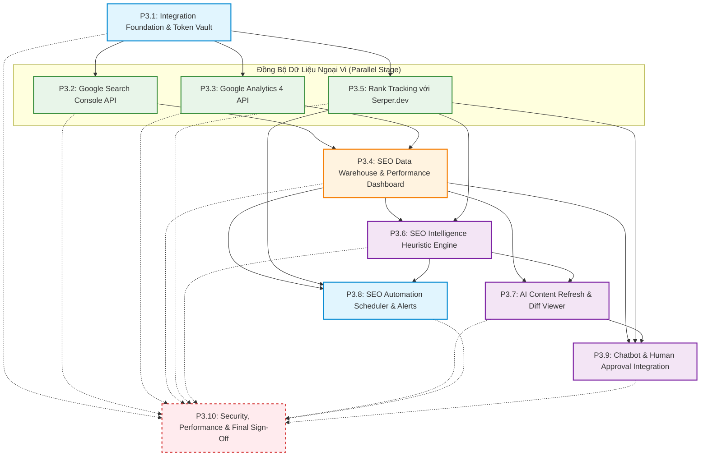

# PHASE_3_DEPENDENCY_GRAPH.md — Sơ Đồ Phụ Thuộc & Các Cổng Thực Thi Phase 3
## AuraSEO – SEO Automation & Intelligence

> **Dự án:** Multi-Tenant SaaS Auto-SEO Content Automation  
> **Kiến trúc:** Laravel 13 + Next.js 16 + Redis + MySQL 8  
> **Quy tắc điều phối:** Tuân thủ tuần tự theo phụ thuộc, chỉ cho phép song song hóa khi độc lập hoàn toàn về database và business logic.  

---

## 1. SƠ ĐỒ PHỤ THUỘC TỔNG THỂ (MERMAID MASTER GRAPH)



---

## 2. PHÂN TÍCH ĐƯỜNG GĂNG (CRITICAL PATH ANALYSIS)

Đường găng (Critical Path) là chuỗi các nhiệm vụ dài nhất và có tính phụ thuộc tuần tự nghiêm ngặt, quyết định tổng tiến độ hoàn thành của Phase 3:

```text
[P3.1: Foundation] 
       │
       ▼
[P3.2: GSC] & [P3.3: GA4] 
       │
       ▼
[P3.4: Data Warehouse] 
       │
       ▼
[P3.6: SEO Intelligence] 
       │
       ▼
[P3.7: Content Refresh] 
       │
       ▼
[P3.9: Chatbot & Approval] 
       │
       ▼
[P3.10: Final Acceptance]
```

> **Lưu ý quan trọng về tiến độ:** Bất kỳ sự chậm trễ nào tại `P3.1`, `P3.4` hoặc `P3.7` sẽ làm chậm trễ toàn bộ các phân hệ phía sau.

---

## 3. CƠ HỘI TRIỂN KHAI SONG SONG (PARALLELIZATION STRATEGY)

Sau khi **P3.1 (Integration Foundation)** hoàn tất và nghiệm thu đạt `PASS`:
1. **Song song nhóm Kết nối Dữ liệu:**
   - **Nhánh A:** `P3.2 (Google Search Console)` và `P3.3 (Google Analytics 4)` có thể triển khai song song vì cả hai đều dùng chung `GoogleAccount` nhưng đọc 2 Google API độc lập.
   - **Nhánh B:** `P3.5 (Rank Tracking Serper.dev)` hoàn toàn độc lập với Google OAuth, có thể triển khai song song ngay sau P3.1.
2. **Song song nhóm Vận hành & Chatbot:**
   - Sau khi `P3.4`, `P3.5`, `P3.6` hoàn tất: `P3.8 (Automation Scheduler)` và `P3.9 (Chatbot Integration)` có thể phát triển song song trước khi tổng hợp vào `P3.10`.

---

## 4. CHI TIẾT 9 CỔNG THỰC THI (EXECUTION GATES)

| Cổng Thực Thi | Điều Kiện Tiên Quyết Bắt Buộc Để Mở Cổng | Rủi Ro Nếu Bỏ Qua Cổng |
| :---: | :--- | :--- |
| **GATE 1 (Sau P3.1)** | Bảng `google_accounts` tạo thành công; Token được mã hóa AES 100%; Kiểm tra IDOR tenant pass; Test suite exit 0. | Token lưu plain-text làm lộ thông tin mật của khách hàng. |
| **GATE 2 (Sau P3.2 & P3.3)** | OAuth Callback hoạt động ổn định; Lấy được danh sách property từ Google API thật/mock; Auto-refresh token hoạt động khi expired. | Lỗi xác thực hàng loạt khi đồng bộ dữ liệu ngầm ban đêm. |
| **GATE 3 (Sau P3.4)** | Schema Time-Series với MD5 Hash hoạt động; Upsert idempotent (chạy lại 2 lần không tăng số bản ghi); Dashboard Recharts render mượt. | Bảng dữ liệu phình to gấp đôi do trùng lặp khi chạy bù dữ liệu GSC. |
| **GATE 4 (Sau P3.5)** | Serper.dev API cào đúng Top 100 kết quả; Có giới hạn request theo plan; Dự báo chi phí hiển thị chính xác. | Chi phí API Serper bị đội vọt ngoài ý muốn do gọi vòng lặp vô tận. |
| **GATE 5 (Sau P3.6)** | Thuật toán Heuristics phân loại chính xác 6 dạng cơ hội; Không trừ credit AI cho khâu quét; Không báo động giả do trễ số liệu. | Gây hoang mang cho người dùng vì cảnh báo sai sự thật. |
| **GATE 6 (Sau P3.7)** | Diff Viewer hiển thị trực quan Trước/Sau; Điểm SEO trước/sau tăng; **Bắt buộc người dùng duyệt mới được cập nhật WordPress**. | AI tự động sửa đè làm hỏng thứ hạng bài viết đang có traffic của website. |
| **GATE 7 (Sau P3.8)** | Scheduler có Distributed Locking `withoutOverlapping(60)`; Không xảy ra Queue Storm lúc 00:00; Thông báo gửi đúng người. | Nghẽn Redis Queue và sập máy chủ do các job định kỳ đè nhau. |
| **GATE 8 (Sau P3.9)** | Chatbot điều khiển được 4 adapter mới; Thẻ duyệt cập nhật bài viết hiện đúng trong chat; Không cho AI quyền tự tung tự tác. | Chatbot tự ý trừ credit hoặc tự ý cập nhật bài mà khách chưa xem qua. |
| **GATE 9 (Sau P3.10)** | Toàn bộ test suite Laravel và Next.js build pass 100%; Không có regression ở Phase 1, 2, 2.5; Reviewer Agent ký xác nhận PASS. | Hệ thống có lỗi tiềm ẩn được đưa lên production gây mất uy tín SaaS. |

---

## 5. GIẢI THÍCH CÁC RÀNG BUỘC KỸ THUẬT (BLOCKING CONSTRAINTS)

1. **Ràng buộc Dữ liệu Lịch sử:**
   - `P3.6 (SEO Intelligence)` tuyệt đối **không thể chạy trước `P3.4`**, vì thuật toán phát hiện tụt hạng và traffic decay đòi hỏi chuỗi dữ liệu tối thiểu 7 đến 28 ngày được lưu trữ trong bảng `gsc_search_performance_daily`.
2. **Ràng buộc Phê Duyệt An Toàn:**
   - `P3.9 (Chatbot Integration)` không được tự tạo luồng duyệt bài riêng, mà bắt buộc phải tái sử dụng `ActionApprovalService` và bảng `chat_pending_actions` đã được bảo vệ nghiêm ngặt ở Phase 2.5.
3. **Ràng buộc Zero Credit:**
   - Các job đồng bộ của `P3.2`, `P3.3`, `P3.4` và bộ quét `P3.6` bị chặn cứng không được gọi đến `CreditLedgerService::deductCredits`.

---
**Tài liệu được lập bởi:** Senior Software Architect  
**Trạng thái:** Đã kiểm tra tính nhất quán với `PHASE_3_TASK_BREAKDOWN.md`.
