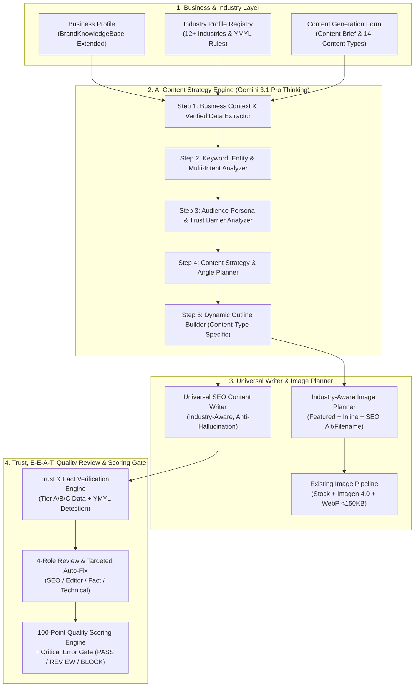

# 📘 BÁO CÁO AUDIT KIẾN TRÚC & KẾ HOẠCH NÂNG CẤP ENGINE TẠO NỘI DUNG AI (`PRE_CONTENT_ENGINE_AUDIT.md`)

**Ngày thực hiện Audit:** 11/11/2026  
**Vai trò:** Senior AI Product Architect, SEO Content Strategist, Full-stack Engineer & AI Quality Engineer  
**Model chiến lược mục tiêu:** `gemini-3.1-pro-preview` (Gemini Pro 3.1 Thinking API) kết hợp fallback an toàn.

---

## 1. KIẾN TRÚC HIỆN TẠI (CURRENT ARCHITECTURE OVERVIEW)

Hệ thống **AuraSEO** đang vận hành trên kiến trúc tách biệt Frontend & Backend:

* **Frontend (`Next.js 16 App Router + TypeScript strict`):**
  * Giao diện quản trị đa không gian làm việc (`Workspace` & `Website`).
  * Các phân hệ chính liên quan đến nội dung:
    * Quản lý Hồ sơ thương hiệu: [`frontend/app/(dashboard)/brand-knowledge/page.tsx`](file:///Users/truongthinh/Documents/SaasAutoSeo/frontend/app/(dashboard)/brand-knowledge/page.tsx)
    * Quản lý Từ khóa & Tạo bài: [`frontend/app/(dashboard)/keywords/page.tsx`](file:///Users/truongthinh/Documents/SaasAutoSeo/frontend/app/(dashboard)/keywords/page.tsx)
    * Danh sách & Chỉnh sửa bài viết (Lexical Gutenberg Editor): [`frontend/app/(dashboard)/articles/page.tsx`](file:///Users/truongthinh/Documents/SaasAutoSeo/frontend/app/(dashboard)/articles/page.tsx), [`frontend/app/(dashboard)/articles/[id]/edit/page.tsx`](file:///Users/truongthinh/Documents/SaasAutoSeo/frontend/app/(dashboard)/articles/[id]/edit/page.tsx)
    * Sản xuất hàng loạt: [`frontend/app/(dashboard)/bulk-generator/page.tsx`](file:///Users/truongthinh/Documents/SaasAutoSeo/frontend/app/(dashboard)/bulk-generator/page.tsx)
    * Trợ lý AI Copilot Chatbot: [`frontend/app/(dashboard)/chatbot/page.tsx`](file:///Users/truongthinh/Documents/SaasAutoSeo/frontend/app/(dashboard)/chatbot/page.tsx)
* **Backend (`Laravel 12 API + Queue/Horizon + Redis + MySQL/PostgreSQL`):**
  * Tầng điều phối AI: [`AIProviderService.php`](file:///Users/truongthinh/Documents/SaasAutoSeo/backend/app/Services/AI/AIProviderService.php) kết nối [`GeminiProvider.php`](file:///Users/truongthinh/Documents/SaasAutoSeo/backend/app/Providers/AI/GeminiProvider.php), `OpenAIProvider`, `AnthropicProvider` kèm theo dõi token (`TokenUsageService`), chi phí (`CostTrackingService`), sổ cái credit (`CreditLedgerService`) và log (`AILog`).
  * Tầng Quản lý Prompt: [`PromptBuilderService.php`](file:///Users/truongthinh/Documents/SaasAutoSeo/backend/app/Services/AI/PromptBuilderService.php) đọc từ bảng `ai_prompt_versions` (hỗ trợ versioning & A/B testing).
  * Tầng Agents (`App\Agents\*`): `OutlineAgent`, `WritingAgent`, `SEOOptimizationAgent`, `InternalLinkingAgent`, `QAValidationAgent`.

---

## 2. LUỒNG TẠO BÀI HIỆN TẠI (CURRENT CONTENT GENERATION FLOWS)

Qua quá trình kiểm toán mã nguồn thực tế, hệ thống hiện đang tồn tại **3 luồng tạo bài viết riêng rẽ** chưa đồng nhất:

### Luồng A: Queue Pipeline từ Keywords (`POST /api/v1/articles/generate`)
1. [`ArticleController::generate()`](file:///Users/truongthinh/Documents/SaasAutoSeo/backend/app/Http/Controllers/Api/V1/ArticleController.php#L299-L394) nhận `keyword_id`, kiểm tra hạn mức credit, tạo bản ghi `Article` ở trạng thái `DRAFT`, khởi tạo `Task` và đẩy [`GenerateOutlineJob`](file:///Users/truongthinh/Documents/SaasAutoSeo/backend/app/Jobs/AI/GenerateOutlineJob.php) vào queue `ai-writing`.
2. [`GenerateOutlineJob`](file:///Users/truongthinh/Documents/SaasAutoSeo/backend/app/Jobs/AI/GenerateOutlineJob.php) gọi [`OutlineAgent`](file:///Users/truongthinh/Documents/SaasAutoSeo/backend/app/Agents/OutlineAgent.php) sinh dàn ý JSON (`h1`, `sections`, `faqs`), lưu vào `articles.outline`, sau đó dispatch [`GenerateArticleJob`](file:///Users/truongthinh/Documents/SaasAutoSeo/backend/app/Jobs/AI/GenerateArticleJob.php).
3. [`GenerateArticleJob`](file:///Users/truongthinh/Documents/SaasAutoSeo/backend/app/Jobs/AI/GenerateArticleJob.php) gọi [`WritingAgent`](file:///Users/truongthinh/Documents/SaasAutoSeo/backend/app/Agents/WritingAgent.php) sinh nội dung HTML từ `outline`, chuẩn hóa qua `ArticleContentFormatter`, kiểm tra đạo văn qua `DuplicateDetectionService`, trừ credit và tiếp tục dispatch:
   * [`GenerateArticleImagesJob`](file:///Users/truongthinh/Documents/SaasAutoSeo/backend/app/Jobs/Media/GenerateArticleImagesJob.php) (queue `imports`)
   * [`OptimizeInternalLinksJob`](file:///Users/truongthinh/Documents/SaasAutoSeo/backend/app/Jobs/AI/OptimizeInternalLinksJob.php) -> [`GenerateSeoMetadataJob`](file:///Users/truongthinh/Documents/SaasAutoSeo/backend/app/Jobs/AI/GenerateSeoMetadataJob.php) (queue `ai-writing`)
4. [`GenerateSeoMetadataJob`](file:///Users/truongthinh/Documents/SaasAutoSeo/backend/app/Jobs/AI/GenerateSeoMetadataJob.php) gọi [`SEOOptimizationAgent`](file:///Users/truongthinh/Documents/SaasAutoSeo/backend/app/Agents/SEOOptimizationAgent.php) sinh `seo_title`, `seo_description`, `faqs`, chấm điểm qua `SEOScoreService` và `ArticleQualityReportService`, rồi chuyển bài sang trạng thái `REVIEW`.

### Luồng B: Tạo bài trực tiếp từ Chatbot (`ConversationController::createSeoArticleFromChat`)
* Trong [`ConversationController.php`](file:///Users/truongthinh/Documents/SaasAutoSeo/backend/app/Http/Controllers/Api/V1/Chatbot/ConversationController.php#L563-L700), khi người dùng yêu cầu viết bài, hệ thống gửi **một prompt duy nhất** (`generateHighQualitySeoArticleWithAi`) tới Gemini và ghi cứng nhiều thông số (`seo_score = 96`, `readability_score = 92`, `word_count = max(1800, $wordCount)`).

### Luồng C: Tạo bài hàng loạt (`BulkGenerationService::processBatch`)
* Trong [`BulkGenerationService.php`](file:///Users/truongthinh/Documents/SaasAutoSeo/backend/app/Services/Bulk/BulkGenerationService.php#L200-L216), hệ thống đang tạo bản ghi `Article` với nội dung placeholder `
Nội dung đang được khởi tạo hàng loạt bởi AI Content Pipeline...
` mà chưa kích hoạt đầy đủ pipeline phân tích chiến lược & kiểm duyệt đa bước.

---

## 3. LUỒNG TẠO ẢNH HIỆN TẠI (CURRENT IMAGE GENERATION PIPELINE)

Hệ thống tạo và xử lý hình ảnh đang hoạt động ổn định qua các module:

1. **Điều phối tạo ảnh bài viết:** [`GeminiImageGenerationService.php`](file:///Users/truongthinh/Documents/SaasAutoSeo/backend/app/Services/Media/GeminiImageGenerationService.php)
   * Hỗ trợ 3 chiến lược (`source_strategy`): `hybrid` (tìm ảnh Stock Pexels/Unsplash trước, thiếu mới gọi AI), `stock` (chỉ dùng ảnh miễn phí bản quyền), `ai` (sinh ảnh bằng model `imagen-4.0-generate-001`).
2. **Tối ưu & Nén ảnh:** [`ImageOptimizationService.php`](file:///Users/truongthinh/Documents/SaasAutoSeo/backend/app/Services/Media/ImageOptimizationService.php) và [`ImageDownloadService.php`](file:///Users/truongthinh/Documents/SaasAutoSeo/backend/app/Services/Media/ImageDownloadService.php) tải ảnh, kiểm tra SSRF (`UrlSafetyValidator`), nén sang định dạng WebP dung lượng nhẹ (<150KB) và lưu trữ vào `MediaAsset`.
3. **Upload trong Editor & Đồng bộ WordPress:** [`EditorImageUploadService.php`](file:///Users/truongthinh/Documents/SaasAutoSeo/backend/app/Services/Media/EditorImageUploadService.php) và [`WordPressMediaService.php`](file:///Users/truongthinh/Documents/SaasAutoSeo/backend/app/Services/WordPress/WordPressMediaService.php) đẩy ảnh kèm `alt_text`, `caption` lên WordPress Media Library.

---

## 4. CƠ SỞ DỮ LIỆU & MÔ HÌNH DỮ LIỆU LIÊN QUAN (DATABASE SCHEMA)

| Bảng CSDL | Model | Các trường chính hiện có | Đánh giá phục vụ nâng cấp |
| :--- | :--- | :--- | :--- |
| `brand_knowledge_bases` | [`BrandKnowledgeBase`](file:///Users/truongthinh/Documents/SaasAutoSeo/backend/app/Models/BrandKnowledgeBase.php) | `workspace_id`, `website_id`, `brand_name`, `tagline`, `tone_of_voice`, `target_personas`, `unique_selling_points`, `product_catalog`, `taboo_words`, `preferred_terms`, `custom_rules`, `is_default` | Cần mở rộng thêm các trường JSON/cột cho **Business Profile toàn diện**, **Industry Profile**, và **E-E-A-T / Verified Credentials** (giữ nguyên các cột cũ để tương thích ngược). |
| `keywords` | [`Keyword`](file:///Users/truongthinh/Documents/SaasAutoSeo/backend/app/Models/Keyword.php) | `keyword`, `language`, `search_intent`, `pillar_topic`, `content_cluster`, `funnel_stage`, `target_word_count`, `brief_notes`, `must_include_points`, `avoid_topics`, `reference_urls`, `competitor_urls_override`, `meta`, `lsi_keywords` | Đã có nền tảng rất tốt (`brief_notes`, `must_include_points`, `avoid_topics`, `reference_urls`, `meta`). Có thể lưu cấu hình **Content Brief Form** mở rộng vào `meta` + bổ sung cột định danh nếu cần. |
| `articles` | [`Article`](file:///Users/truongthinh/Documents/SaasAutoSeo/backend/app/Models/Article.php) | `title`, `slug`, `content`, `excerpt`, `seo_title`, `seo_description`, `focus_keyword`, `word_count`, `seo_score`, `readability_score`, `outline`, `faqs`, `internal_links`, `featured_image_url`, `media_plan`, `image_assets`, `quality_report`, `pipeline_status` | Cần bổ sung/mở rộng lưu trữ: `brand_knowledge_id`, `industry_profile`, `content_type`, `secondary_keywords`, `search_intent_analysis`, `strategy_plan`, `external_references`, `schema_data`, `fact_check_report`, `quality_score_breakdown`, `critical_issues`, `gate_status` (`PASS` / `REVIEW` / `BLOCK`). |
| `quality_reports` | `QualityReport` | `article_id`, `seo_score`, `readability_score`, `media_score`, `wordpress_readiness_score`, `total_score`, `checks`, `warnings`, `blocking_errors`, `auto_fixable` | Cần nâng cấp để hỗ trợ **Hệ thống chấm điểm 100 độc lập (7 trụ cột)** và **Critical Error Gate**. |
| `media_assets` | `MediaAsset` | `article_id`, `source_type`, `source_url`, `local_path`, `wordpress_media_id`, `alt_text`, `caption`, `description`, `status`, `metadata` | Sẵn sàng lưu trữ thêm thông tin `image_plan` (mục đích ảnh, vị trí heading, tỷ lệ khung hình, SEO filename). |
| `ai_prompt_versions` | `AIPromptVersion` | `agent_type`, `version`, `name`, `system_prompt`, `user_prompt_template`, `variables`, `is_active` | Đang hoạt động tốt, cần cập nhật prompt chuyên sâu đa ngành. |
| `ai_logs` | `AILog` | `tenant_id`, `article_id`, `keyword_id`, `agent_type`, `provider`, `model`, `prompt_tokens`, `completion_tokens`, `cost_usd`, `latency_ms`, `status` | Sẵn sàng tái sử dụng 100%. |

---

## 5. CÁC API HIỆN CÓ LIÊN QUAN (EXISTING API ENDPOINTS)

* **Brand Knowledge API:**
  * `GET /api/v1/brand-knowledge`
  * `POST /api/v1/brand-knowledge`
  * `GET /api/v1/brand-knowledge/{id}`
  * `PUT /api/v1/brand-knowledge/{id}`
  * `DELETE /api/v1/brand-knowledge/{id}`
  * `POST /api/v1/brand-knowledge/{id}/set-default`
  * `POST /api/v1/brand-knowledge/inject-context`
  * `POST /api/v1/brand-knowledge/validate-taboo`
* **Articles & Content Generation API:**
  * `POST /api/v1/articles/generate` (Khởi chạy pipeline tạo bài từ keyword)
  * `GET /api/v1/articles`, `GET /api/v1/articles/{id}`, `PUT /api/v1/articles/{id}`
  * `POST /api/v1/articles/{id}/score-audit`, `POST /api/v1/articles/score-audit`
  * `POST /api/v1/articles/{id}/auto-fix`
  * `POST /api/v1/articles/{id}/generate-images`
  * `POST /api/v1/articles/{id}/approve-publish`

---

## 6. NHỮNG TÍNH NĂNG CÓ THỂ TÁI SỬ DỤNG (REUSABLE MODULES)

1. **`BrandKnowledgeService` & `BrandKnowledgeBase`:** Đã có cơ chế CRUD theo Workspace/Website, chọn hồ sơ mặc định (`is_default`) và kiểm tra từ cấm (`validateContentAgainstTaboo`).
2. **`AIProviderService` + `GeminiProvider` + `TokenUsageService` + `CostTrackingService` + `CreditLedgerService`:** Toàn bộ hạ tầng gọi Gemini API, rate limiting bằng Redis, tính token và trừ/hoàn credit hoạt động chuẩn xác.
3. **`SerpResearchService` + `SerpCacheService` + `CompetitorAnalysisService`:** Bộ máy nghiên cứu SERP và cache 14 ngày đã sẵn sàng cung cấp dữ liệu đối thủ thực tế.
4. **`GeminiImageGenerationService` + `StockImageSearchService` + `ImageOptimizationService`:** Pipeline tạo ảnh hybrid (Stock + Imagen 4.0) và nén WebP <150KB hoạt động tốt, chỉ cần nâng cấp bộ lập kế hoạch hình ảnh (`ImagePlanner`) theo ngành nghề.
5. **`SeoScoringEngine` (1.088 dòng thuần PHP):** Chấm điểm kỹ thuật SEO On-page cực nhanh (<5ms, 0 credit), giữ nguyên để phục vụ điểm SEO kỹ thuật, đồng thời kết hợp với bộ chấm điểm **Content Quality Scoring 100 điểm** mới.
6. **`ArticlePipelineService` & `TaskService`:** Lưu trạng thái từng bước trong `articles.pipeline_status` giúp theo dõi tiến độ realtime và resume khi lỗi.

---

## 7. NHỮNG VẤN ĐỀ HIỆN TẠI CẦN KHẮC PHỤC (IDENTIFIED PROBLEMS & GAPS)

1. **Hardcode nội dung ngành Nha khoa / Y tế (Critical):**
   * Trong [`ConversationController.php`](file:///Users/truongthinh/Documents/SaasAutoSeo/backend/app/Http/Controllers/Api/V1/Chatbot/ConversationController.php#L653-L900) và [`chatbot/page.tsx`](file:///Users/truongthinh/Documents/SaasAutoSeo/frontend/app/(dashboard)/chatbot/page.tsx#L506-L538), prompt, mô tả SEO, template fallback và kho ảnh stock đang gắn cứng với *"Nha Khoa Smile Luxury"*, *"Bác sĩ Cố vấn Y khoa"*, *"chụp phim CT Cone Beam 3D"*, *"vô trùng Autoclave"*. Khi doanh nghiệp thuộc ngành Luật, Bất động sản, SaaS hay Du lịch tạo bài sẽ bị lệch ngữ cảnh nghiêm trọng.
2. **Hồ sơ doanh nghiệp (`BrandKnowledgeBase`) chưa đủ chiều sâu và chưa được kết nối vào Pipeline chính:**
   * Thiếu thông tin pháp lý, lịch sử, khu vực phục vụ, mô hình B2B/B2C, bằng cấp/chứng chỉ xác minh, chính sách bảo hành, người kiểm duyệt nội dung.
   * Đặc biệt: `OutlineAgent` và `WritingAgent` trong queue pipeline hiện **chưa gọi `BrandKnowledgeService`** nên bài viết sinh ra không mang bản sắc và dữ liệu thật của doanh nghiệp.
3. **Chưa có Industry Profile Registry đa ngành:**
   * Chưa có bộ phân loại và cấu hình quy tắc riêng cho từng ngành (Healthcare, Legal, Real Estate, Education, Technology/SaaS, Ecommerce, Travel, Finance, Manufacturing, Beauty, F&B, Other).
4. **Quy trình tạo bài còn đơn giản, thiếu AI Content Strategy Engine 5 bước:**
   * Hiện tại nhận từ khóa là gọi tạo Outline ngay bằng một prompt ngắn, chưa qua phân tích Ngữ cảnh doanh nghiệp -> Phân tích từ khóa/Semantic/Intent chính-phụ -> Phân tích chân dung & rào cản khách hàng -> Hoạch định chiến lược & Content Type (14 loại bài viết).
5. **Thiếu cơ chế E-E-A-T, Fact-Check 3 tầng dữ liệu & YMYL Safety Gate:**
   * Chưa phân tách rõ **Nhóm A (Verified Business Data)**, **Nhóm B (Verified External Info)** và **Nhóm C (AI Generated Suggestions)**.
   * Chưa có bộ phát hiện chủ đề nhạy cảm **YMYL** (Y tế, Nha khoa, Tài chính, Pháp luật) để chặn cam kết tuyệt đối, chặn việc AI tự bịa số liệu/bằng cấp/điều luật và buộc chuyển sang trạng thái kiểm duyệt (`REVIEW`/`BLOCK`).
6. **Image Prompt chưa linh hoạt theo ngành và ngữ cảnh từng H2:**
   * `GeminiImageGenerationService::imagePrompts()` mới chỉ ghép câu cơ bản, chưa lên kế hoạch hình ảnh chi tiết (`Image Plan`) theo ngành nghề và chưa ngăn chặn triệt để việc dùng ảnh AI làm bằng chứng cơ sở vật chất thật.
7. **Thiếu quy trình Tự kiểm duyệt 4 vai trò (4-Stage Review Pipeline) & Chấm điểm Chất lượng 100 điểm độc lập:**
   * Chưa có bước kiểm duyệt độc lập (SEO Reviewer, Content Editor, Fact Checker, Technical Reviewer) và cổng chặn lỗi nghiêm trọng (**Critical Error Gate**: `PASS` / `REVIEW` / `BLOCK`).
8. **Xử lý phản hồi của Gemini Pro 3.1 Thinking API (`GeminiProvider`):**
   * Khi gọi model dòng Thinking (`gemini-3.1-pro-preview`), mảng `candidates[0].content.parts` có thể chứa part `thought: true` ở vị trí đầu tiên trước part chứa kết quả JSON chính thức. Hiện tại `GeminiProvider` chỉ đọc `parts.0.text`, cần nâng cấp để bóc tách chính xác cả phần suy luận (`thought`) và phần nội dung đầu ra (`text`), đồng thời cập nhật `modelMap` ưu tiên `gemini-3.1-pro-preview`.

---

## 8. KIẾN TRÚC MỤC TIÊU (TARGET ARCHITECTURE)

### Tối ưu hóa Token, Chi phí & Latency (Cost & Token Optimization)
Để tránh tạo quá nhiều API calls rời rạc gây tốn kém và chậm trễ, kiến trúc sử dụng **Consolidated Thinking Steps** với `gemini-3.1-pro-preview`:
1. **Call 1 — Strategy & Outline Synthesis (Steps 1–5):** Thực hiện phân tích Business Context + Keyword/Intent + Audience + Content Strategy + Sinh Outline chi tiết trong một lượt suy luận có cấu trúc (Structured JSON Output), lưu trạng thái vào `articles.pipeline_status` và `articles.outline`.
2. **Call 2 — Universal Expert Article Writing + Image Plan + Schema Selection:** Dựa trên Strategy & Outline đã duyệt, viết bài chuyên sâu theo đúng `IndustryProfile` và `ContentType`, đồng thời xuất kế hoạch hình ảnh (`media_plan`) và dữ liệu có cấu trúc (`schema_data`).
3. **Call 3 — Multi-Role Quality Review, Fact-Check & Scoring Gate:** Thực hiện kiểm định độc lập (SEO Reviewer + Content Editor + Fact/YMYL Checker + Technical Reviewer), chấm điểm 7 trụ cột (100 điểm) kết hợp cùng `SeoScoringEngine` thuần PHP, và tự động sửa các lỗi cục bộ nếu cần.

---

## 9. DANH SÁCH CÁC PHASE TRIỂN KHAI & PHỤ THUỘC (EXECUTION PHASES)

| Phase | Tên Phase | Các hạng mục triển khai chính | Phụ thuộc |
| :--- | :--- | :--- | :--- |
| **Phase 1** | **Business Profile & Industry Profile Registry** | - Mở rộng schema `brand_knowledge_bases` (tương thích ngược 100%) để lưu đầy đủ Thông tin cơ bản, Mô tả kinh doanh, Chuyên môn/Độ tin cậy (E-E-A-T), Định hướng thương hiệu. - Xây dựng `IndustryProfileRegistry` hỗ trợ 12+ ngành nghề (Healthcare, Legal, Real Estate, Education, Tech/SaaS, Ecommerce, Travel, Finance, Manufacturing, Beauty, F&B, Other) kèm cấu hình YMYL, thuật ngữ, cấu trúc gợi ý và tuyên bố cần kiểm soát. - Nâng cấp UI biểu mẫu Hồ sơ doanh nghiệp tại `/brand-knowledge`. - Viết Unit/Feature Tests kiểm증. | Độc lập (Nền tảng gốc) |
| **Phase 2** | **Content Brief Form & AI Content Strategy Engine** | - Nâng cấp `GeminiProvider` hỗ trợ trọn vẹn `gemini-3.1-pro-preview` (Thinking API). - Thiết kế `ContentGenerationForm` (UI & API) hỗ trợ chọn Doanh nghiệp, 14 `ContentType`, `SearchIntent` chính/phụ, Local SEO, sản phẩm quảng bá, tài liệu tham khảo. - Xây dựng `ContentStrategyService` & nâng cấp `OutlineAgent` thực hiện đủ 5 bước phân tích trước khi viết. | Phụ thuộc Phase 1 |
| **Phase 3** | **Universal Content Writer & On-Page SEO Optimizer** | - Nâng cấp `WritingAgent` & `SEOOptimizationAgent` hoạt động đa ngành theo `IndustryProfile` và `ContentType`. - Loại bỏ toàn bộ nội dung hardcode nha khoa trong `ConversationController` và `chatbot/page.tsx`. - Tích hợp chọn Schema thông minh (`SchemaBuilderService`) và kiểm tra Keyword Cannibalization / Internal Linking thực tế. | Phụ thuộc Phase 1, 2 |
| **Phase 4** | **Fact Checking, E-E-A-T & Quality Control Pipeline** | - Xây dựng `TrustAndFactVerificationService` phân loại dữ liệu Nhóm A/B/C và nhận diện YMYL. - Xây dựng `ContentReviewPipelineService` thực hiện 4 vai trò kiểm duyệt (SEO, Content Editor, Fact Checker, Technical Reviewer) và sửa lỗi cục bộ có kiểm soát. | Phụ thuộc Phase 1, 3 |
| **Phase 5** | **Industry-Aware Image Planning Integration** | - Xây dựng `ImagePlannerService` tích hợp vào `GeminiImageGenerationService` (giữ nguyên API & quy trình nén WebP hiện tại). - Sinh Image Prompt, SEO filename, ALT text, caption theo đúng ngành nghề và từng mục H2; cấm dùng ảnh AI làm bằng chứng cơ sở vật chất thật. | Phụ thuộc Phase 1, 3 |
| **Phase 6** | **100-Point Quality Scoring, Multi-Industry Testing & Final Report** | - Xây dựng `ContentQualityScoringService` (7 tiêu chí = 100 điểm) + **Critical Error Gate** (`PASS` / `REVIEW` / `BLOCK`). - Lưu trữ đầy đủ 19 trường Output Format vào `Article` và hiển thị trên UI. - Thực hiện kiểm thử tự động & tạo bộ 6 bài test đa ngành (Nha khoa, BĐS, Luật, SaaS, Du lịch, TMĐT) và cập nhật `PROGRESS.md`. | Phụ thuộc Phase 1–5 |

---

## 10. RỦI RO VÀ PHƯƠNG ÁN PHÒNG TRÁNH (RISKS & MITIGATION)

| Rủi ro | Mức độ | Phương án phòng tránh |
| :--- | :--- | :--- |
| **1. Phá vỡ API hoặc dữ liệu hiện có khi mở rộng Database** | Cao | Chỉ sử dụng migration bổ sung cột `nullable` hoặc cột JSON (`business_profile`, `eeat_credentials`, `industry_profile`, `quality_gate`) trên bảng `brand_knowledge_bases`, `keywords`, `articles`. Giữ nguyên 100% các trường hiện tại trong `ArticleResource` và `BrandKnowledgeRequest`. |
| **2. Lỗi parse JSON hoặc nghẽn thời gian chờ (Timeout) khi gọi Gemini Thinking API** | Trung bình | Cấu hình `responseMimeType: application/json` khi phù hợp, lọc bỏ `thought` parts trong `GeminiProvider`, sử dụng `JsonResponseParser` hiện có kèm cơ chế retry có kiểm soát và lưu `pipeline_status` sau mỗi bước. |
| **3. Tăng chi phí Token nếu tách quá nhiều lần gọi AI rời rạc** | Trung bình | Gộp các bước phân tích chiến lược + dàn ý vào 1 lượt gọi Thinking có cấu trúc; kết hợp kiểm tra quy tắc tĩnh bằng PHP (`SeoScoringEngine`, `TabooWords`, `HtmlTechnicalValidator`, `CriticalClaimRegex`) với kiểm tra ngữ nghĩa bằng AI. |
| **4. Làm ảnh hưởng chức năng Tạo ảnh và Xuất bản WordPress đang chạy tốt** | Cao | Tuyệt đối không xóa hay thay đổi chữ ký hàm của `GeminiImageGenerationService::ensureInlineImages()`, `EditorImageUploadService` và `PublishToWordPressJob`. Chỉ bổ sung lớp `ImagePlannerService` cung cấp dữ liệu đầu vào tốt hơn cho `media_plan`. |

---

## 11. ĐỀ XUẤT CHI TIẾT PHASE 1 (READY FOR EXECUTION)

### Phạm vi công việc Phase 1: Business Profile & Industry Profile Registry
1. **Backend — Industry Profile Registry (`app/Services/Brand/IndustryProfileRegistry.php`):**
   * Định nghĩa đầy đủ 12 hồ sơ ngành nghề tiêu chuẩn (`healthcare`, `legal`, `real_estate`, `education`, `technology`, `ecommerce`, `travel`, `finance`, `manufacturing`, `beauty`, `food_beverage`, `other`) và cho phép đăng ký/mở rộng ngành nghề động mà không cần sửa code lõi.
   * Mỗi Industry Profile bao gồm: `key`, `name`, `is_ymyl`, `verification_level`, `content_rules`, `terminology_guidelines`, `common_intents`, `recommended_structures`, `sensitive_claims_to_control`, `suitable_ctas`, `image_style_guidelines`, `schema_types`.
   * Hỗ trợ tự động nhận diện ngành nghề (`detectIndustryFromProfile`) từ tên ngành nghề, sản phẩm/dịch vụ và mô tả doanh nghiệp.
2. **Backend — Mở rộng `BrandKnowledgeBase` (Business Profile):**
   * Tạo migration an toàn bổ sung các cột mới vào `brand_knowledge_bases`:
     * `company_name`, `primary_industry`, `secondary_industries` (JSON), `industry_profile_key`, `country_market`, `service_areas` (JSON), `content_language`, `business_model`.
     * `business_details` (JSON: giới thiệu, lịch sử hình thành, vấn đề giải quyết, điểm khác biệt đối thủ, khu vực khách hàng, chính sách bán hàng, chính sách bảo hành, thông tin liên hệ).
     * `eeat_credentials` (JSON: đội ngũ chuyên gia, bằng cấp/chứng chỉ đã xác minh, giấy phép hoạt động, thành tựu/giải thưởng có bằng chứng, đối tác/chứng nhận, nguồn tài liệu chuyên môn, người chịu trách nhiệm kiểm duyệt).
     * `brand_orientation` (JSON: phong cách viết, cách xưng hô, định vị thương hiệu, CTA ưu tiên).
   * Cập nhật `BrandKnowledgeRequest` và `BrandKnowledgeService::buildPromptContext()` để trích xuất rõ ràng **Verified Business Data (Nhóm A)**, **Unverified/Missing Info Warnings** và **Industry Profile Rules** khi cung cấp ngữ cảnh cho AI, đảm bảo nguyên tắc: *"Không tự tạo hoặc suy diễn bất kỳ thông tin nào chưa được doanh nghiệp cung cấp"*.
   * Thêm endpoint `GET /api/v1/brand-knowledge/industries` trả về danh sách Industry Profiles chuẩn để Frontend hiển thị và tự động phân loại.
3. **Frontend — Nâng cấp giao diện Hồ sơ doanh nghiệp (`/brand-knowledge`):**
   * Nâng cấp Modal tạo/chỉnh sửa Hồ sơ doanh nghiệp trong [`frontend/app/(dashboard)/brand-knowledge/page.tsx`](file:///Users/truongthinh/Documents/SaasAutoSeo/frontend/app/(dashboard)/brand-knowledge/page.tsx) và [`frontend/hooks/useBrandKnowledge.ts`](file:///Users/truongthinh/Documents/SaasAutoSeo/frontend/hooks/useBrandKnowledge.ts) theo 5 nhóm tab rõ ràng (Thông tin cơ bản & Ngành nghề, Hoạt động kinh doanh & Sản phẩm, Chuyên môn & Độ tin cậy E-E-A-T, Định hướng thương hiệu & Từ cấm, Hồ sơ ngành nghề tự động).
4. **Kiểm thử & Theo dõi tiến độ:**
   * Tạo tệp [`PROGRESS.md`](file:///Users/truongthinh/Documents/SaasAutoSeo/PROGRESS.md) theo dõi trạng thái từng Phase.
   * Kiểm thử toàn diện việc lưu trữ, phân loại ngành nghề tự động và kết xuất ngữ cảnh doanh nghiệp.
