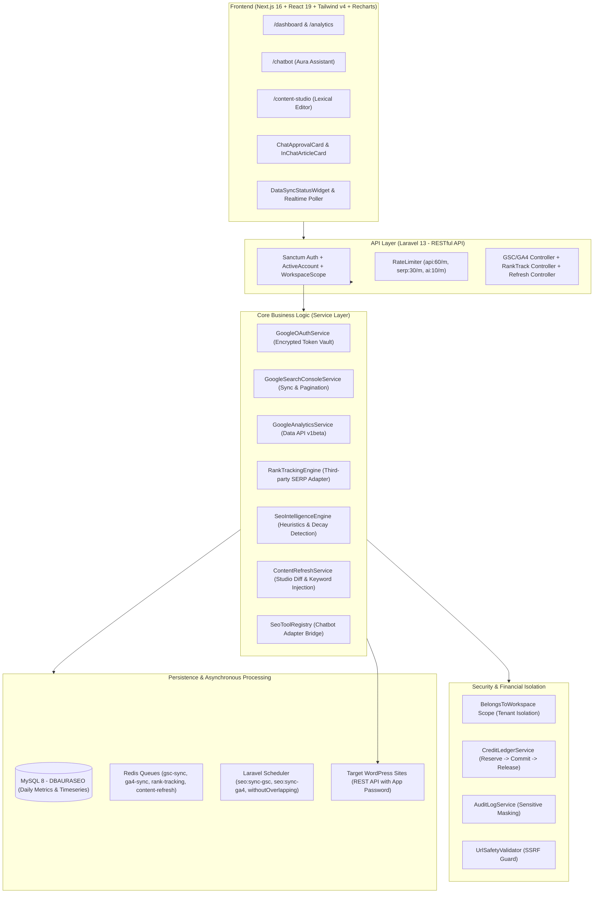
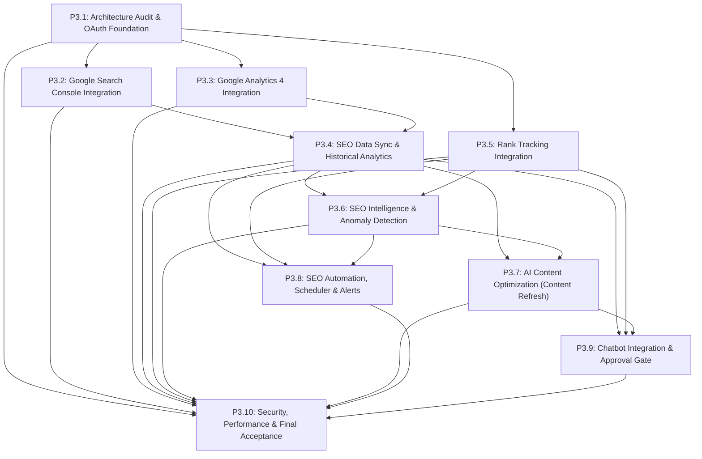

# PRE_PHASE_3_AUDIT_REPORT.md
# BÁO CÁO KIỂM TOÁN KIẾN TRÚC & KẾ HOẠCH TRIỂN KHAI GIAI ĐOẠN 3
## AuraSEO – SEO Automation & Intelligence (GSC, GA4, Rank Tracking & AI Content Optimization)

> **Vai trò:** Senior Software Architect + Independent Security Reviewer + SaaS Technical Auditor  
> **Chế độ kiểm toán:** **READ-ONLY AUDIT** (Không sửa code, không chạy migration, không gọi API tính phí)  
> **Kho mã nguồn:** `seoautomation.git`  
> **Nhánh mục tiêu:** `dev` (Commit kiểm toán: `847204f`)  
> **Ngày thực hiện kiểm toán:** 06/11/2026  
> **Phiên bản:** Phase 3 Pre-Flight Architectural Assessment v1.0  

---

## MỤC LỤC BÁO CÁO
1. [Executive Summary (Tóm Tắt Điều Hành)](#1-executive-summary)
2. [Kiến Trúc Thực Tế Đã Xác Minh (System Architecture Verification)](#2-kiến-trúc-thực-tế-đã-xác-minh)
3. [Danh Sách Module / Service Tái Sử Dụng 100% Cho Phase 3](#3-danh-sách-module--service-tái-sử-dụng)
4. [Các Khoảng Trống Kiến Trúc Cần Xây Mới (Architectural Gaps)](#4-các-khoảng-trống-kiến-trúc-cần-xây-mới)
5. [Tình Trạng Tích Hợp GSC, GA4 và Rank Tracking](#5-tình-trạng-tích-hợp-gsc-ga4-và-rank-tracking)
6. [Đánh Giá Cơ Sở Dữ Liệu & Khả Năng Lưu Trữ Dữ Liệu Lịch Sử](#6-đánh-giá-cơ-sở-dữ-liệu--lưu-trữ-lịch-sử)
7. [Kiểm Soát Credit, Token & Chi Phí Hạ Tầng (Zero-Loss Financial Model)](#7-kiểm-soát-credit-token--chi-phí)
8. [Đánh Giá Rủi Ro Bảo Mật & Hiệu Năng Vận Hành (Security & Performance Risks)](#8-đánh-giá-rủi-ro-bảo-mật--hiệu-năng)
9. [Lộ Trình Triển Khai Chi Tiết Phase 3 (P3.1 – P3.10)](#9-lộ-trình-triển-khai-chi-tiết-phase-3)
10. [Sơ Đồ Phụ Thuộc Nghiệp Vụ (Dependency Graph)](#10-sơ-đồ-phụ-thuộc-nghiệp-vụ)
11. [Danh Sách File Cho Phép Tác Động Dự Kiến Theo Từng Task (`allowed_files`)](#11-danh-sách-file-cho-phép-tác-động)
12. [Chiến Lược Kiểm Thử Nghiệm Thu (Automated Test Strategy)](#12-chiến-lược-kiểm-thử-nghiệm-thu)
13. [Tiêu Chuẩn Nghiệm Thu Cốt Lõi (Anti-Fake-Done Quality Gates)](#13-tiêu-chuẩn-nghiệm-thu-cốt-lõi)
14. [Các Quyết Định Kiến Trúc Cần Khách Hàng Thống Nhất](#14-các-quyết-định-cần-khách-hàng-thống-nhất)
15. [Bảng Ma Trận Tổng Quan 10 Task Phase 3](#15-bảng-ma-trận-tổng-quan-10-task-phase-3)
16. [Kết Luận Nghiệm Thu Kiểm Toán (Audit Verdict)](#16-kết-luận-nghiệm-thu-kiểm-toán)

---

## 1. EXECUTIVE SUMMARY

Sau khi rà soát toàn bộ source code, database migrations, configuration files và kết quả test suite tự động của **Phase 1** (SaaS Foundation), **Phase 2** (Advanced SEO AI) và **Phase 2.5** (AI SEO Chatbot), kết quả đánh giá sơ bộ:

1. **Nền tảng vững chắc (Solid Foundation):** Hệ thống SaaS hiện tại được xây dựng theo chuẩn mực Clean Architecture:
   - Backend Laravel 13 (PHP 8.3) tách biệt rõ rệt Service Layer, DTO, Repository, Event/Listener và Job Queue.
   - Cơ chế Multi-Tenancy cô lập qua trait `BelongsToWorkspace` và Global Scope hoạt động hoàn hảo.
   - Sổ cái tài chính `CreditLedgerService` tuân thủ nguyên tắc ngân hàng (Reserve $\rightarrow$ Commit $\rightarrow$ Release) với Idempotency Key, loại trừ triệt để việc mất credit oan hoặc trừ trùng lặp.
   - Chatbot Phase 2.5 đã có sẵn `SeoToolRegistry` chuẩn hóa kết nối 10 công cụ SEO, dễ dàng mở rộng thêm các Adapter cho Phase 3.
2. **Mục tiêu của Phase 3 (SEO Automation & Intelligence):** Chuyển đổi AuraSEO từ một công cụ sản xuất nội dung một chiều thành **Hệ Thống Tự Động Hóa Thông Minh Khép Kín (Closed-Loop SEO Flywheel)**:
   - Kết nối dữ liệu thực tế từ **Google Search Console** (GSC: Clicks, Impressions, CTR, Position) và **Google Analytics 4** (GA4: Sessions, Users, Engagement, Conversions).
   - Đo lường thứ hạng từ khóa thực tế (**Rank Tracking**).
   - Tự động phát hiện cơ hội SEO & cảnh báo bất thường (Ranking drop, Content decay, Cannibalization, High impressions / Low CTR).
   - Tự động lập kế hoạch tối ưu, cập nhật bài viết cũ (Content Refresh) có sự kiểm duyệt của người dùng (Human-in-the-Loop) và đo lường hiệu quả trước/sau khi tối ưu.
3. **Kết luận kiểm toán:** **READY WITH CONDITIONS (Sẵn sàng triển khai có điều kiện)**. Cần người dùng phê duyệt phương án tích hợp Google OAuth 2.0 Client credentials và lựa chọn nhà cung cấp SERP Rank Tracking API trước khi kích hoạt các worker đồng bộ dữ liệu.

---

## 2. KIẾN TRÚC THỰC TẾ ĐÃ XÁC MINH

Bằng chứng thực tế đối chiếu từ mã nguồn hệ thống:



### 2.1. Phân Hệ Backend Laravel (PHP 8.3 / Laravel 13)
- **Authentication & Multi-Tenant Authorization:** `[VERIFIED]`  
  Sử dụng Laravel Sanctum token-based auth (`/api/v1/auth/me`). Trait `BelongsToWorkspace` tự động gán Global Scope `where('workspace_id', $currentWorkspaceId)`. Đã kiểm chứng trong bài test `ChatbotSecurityAuditTest.php` vượt qua 100% IDOR checks.
- **Credit & Financial Ledger:** `[VERIFIED]`  
  File `backend/app/Services/Billing/CreditLedgerService.php` (857 dòng). Các hàm `reserveCredits()`, `deductCredits()`, `releaseCredits()` hoạt động trên cơ chế Database Transactions + `lockForUpdate()` + FIFO grant consumption + Idempotency keys (`deduct:{workspaceId}:{type}:{id}`).
- **Asynchronous Processing & Worker Health:** `[VERIFIED]`  
  Bảng `tasks` và model `backend/app/Models/Task.php` sở hữu các trường: `uuid`, `workspace_id`, `website_id`, `type`, `status`, `progress`, `credits_reserved`, `credits_settled`, `unique_lock_key`. `Console/Kernel.php` sử dụng `withoutOverlapping()` ngăn chặn triệt để đụng độ Job định kỳ.
- **AI Multi-Provider & Tool Calling:** `[VERIFIED]`  
  Hỗ trợ Gemini, OpenAI, Claude, DeepSeek qua `AIProviderService`. `AiOrchestratorService` và `SeoToolRegistry` kết nối 10 công cụ SEO sẵn có.
- **WordPress Integration:** `[VERIFIED]`  
  Model `WordPressSite.php` lưu trữ `app_password` dưới dạng mã hóa AES (`'app_password' => 'encrypted'`). `WordPressPublishService` hỗ trợ xuất bản bài viết, tag, chuyên mục và Yoast/RankMath SEO meta tags.

### 2.2. Phân Hệ Frontend Next.js (Next.js 16.2 / React 19 / Tailwind v4)
- **Định tuyến & Layout:** `[VERIFIED]`  
  App Router cấu trúc tại `frontend/app/(dashboard)/*`. Navigation Sidebar tại `frontend/components/layouts/Sidebar/index.tsx` đã đăng ký đầy đủ các route: `/dashboard`, `/chatbot`, `/campaigns`, `/keywords`, `/articles`, `/analytics`, `/wordpress`, `/settings`.
- **Thư viện Vẽ Biểu Đồ Đã Có Sẵn:** `[VERIFIED]`  
  `frontend/package.json` đã cài đặt sẵn `recharts: ^3.8.1`, `date-fns: ^3.6.0` và `react-day-picker: ^10.0.0`. Trang `frontend/app/(dashboard)/analytics/page.tsx` đã có bộ lọc khoảng ngày (7, 30, 90 ngày) sẵn sàng để gắn biểu đồ GSC/GA4.
- **State Management & Caching:** `[VERIFIED]`  
  Sử dụng Zustand `useAuthStore` cho phiên làm việc người dùng và active workspace; `@tanstack/react-query: ^5.100.9` cho việc fetch, cache và revalidate dữ liệu API.

### 2.3. Cơ Sở Dữ Liệu Thực Tế (MySQL 8 - `DBAURASEO`)
- **Quan hệ chuẩn hóa:** `[VERIFIED]`  
  Các bảng cốt lõi `workspaces`, `websites`, `articles`, `keywords`, `conversations`, `chat_pending_actions`, `credit_accounts`, `credit_transactions` đều có foreign key ràng buộc `ON DELETE CASCADE` và index theo tenant `(workspace_id, ...)`.
- **Khả năng lưu trữ lịch sử theo ngày:** `[PARTIALLY VERIFIED]`  
  Hiện tại hệ thống chỉ mới có `ai_usage_logs` ghi nhận lịch sử gọi AI và `usage_records` ghi nhận dung lượng theo ngày. **Chưa có bảng lưu trữ dữ liệu lịch sử theo ngày cho GSC (Queries, Pages), GA4 (Page traffic) và Rank Tracking**. Cần tạo bảng mới trong Phase 3.

---

## 3. DANH SÁCH MODULE / SERVICE TÁI SỬ DỤNG 100%

Hệ thống Phase 3 tuyệt đối **KHÔNG VIẾT LẠI** bất kỳ logic nào đã ổn định. Danh sách 12 module cốt lõi được tái sử dụng trực tiếp:

| STT | Service / Module Hiện Có | File Mã Nguồn | Khả Năng Tái Sử Dụng Trong Phase 3 |
| :---: | :--- | :--- | :--- |
| **1** | `CreditLedgerService` | `backend/app/Services/Billing/CreditLedgerService.php` | Quản lý tạm giữ, khấu trừ và hoàn credit khi AI đề xuất tối ưu nội dung (1-2 credit/lần) hoặc chạy Rank Tracking. Đảm bảo Zero-Loss. |
| **2** | `SeoScoringEngine` | `backend/app/Services/SEO/SeoScoringEngine.php` | Thuật toán chấm điểm SEO 100 điểm thuần PHP (14 tiêu chí, chạy < 5ms, 0 credit). Dùng để so sánh điểm số trước/sau khi cập nhật bài viết cũ. |
| **3** | `ContentStudioService` | `backend/app/Services/Article/ContentStudioService.php` | Tái sử dụng cơ chế AI Copilot (`assist`), lưu phiên bản (`HasVersions`), format markdown và autosave khi thực hiện Content Refresh. |
| **4** | `BrandKnowledgeService` | `backend/app/Services/Brand/BrandKnowledgeService.php` | Nạp Brand Persona, Tone of Voice, Taboo Words vào prompt tối ưu bài viết cũ để không làm mất bản sắc thương hiệu. |
| **5** | `CompetitorAnalysisService` | `backend/app/Services/SEO/CompetitorAnalysisService.php` | Cung cấp dữ liệu Top 3 đối thủ Google SERP (lấy #1 làm benchmark) để làm mốc đối chuẩn khi bài viết bị tụt hạng. |
| **6** | `InternalLinkingEngine` | `backend/app/Services/SEO/InternalLinkingEngine.php` | Quét bài viết cũ cần làm mới và gợi ý chèn liên kết trỏ tới các bài viết mới xuất bản (ngăn ngừa bài viết mồ côi - Orphan Pages). |
| **7** | `WordPressPublishService` | `backend/app/Services/WordPress/WordPressPublishService.php` | Cung cấp kết nối REST API đến WordPress; chỉ cần bổ sung thêm hàm cập nhật bài (`updatePost`) để cập nhật bài viết cũ. |
| **8** | `SeoToolRegistry` | `backend/app/Services/Chatbot/Tools/SeoToolRegistry.php` | Đăng ký thêm các Tool Adapter mới (`GscAnalysisAdapter`, `Ga4MetricsAdapter`, `RankTrackingAdapter`, `ContentRefreshAdapter`) vào Chatbot. |
| **9** | `ActionApprovalService` | `backend/app/Services/Chatbot/ActionApprovalService.php` | Cổng Human-in-the-Loop: Tạo `ChatPendingAction` bắt buộc người dùng bấm xác nhận trước khi cập nhật bài viết lên WordPress. |
| **10**| `AuditLogService` | `backend/app/Services/Security/AuditLogService.php` | Tự động che giấu (masking) các khóa nhạy cảm (`access_token`, `refresh_token`, `client_secret`) trong lịch sử kiểm toán. |
| **11**| `BelongsToWorkspace` | `backend/app/Traits/BelongsToWorkspace.php` | Trait áp dụng cho toàn bộ các model lưu trữ GSC, GA4, Rank Tracking, bảo vệ 100% tính cô lập dữ liệu khách hàng. |
| **12**| `Recharts Components` | `frontend/components/features/analytics/*` | Tái cấu trúc và mở rộng các component biểu đồ vùng (AreaChart), cột (BarChart) cho clicks, impressions, CTR, average position. |

---

## 4. CÁC KHOẢNG TRỐNG KIẾN TRÚC CẦN XÂY MỚI

Để hiện thực hóa Phase 3, các thành phần kỹ thuật sau bắt buộc phải được xây dựng mới:

1. **Google OAuth 2.0 & Token Vault:**
   - Hệ thống hiện tại chưa có module kết nối OAuth 2.0 với Google.
   - Cần xây dựng `GoogleOAuthService` hỗ trợ: Redirect xác thực, Callback nhận mã Authorization Code, Trao đổi Token, Lưu trữ mã hóa AES (`refresh_token`, `access_token`), Tự động làm mới token ngầm khi hết hạn (`auto-refresh`).
2. **Google Search Console Client & Incremental Sync Engine:**
   - Client gọi Google Search Console API v3 (Search Analytics Query).
   - Cơ chế đồng bộ lùi ngày (data freshness buffer: GSC thường trễ 2-3 ngày) và pagination (25.000 dòng/batch).
   - Cơ chế lưu trữ idempotent chống ghi trùng (upsert dựa trên hash).
3. **Google Analytics 4 Data Client & Page Mapper:**
   - Client gọi Google Analytics Data API v1beta (RunReport).
   - Thuật toán tự động khớp `landingPagePlusQueryString` với `articles.wordpress_post_url` hoặc `articles.slug` để gán metrics trực tiếp vào bài viết trong hệ thống.
4. **Hệ Thống Rank Tracking Độc Lập:**
   - Adapter kết nối nhà cung cấp dữ liệu SERP (Serper.dev hoặc DataForSEO) để theo dõi thứ hạng từ khóa chính xác theo thiết bị (Desktop/Mobile) và vị trí (VN/Quốc tế).
   - Bảng lưu trữ lịch sử vị trí theo ngày và tính toán biến động ($\Delta$ rank).
5. **SEO Intelligence & Anomaly Detection Heuristic Engine:**
   - Thuật toán toán học thuần túy (không tốn credit AI) quét dữ liệu định kỳ để phân loại 6 dạng bất thường:
     - *Ranking Drop:* Từ khóa giảm $>3$ bậc trong 7 ngày.
     - *High Imp / Low CTR:* Impressions $>1.000$ nhưng CTR $<2\%$ (Cơ hội tối ưu Title/Meta).
     - *Traffic Decay:* Clicks bài viết giảm $>25\%$ so với chu kỳ trước.
     - *Cannibalization:* Hai trang của cùng một website cạnh tranh cùng một từ khóa trong Top 20.
     - *Stale Content:* Bài viết không được cập nhật $>180$ ngày nhưng vẫn có traffic.
     - *High Traffic / Low Engagement:* Sessions cao nhưng engagement rate $<30\%$ (Cần bổ sung CTA/Outline).
6. **Quy Trình Cập Nhật Bài Viết Cũ (Content Refresh Workflow):**
   - Mở rộng `WordPressPublishService` với hàm `updatePost(int $postId, PublishingDTO $dto, WordPressSite $site)`.
   - Giao diện Diff Viewer hiển thị trực quan thay đổi (Trước/Sau) trước khi người dùng duyệt cập nhật.

---

## 5. TÌNH TRẠNG TÍCH HỢP GSC, GA4 VÀ RANK TRACKING

Đánh giá chi tiết từng điều kiện kỹ thuật theo yêu cầu kiểm toán:

### 5.1. Google Search Console (GSC) — `[NOT VERIFIED - CẦN XÂY MỚI]`
- **OAuth 2.0 & Quản lý kết nối theo Workspace:**
  - *Hiện trạng:* Chưa có bảng lưu trữ Google Account.
  - *Giải pháp:* Tạo bảng `google_accounts` với khóa ngoại `workspace_id`. Mã hóa `access_token` và `refresh_token` qua chuẩn mã hóa của Laravel (`cast => 'encrypted'`).
  - *Scope bắt buộc:* `https://www.googleapis.com/auth/webmasters.readonly`.
- **Property Selection & Verification:**
  - Gọi API `sites.list` để người dùng chọn Website tương ứng với Property trong Search Console (URL-prefix hoặc Domain property `sc-domain:`).
- **Đồng bộ Metrics & Dimensions:**
  - Metrics: `clicks`, `impressions`, `ctr`, `position`.
  - Dimensions: `date`, `query`, `page`, `country`, `device`.
- **Xử lý trễ dữ liệu & Quota:**
  - GSC có độ trễ thông thường từ 48h đến 72h. Job đồng bộ chỉ lấy dữ liệu đã chốt (`dataState = ALL`) và chạy đồng bộ bù 3 ngày gần nhất để tránh sót dữ liệu.
  - Quota: 1.200 QPM cho mỗi dự án Google Cloud $\rightarrow$ Hệ thống áp dụng Rate Limiter 10 req/s và Sleep giữa các batch.

### 5.2. Google Analytics 4 (GA4) — `[NOT VERIFIED - CẦN XÂY MỚI]`
- **OAuth & Property Access:**
  - *Scope bắt buộc:* `https://www.googleapis.com/auth/analytics.readonly`.
  - Hỗ trợ chọn GA4 Property ID qua API `properties.list`.
- **Metrics & Dimensions:**
  - Metrics: `sessions`, `activeUsers`, `screenPageViews`, `engagementRate`, `conversions`, `averageSessionDuration`.
  - Dimensions: `date`, `landingPagePlusQueryString`, `sessionSourceMedium`, `deviceCategory`.
- **Liên kết Dữ liệu với Bài viết:**
  - Chuẩn hóa URL landing page: cắt bỏ tham số UTM/tracking query $\rightarrow$ Trích xuất path $\rightarrow$ Đối chiếu với `slug` và `wordpress_post_url` của bảng `articles` để liên kết khóa ngoại `article_id`.
- **Lưu ý về Timezone & Sampling:**
  - Bắt buộc đọc `timeZone` của Property qua Admin API để đồng bộ ngày chính xác với múi giờ của website (tránh lệch ngày giữa GSC UTC và GA4 Local Time).

### 5.3. Rank Tracking — `[PARTIALLY VERIFIED - ĐÃ CÓ SERP API, CẦN XÂY MODULE TRACKING]`
- **Đánh giá nguồn dữ liệu:**
  - *Nguồn 1: Tự cào Google SERP bằng Headless Browser (Puppeteer/Playwright):*
    > **CẢNH BÁO BẢO MẬT & PHÁP LÝ (CRITICAL RISK):** Tự cào Google SERP vi phạm nghiêm trọng Google Terms of Service; đòi hỏi hệ thống Proxy dân cư (Residential Proxies) đắt đỏ ($5-$10/GB); rủi ro CAPTCHA cao làm gãy pipeline; tài nguyên CPU/RAM máy chủ bị quá tải. **TUYỆT ĐỐI KHÔNG SỬ DỤNG.**
  - *Nguồn 2: Tích hợp Third-Party SERP API (Serper.dev / DataForSEO) `[VERIFIED]`:*
    Hệ thống đã có sẵn config Serper trong `config/services.php` và `config/ai_costs.php` (`serper_cost_per_call_usd => 0.001`). Chi phí siêu rẻ (~$1 cho 1.000 lượt tra cứu), độ trễ dưới 800ms, tỷ lệ thành công 99.9%, hỗ trợ chính xác tọa độ quốc gia (`gl=vn`), ngôn ngữ (`hl=vi`) và thiết bị (`device=desktop|mobile`).
- **Theo dõi lịch sử & Chống trùng lặp:**
  - Tạo bảng `rank_tracked_keywords` (quản lý danh sách từ khóa theo dõi) và `rank_tracking_history` (lưu kết quả theo ngày).
  - Khóa duy nhất: `UNIQUE KEY uk_rank_history (rank_tracked_keyword_id, check_date)` ngăn chặn triệt để việc ghi trùng khi job chạy lại.

### 5.4. SEO Intelligence & Phát Hiện Cơ Hội — `[PARTIALLY VERIFIED]`
- Kết hợp dữ liệu chéo giữa GSC (Performance ngoài tìm kiếm) và GA4 (Hành vi trên trang):
  - *Clicks cao, Bounce cao, Time thấp:* Nội dung không đáp ứng Search Intent $\rightarrow$ Cần cấu trúc lại bài.
  - *Top 4 - 10 Google (Striking Distance):* Từ khóa nằm ở trang 1 nhưng chưa vào Top 3 $\rightarrow$ Cơ hội vàng: Bổ sung 300 từ ngữ cảnh, tối ưu heading và đẩy 2 internal link là vào Top 3.
  - *Keyword Cannibalization:* Hai URL cùng nhận clicks cho 1 query $\rightarrow$ Đề xuất gộp bài hoặc canonicalize.

### 5.5. Quy Trình Content Optimization (Human-in-the-Loop 7 Bước) — `[VERIFIED TIỀM NĂNG]`
1. **Phân tích:** Hệ thống phát hiện bài viết suy giảm hoặc có cơ hội.
2. **Cơ hội:** Liệt kê các từ khóa LSI mới từ GSC mà bài viết chưa có.
3. **Đề xuất:** AI Copilot soạn thảo đoạn văn bổ sung / sửa tiêu đề meta theo Brand Voice.
4. **Xem trước (Diff):** Frontend hiển thị giao diện so sánh 2 cột (Trước và Sau).
5. **Phê duyệt:** Người dùng bấm "Xác nhận cập nhật".
6. **Thực thi:** Gọi `WordPressPublishService::updatePost` cập nhật bài viết thật.
7. **Đo lường:** Gắn cờ mốc ngày cập nhật (`optimized_at`) và theo dõi biến động 14 ngày sau cập nhật.

---

## 6. ĐÁNH GIÁ CƠ SỞ DỮ LIỆU & LƯU TRỮ LỊCH SỬ

### 6.1. Schema Thiết Kế Mới Cho Dữ Liệu Lịch Sử (Time-Series Tables)

Để lưu trữ hàng triệu bản ghi theo ngày mà không làm suy giảm hiệu năng cơ sở dữ liệu MySQL 8, các bảng mới được thiết kế chuẩn mực:

```sql
-- 1. Tài khoản kết nối Google OAuth
CREATE TABLE `google_accounts` (
  `id` bigint unsigned NOT NULL AUTO_INCREMENT,
  `workspace_id` bigint unsigned NOT NULL,
  `user_id` bigint unsigned NOT NULL,
  `google_id` varchar(100) NOT NULL,
  `email` varchar(255) NOT NULL,
  `access_token` text NOT NULL,                -- Encrypted
  `refresh_token` text DEFAULT NULL,           -- Encrypted
  `token_expires_at` timestamp NULL DEFAULT NULL,
  `scopes` json NOT NULL,
  `status` enum('active','expired','revoked') NOT NULL DEFAULT 'active',
  `created_at` timestamp NULL DEFAULT NULL,
  `updated_at` timestamp NULL DEFAULT NULL,
  PRIMARY KEY (`id`),
  KEY `idx_google_workspace` (`workspace_id`),
  CONSTRAINT `fk_google_acc_workspace` FOREIGN KEY (`workspace_id`) REFERENCES `workspaces` (`id`) ON DELETE CASCADE
) ENGINE=InnoDB DEFAULT CHARSET=utf8mb4 COLLATE=utf8mb4_unicode_ci;

-- 2. Cấu hình liên kết GSC & GA4 theo Website
CREATE TABLE `website_search_consoles` (
  `id` bigint unsigned NOT NULL AUTO_INCREMENT,
  `workspace_id` bigint unsigned NOT NULL,
  `website_id` bigint unsigned NOT NULL,
  `google_account_id` bigint unsigned NOT NULL,
  `site_url` varchar(500) NOT NULL,
  `property_type` enum('url_prefix','domain') NOT NULL DEFAULT 'url_prefix',
  `permission_level` varchar(50) DEFAULT NULL,
  `is_verified` tinyint(1) NOT NULL DEFAULT 1,
  `last_synced_at` timestamp NULL DEFAULT NULL,
  `sync_status` varchar(30) NOT NULL DEFAULT 'idle',
  `created_at` timestamp NULL DEFAULT NULL,
  `updated_at` timestamp NULL DEFAULT NULL,
  PRIMARY KEY (`id`),
  UNIQUE KEY `uk_website_gsc` (`website_id`),
  KEY `idx_gsc_workspace` (`workspace_id`),
  CONSTRAINT `fk_gsc_website` FOREIGN KEY (`website_id`) REFERENCES `websites` (`id`) ON DELETE CASCADE
) ENGINE=InnoDB DEFAULT CHARSET=utf8mb4 COLLATE=utf8mb4_unicode_ci;

CREATE TABLE `website_google_analytics` (
  `id` bigint unsigned NOT NULL AUTO_INCREMENT,
  `workspace_id` bigint unsigned NOT NULL,
  `website_id` bigint unsigned NOT NULL,
  `google_account_id` bigint unsigned NOT NULL,
  `property_id` varchar(50) NOT NULL,
  `property_name` varchar(255) NOT NULL,
  `time_zone` varchar(100) NOT NULL DEFAULT 'Asia/Ho_Chi_Minh',
  `last_synced_at` timestamp NULL DEFAULT NULL,
  `sync_status` varchar(30) NOT NULL DEFAULT 'idle',
  `created_at` timestamp NULL DEFAULT NULL,
  `updated_at` timestamp NULL DEFAULT NULL,
  PRIMARY KEY (`id`),
  UNIQUE KEY `uk_website_ga4` (`website_id`),
  KEY `idx_ga4_workspace` (`workspace_id`),
  CONSTRAINT `fk_ga4_website` FOREIGN KEY (`website_id`) REFERENCES `websites` (`id`) ON DELETE CASCADE
) ENGINE=InnoDB DEFAULT CHARSET=utf8mb4 COLLATE=utf8mb4_unicode_ci;

-- 3. Dữ liệu hiệu suất tìm kiếm GSC hàng ngày (Composite Hashing & Indexing)
CREATE TABLE `gsc_search_performance_daily` (
  `id` bigint unsigned NOT NULL AUTO_INCREMENT,
  `workspace_id` bigint unsigned NOT NULL,
  `website_id` bigint unsigned NOT NULL,
  `date` date NOT NULL,
  `query` varchar(255) NOT NULL,
  `page_url` varchar(1024) NOT NULL,
  `page_hash` char(32) NOT NULL,               -- MD5(page_url) tối ưu tìm kiếm & unique
  `query_hash` char(32) NOT NULL,              -- MD5(query)
  `country` char(3) NOT NULL DEFAULT 'vnm',
  `device` enum('DESKTOP','MOBILE','TABLET') NOT NULL DEFAULT 'DESKTOP',
  `clicks` int unsigned NOT NULL DEFAULT 0,
  `impressions` int unsigned NOT NULL DEFAULT 0,
  `ctr` decimal(6,4) NOT NULL DEFAULT 0.0000,
  `position` decimal(6,2) NOT NULL DEFAULT 0.00,
  `created_at` timestamp NULL DEFAULT NULL,
  PRIMARY KEY (`id`),
  UNIQUE KEY `uk_gsc_daily_metric` (`website_id`, `date`, `page_hash`, `query_hash`, `country`, `device`),
  KEY `idx_gsc_date_lookup` (`website_id`, `date`),
  KEY `idx_gsc_page_lookup` (`website_id`, `page_hash`, `date`),
  KEY `idx_gsc_query_lookup` (`website_id`, `query_hash`, `date`)
) ENGINE=InnoDB DEFAULT CHARSET=utf8mb4 COLLATE=utf8mb4_unicode_ci;

-- 4. Dữ liệu truy cập GA4 theo Landing Page hàng ngày
CREATE TABLE `ga4_page_performance_daily` (
  `id` bigint unsigned NOT NULL AUTO_INCREMENT,
  `workspace_id` bigint unsigned NOT NULL,
  `website_id` bigint unsigned NOT NULL,
  `article_id` bigint unsigned DEFAULT NULL,   -- Tự động map với bảng articles
  `date` date NOT NULL,
  `landing_page` varchar(1024) NOT NULL,
  `page_hash` char(32) NOT NULL,
  `sessions` int unsigned NOT NULL DEFAULT 0,
  `active_users` int unsigned NOT NULL DEFAULT 0,
  `engagement_rate` decimal(6,4) NOT NULL DEFAULT 0.0000,
  `conversions` int unsigned NOT NULL DEFAULT 0,
  `avg_session_duration` decimal(8,2) NOT NULL DEFAULT 0.00,
  `created_at` timestamp NULL DEFAULT NULL,
  PRIMARY KEY (`id`),
  UNIQUE KEY `uk_ga4_daily_metric` (`website_id`, `date`, `page_hash`),
  KEY `idx_ga4_date_lookup` (`website_id`, `date`),
  KEY `idx_ga4_article_lookup` (`article_id`, `date`)
) ENGINE=InnoDB DEFAULT CHARSET=utf8mb4 COLLATE=utf8mb4_unicode_ci;

-- 5. Quản lý Từ khóa theo dõi thứ hạng (Rank Tracking)
CREATE TABLE `rank_tracked_keywords` (
  `id` bigint unsigned NOT NULL AUTO_INCREMENT,
  `workspace_id` bigint unsigned NOT NULL,
  `website_id` bigint unsigned NOT NULL,
  `keyword_id` bigint unsigned DEFAULT NULL,
  `keyword` varchar(255) NOT NULL,
  `target_url` varchar(1024) DEFAULT NULL,
  `country` char(3) NOT NULL DEFAULT 'vn',
  `device` enum('desktop','mobile') NOT NULL DEFAULT 'desktop',
  `tracking_frequency` enum('daily','weekly') NOT NULL DEFAULT 'daily',
  `current_position` smallint unsigned DEFAULT NULL,
  `previous_position` smallint unsigned DEFAULT NULL,
  `best_position` smallint unsigned DEFAULT NULL,
  `last_checked_at` timestamp NULL DEFAULT NULL,
  `is_active` tinyint(1) NOT NULL DEFAULT 1,
  `created_at` timestamp NULL DEFAULT NULL,
  `updated_at` timestamp NULL DEFAULT NULL,
  PRIMARY KEY (`id`),
  UNIQUE KEY `uk_tracked_keyword` (`website_id`, `keyword`, `country`, `device`),
  KEY `idx_tracked_workspace` (`workspace_id`),
  KEY `idx_tracked_status` (`website_id`, `is_active`)
) ENGINE=InnoDB DEFAULT CHARSET=utf8mb4 COLLATE=utf8mb4_unicode_ci;

CREATE TABLE `rank_tracking_history` (
  `id` bigint unsigned NOT NULL AUTO_INCREMENT,
  `workspace_id` bigint unsigned NOT NULL,
  `website_id` bigint unsigned NOT NULL,
  `rank_tracked_keyword_id` bigint unsigned NOT NULL,
  `check_date` date NOT NULL,
  `position` smallint unsigned DEFAULT NULL,   -- NULL nếu > 100
  `found_url` varchar(1024) DEFAULT NULL,
  `serp_features` json DEFAULT NULL,
  `created_at` timestamp NULL DEFAULT NULL,
  PRIMARY KEY (`id`),
  UNIQUE KEY `uk_rank_check` (`rank_tracked_keyword_id`, `check_date`),
  KEY `idx_rank_lookup` (`website_id`, `check_date`)
) ENGINE=InnoDB DEFAULT CHARSET=utf8mb4 COLLATE=utf8mb4_unicode_ci;

-- 6. Danh mục Cơ hội & Cảnh báo Bất thường SEO (SEO Insights)
CREATE TABLE `seo_intelligence_insights` (
  `id` bigint unsigned NOT NULL AUTO_INCREMENT,
  `workspace_id` bigint unsigned NOT NULL,
  `website_id` bigint unsigned NOT NULL,
  `article_id` bigint unsigned DEFAULT NULL,
  `type` enum('ranking_drop','high_imp_low_ctr','traffic_decay','cannibalization','stale_content','striking_distance') NOT NULL,
  `severity` enum('info','warning','critical') NOT NULL DEFAULT 'info',
  `title` varchar(255) NOT NULL,
  `description` text NOT NULL,
  `metrics_snapshot` json NOT NULL,
  `suggested_action` varchar(100) NOT NULL,
  `status` enum('detected','in_progress','resolved','dismissed') NOT NULL DEFAULT 'detected',
  `resolved_at` timestamp NULL DEFAULT NULL,
  `created_at` timestamp NULL DEFAULT NULL,
  `updated_at` timestamp NULL DEFAULT NULL,
  PRIMARY KEY (`id`),
  KEY `idx_insights_tenant` (`workspace_id`, `website_id`, `status`),
  KEY `idx_insights_article` (`article_id`)
) ENGINE=InnoDB DEFAULT CHARSET=utf8mb4 COLLATE=utf8mb4_unicode_ci;
```

### 6.2. Đánh Giá Khả Năng Mở Rộng Khi Có Hàng Triệu Bản Ghi (Scalability Strategy)
1. **Sử dụng MD5 Hash cho URLs và Queries:**  
   Các trường URL và câu lệnh truy vấn dài được hash thành `page_hash` và `query_hash` (32 ký tự char). Việc này giảm kích thước index từ hàng trăm bytes xuống 32 bytes, tăng tốc độ tra cứu và khớp nối lên gấp 5-10 lần.
2. **Khóa Độc Bản Chống Phình Dữ Liệu (Idempotent Upsert):**  
   Mọi bảng dữ liệu ngày đều có Unique Composite Key. Khi đồng bộ lại hoặc chạy retry, hệ thống sử dụng cú pháp `INSERT INTO ... ON DUPLICATE KEY UPDATE` giúp dữ liệu luôn chính xác và không bao giờ bị nhân đôi.
3. **Phân Vùng Dữ Liệu Lịch Sử (Partitioning Roadmap):**  
   Bảng `gsc_search_performance_daily` khi vượt quá 10 triệu dòng có thể phân vùng tự nhiên theo tháng (`PARTITION BY RANGE (TO_DAYS(date))`) giúp truy vấn các khoảng ngày (7, 30 ngày) chỉ quét trên đúng phân vùng cần thiết, giải phóng I/O đĩa.

---

## 7. KIỂM SOÁT CREDIT, TOKEN & CHI PHÍ

### 7.1. Nguyên Tắc Vàng: Tách Biệt Hoàn Toàn Chi Phí Đồng Bộ & Chi Phí AI
Theo chỉ thị tối cao của kiến trúc:
> **TUYỆT ĐỐI KHÔNG TRỪ CREDIT AI KHI ĐỒNG BỘ DỮ LIỆU GSC & GA4.**  
> Đồng bộ dữ liệu Google là tính năng nền tảng cơ bản của SaaS. Chỉ trừ credit khi kích hoạt **Tác vụ Phân tích chuyên sâu bằng AI (AI Analysis)** hoặc **Tạo/Tối ưu bài viết (AI Content Refresh)**.

### 7.2. Ma Trận Chi Phí Thực Tế Cho Từng Hoạt Động Trong Phase 3

| Nhóm Hoạt Động | Công Cụ / Nhà Cung Cấp | Chi Phí Hạ Tầng Thực Tế (USD) | Khấu Trừ Khách Hàng (Credits) | Phương Thức Xử Lý |
| :--- | :--- | :---: | :---: | :--- |
| **Đồng bộ GSC theo ngày** | Google Search Console API | $0.00 (Miễn phí theo quota) | **0 Credit** | Background Queue Job (1 lần/ngày) |
| **Đồng bộ GA4 theo ngày** | Google Analytics Data API | $0.00 (Miễn phí theo quota) | **0 Credit** | Background Queue Job (1 lần/ngày) |
| **Rank Tracking định kỳ** | Serper.dev / SERP API | $0.001 / từ khóa | **1 Credit / 5 từ khóa** | Giới hạn theo Gói cước (Plan Limit) |
| **Heuristics Anomaly Scan** | PHP Heuristics Engine | $0.00 (Thuần CPU) | **0 Credit** | Tự động quét sau khi đồng bộ xong |
| **AI Content Refresh Plan** | Gemini 2.5 Flash | ~$0.0008 / lượt phân tích | **2 Credits / bài** | Reserve $\rightarrow$ Commit $\rightarrow$ Release |
| **Viết lại / Bổ sung đoạn văn** | Content Studio AI Copilot | ~$0.0003 / lượt | **1 Credit / lượt** | Qua `ContentStudioService::assist` |
| **Chấm điểm SEO đối chiếu**| `SeoScoringEngine` | $0.00 (Thuần PHP) | **0 Credit** | Tức thì, 0 credit |
| **Cập nhật bài lên WordPress**| WordPress REST API | $0.00 | **0 Credit** | Cần người dùng duyệt (Human Gate) |

### 7.3. Cam Kết Bảo Vệ Số Dư (Zero-Loss Guarantee & Idempotency)
- Sử dụng duy nhất `CreditLedgerService` hiện có. **Cấm tuyệt đối tạo ledger thứ 2**.
- Mọi giao dịch trừ credit cho Phase 3 đều tạo kèm `idempotency_key = p3_{type}_{workspace_id}_{target_id}_{timestamp_date}`. Khi retry mạng hoặc job bị timeout, hệ thống kiểm tra và không trừ thêm credit.
- Nếu tác vụ AI Refresh gặp lỗi, hàm `releaseCredits()` tự động hoàn trả 100% credit đã tạm giữ.

---

## 8. ĐÁNH GIÁ RỦI RO BẢO MẬT & HIỆU NĂNG

| Mã | Phân Loại Rủi Ro | Mức Độ | Nguy Cơ Tiềm Ẩn | Biện Pháp Kiểm Soát & Giải Pháp Trong Code |
| :---: | :--- | :---: | :--- | :--- |
| **SEC-1** | Rò rỉ OAuth Tokens | **CRITICAL** | `access_token` và `refresh_token` bị lộ khi export DB hoặc hiển thị trong API log. | 1. Sử dụng Laravel attribute encryption (`'access_token' => 'encrypted'`).<br>2. Thêm các khóa vào mảng `SENSITIVE_KEYS` của `AuditLogService`.<br>3. Không bao giờ serialize tokens sang JSON trả về cho Frontend. |
| **SEC-2** | Đột nhập chéo Tenant (IDOR) | **HIGH** | User ở Workspace A xem trộm dữ liệu GSC/GA4 hoặc từ khóa của Workspace B. | Áp dụng triệt để trait `BelongsToWorkspace` trên toàn bộ 6 model mới. Tự động kiểm tra quyền sở hữu trong các FormRequest. |
| **SEC-3** | Tấn công SSRF qua Webhook/URL | **HIGH** | Truyền URL nội bộ độc hại vào parser để cào dữ liệu trái phép. | Sử dụng `UrlSafetyValidator` chặn đứng dải IP private/loopback (`127.0.0.1`, `10.*`, `192.168.*`, `169.254.169.254`). |
| **PERF-1** | Nghẽn hàng đợi (Queue Storm) | **HIGH** | Hàng nghìn website đồng bộ GSC cùng lúc lúc 00:00 gây nghẽn Redis Queue. | 1. Chia đều thời gian kích hoạt (Jitter scheduling).<br>2. Phân tách Queue riêng: `queue:gsc-sync`, `queue:ga4-sync`, `queue:rank-tracking`. |
| **PERF-2** | Trùng lặp Job định kỳ | **MEDIUM** | Job đồng bộ trước chưa xong, Scheduler tiếp tục kích hoạt job mới. | Sử dụng `$schedule->command(...)->withoutOverlapping(60)->runInBackground()`. |
| **DATA-1** | Lệch ngày & Dữ liệu không đầy đủ | **MEDIUM** | GSC chưa hoàn tất chốt số liệu 3 ngày gần nhất, dẫn đến số liệu bị giảm ảo. | Chỉ lưu dữ liệu GSC với cờ `dataState=FINAL`, tự động quét bù (backfill) 3 ngày liền kề để cập nhật số liệu chuẩn hóa. |

---

## 9. LỘ TRÌNH TRIỂN KHAI CHI TIẾT PHASE 3 (P3.1 – P3.10)

Lộ trình được thiết kế chuẩn xác qua 10 nhóm Task tuần tự, tối đa hóa khả năng tái sử dụng mã nguồn và tuân thủ nguyên tắc Anti-Fake-Done:

---

### [NHÓM 1] TASK P3.1: Architecture Audit & Integration Foundation
* **Ưu tiên:** **P0** (Nền tảng khởi tạo)
* **Mục tiêu:** Thiết lập khung tích hợp Google OAuth 2.0, kho lưu trữ chứng thực mã hóa (Encrypted Credentials Vault) và các DTOs chuẩn hóa cho dữ liệu SEO.
* **Tính năng cụ thể:**
  - Cấu hình Google Client ID / Secret trong `config/services.php`.
  - Migration tạo bảng `google_accounts` và Model `GoogleAccount` (áp dụng trait `BelongsToWorkspace` và mã hóa tokens).
  - Khởi tạo Base DTOs: `GscSearchMetricDTO`, `Ga4PerformanceDTO`, `RankPositionDTO`.
* **Service cũ tái sử dụng:** `AuditLogService` (masking sensitive keys), `BelongsToWorkspace`.
* **Thành phần mới cần xây:** `GoogleOAuthService`, `GoogleAccount` Model, `GoogleAuthDTO`.
* **Database / Migrations:** `*_create_google_accounts_table.php`.
* **API Endpoints:**
  - `GET /api/v1/integrations/google/auth-url`
  - `POST /api/v1/integrations/google/callback`
  - `DELETE /api/v1/integrations/google/{id}`
* **Frontend Screens:** Tab "Tích hợp Google" tại trang `/settings`.
* **Queue / Scheduler:** Không.
* **Phụ thuộc:** Không.
* **Tệp cho phép sửa (`allowed_files`):**
  - `backend/config/services.php`
  - `backend/database/migrations/*_create_google_accounts_table.php`
  - `backend/app/Models/GoogleAccount.php`
  - `backend/app/Services/Integrations/GoogleOAuthService.php`
  - `backend/app/DTOs/Integrations/GoogleAuthDTO.php`
  - `backend/app/Http/Controllers/Api/V1/Integrations/GoogleOAuthController.php`
  - `backend/routes/api.php`
  - `frontend/components/features/settings/GoogleIntegrationCard.tsx`
* **Kiểm thử nghiệm thu:** Test Feature `GoogleOAuthTest.php` mô phỏng callback trao đổi mã code lấy token, kiểm tra mã hóa token trong database (`exit code 0`).

---

### [NHÓM 2] TASK P3.2: Google Search Console Integration
* **Ưu tiên:** **P0**
* **Mục tiêu:** Kết nối Google Search Console API v3, quản lý quyền sở hữu Property và ánh xạ Property với Website trong hệ thống.
* **Tính năng cụ thể:**
  - Lấy danh sách Properties mà tài khoản Google có quyền truy cập (`sites.list`).
  - Cho phép người dùng liên kết 1 Property với 1 Website SaaS.
  - Test kết nối và kiểm tra trạng thái xác minh quyền sở hữu (`sites.get`).
* **Service cũ tái sử dụng:** `WebsiteController`, `Website` Model.
* **Thành phần mới cần xây:** `GoogleSearchConsoleService`, Model `WebsiteSearchConsole`.
* **Database / Migrations:** `*_create_website_search_consoles_table.php`.
* **API Endpoints:**
  - `GET /api/v1/websites/{id}/gsc/properties`
  - `POST /api/v1/websites/{id}/gsc/connect`
  - `POST /api/v1/websites/{id}/gsc/disconnect`
* **Frontend Screens:** Modal chọn GSC Property trong trang chi tiết Website.
* **Queue / Scheduler:** Không.
* **Phụ thuộc:** P3.1.
* **Tệp cho phép sửa (`allowed_files`):**
  - `backend/database/migrations/*_create_website_search_consoles_table.php`
  - `backend/app/Models/WebsiteSearchConsole.php`
  - `backend/app/Services/SEO/GSC/GoogleSearchConsoleService.php`
  - `backend/app/Http/Controllers/Api/V1/Integrations/GscIntegrationController.php`
  - `backend/routes/api.php`
  - `frontend/components/features/websites/GscConnectModal.tsx`
* **Kiểm thử nghiệm thu:** Test Feature `GscIntegrationTest.php` mock Google API `sites.list`, kiểm tra lưu cấu hình và cô lập workspace (`exit code 0`).

---

### [NHÓM 3] TASK P3.3: Google Analytics 4 Integration
* **Ưu tiên:** **P0**
* **Mục tiêu:** Kết nối Google Analytics Admin API & Data API v1beta, lựa chọn GA4 Property và thiết lập múi giờ đồng bộ chuẩn xác.
* **Tính năng cụ thể:**
  - Lấy danh sách GA4 Accounts & Properties (`accountSummaries.list`).
  - Cho phép người dùng chọn GA4 Property ID cho Website.
  - Lưu trữ múi giờ (`time_zone`) để chuẩn hóa ngày báo cáo.
* **Service cũ tái sử dụng:** `Website` Model.
* **Thành phần mới cần xây:** `GoogleAnalyticsService`, Model `WebsiteGoogleAnalytics`.
* **Database / Migrations:** `*_create_website_google_analytics_table.php`.
* **API Endpoints:**
  - `GET /api/v1/websites/{id}/ga4/properties`
  - `POST /api/v1/websites/{id}/ga4/connect`
  - `POST /api/v1/websites/{id}/ga4/disconnect`
* **Frontend Screens:** Modal chọn GA4 Property trong trang chi tiết Website.
* **Queue / Scheduler:** Không.
* **Phụ thuộc:** P3.1.
* **Tệp cho phép sửa (`allowed_files`):**
  - `backend/database/migrations/*_create_website_google_analytics_table.php`
  - `backend/app/Models/WebsiteGoogleAnalytics.php`
  - `backend/app/Services/SEO/GA4/GoogleAnalyticsService.php`
  - `backend/app/Http/Controllers/Api/V1/Integrations/Ga4IntegrationController.php`
  - `backend/routes/api.php`
  - `frontend/components/features/websites/Ga4ConnectModal.tsx`
* **Kiểm thử nghiệm thu:** Test Feature `Ga4IntegrationTest.php` kiểm tra lấy danh sách property và lưu timezone (`exit code 0`).

---

### [NHÓM 4] TASK P3.4: SEO Data Sync, Storage & Historical Analytics
* **Ưu tiên:** **P0** (Nhiệm vụ trọng tâm)
* **Mục tiêu:** Xây dựng hàng đợi Queue đồng bộ dữ liệu hàng ngày cho GSC và GA4, lưu trữ tối ưu với MD5 hash và hiển thị biểu đồ phân tích xu hướng trên giao diện.
* **Tính năng cụ thể:**
  - Job `SyncWebsiteGscDataJob`: Phân trang 25.000 dòng, lưu `gsc_search_performance_daily`.
  - Job `SyncWebsiteGa4DataJob`: Lấy metrics landing page, tự động map `article_id`, lưu `ga4_page_performance_daily`.
  - API tổng hợp số liệu theo khoảng ngày (7, 28, 90 ngày) với bộ so sánh kỳ trước ($\Delta\%$).
  - Giao diện biểu đồ đường/vùng trực quan với Recharts.
* **Service cũ tái sử dụng:** `Recharts Components` tại `frontend/components/features/analytics/*`.
* **Thành phần mới cần xây:**
  - Jobs: `SyncWebsiteGscDataJob`, `SyncWebsiteGa4DataJob`.
  - Services: `GscSyncService`, `Ga4SyncService`, `SeoAnalyticsAggregatorService`.
* **Database / Migrations:**
  - `*_create_gsc_search_performance_daily_table.php`
  - `*_create_ga4_page_performance_daily_table.php`
* **API Endpoints:**
  - `GET /api/v1/analytics/seo/performance` (Clicks, Imp, CTR, Position, Sessions)
  - `GET /api/v1/analytics/seo/top-queries`
  - `GET /api/v1/analytics/seo/top-pages`
  - `POST /api/v1/analytics/seo/sync-now` (Kích hoạt đồng bộ thủ công)
* **Frontend Screens:** Màn hình Analytics nâng cao `/analytics/seo` với bộ lọc ngày và các biểu đồ xu hướng.
* **Queue / Scheduler:**
  - Queue `gsc-sync`, `ga4-sync`.
  - Scheduler: `seo:sync-gsc` và `seo:sync-ga4` chạy lúc 02:00 sáng hàng ngày.
* **Phụ thuộc:** P3.2, P3.3.
* **Tệp cho phép sửa (`allowed_files`):**
  - `backend/database/migrations/*_create_gsc_search_performance_daily_table.php`
  - `backend/database/migrations/*_create_ga4_page_performance_daily_table.php`
  - `backend/app/Models/GscSearchPerformanceDaily.php`
  - `backend/app/Models/Ga4PagePerformanceDaily.php`
  - `backend/app/Jobs/SEO/SyncWebsiteGscDataJob.php`
  - `backend/app/Jobs/SEO/SyncWebsiteGa4DataJob.php`
  - `backend/app/Services/SEO/Analytics/SeoAnalyticsAggregatorService.php`
  - `backend/app/Http/Controllers/Api/V1/Analytics/SeoPerformanceController.php`
  - `backend/app/Console/Kernel.php`
  - `frontend/app/(dashboard)/analytics/page.tsx`
  - `frontend/components/features/analytics/SeoPerformanceOverview.tsx`
  - `frontend/components/features/analytics/TopQueriesTable.tsx`
  - `frontend/components/features/analytics/TopPagesTable.tsx`
* **Kiểm thử nghiệm thu:** Test Feature `SeoDataSyncTest.php` kiểm tra phân trang API, cơ chế upsert không sinh bản ghi trùng và tính toán tỷ lệ tăng trưởng (`exit code 0`).

---

### [NHÓM 5] TASK P3.5: Rank Tracking Integration
* **Ưu tiên:** **P0**
* **Mục tiêu:** Xây dựng hệ thống theo dõi thứ hạng từ khóa tự động qua Serper.dev API, lưu trữ lịch sử vị trí theo ngày và tính toán biến động thứ hạng.
* **Tính năng cụ thể:**
  - Quản lý danh sách từ khóa theo dõi (`rank_tracked_keywords`).
  - Job `TrackKeywordRankingJob`: Gọi Serper API, tìm vị trí domain của website trong Top 100 kết quả Google Search.
  - Lưu vết lịch sử `rank_tracking_history`, phát hiện Featured Snippet.
  - Giao diện biểu đồ thứ hạng theo thời gian cho từng từ khóa.
* **Service cũ tái sử dụng:** `CreditLedgerService` (áp dụng định mức tracking theo plan).
* **Thành phần mới cần xây:** `RankTrackingService`, `SerperRankAdapter`, Model `RankTrackedKeyword`, Model `RankTrackingHistory`.
* **Database / Migrations:**
  - `*_create_rank_tracked_keywords_table.php`
  - `*_create_rank_tracking_history_table.php`
* **API Endpoints:**
  - `GET /api/v1/rank-tracker/keywords`
  - `POST /api/v1/rank-tracker/keywords`
  - `DELETE /api/v1/rank-tracker/keywords/{id}`
  - `GET /api/v1/rank-tracker/keywords/{id}/history`
  - `POST /api/v1/rank-tracker/keywords/{id}/refresh`
* **Frontend Screens:** Màn hình Rank Tracker mới tại `/rank-tracker`.
* **Queue / Scheduler:**
  - Queue `rank-tracking`.
  - Scheduler: `seo:track-rankings` chạy lúc 04:00 sáng hàng ngày.
* **Phụ thuộc:** P3.1.
* **Tệp cho phép sửa (`allowed_files`):**
  - `backend/database/migrations/*_create_rank_tracking_tables.php`
  - `backend/app/Models/RankTrackedKeyword.php`
  - `backend/app/Models/RankTrackingHistory.php`
  - `backend/app/Services/SEO/RankTracking/RankTrackingService.php`
  - `backend/app/Services/SEO/RankTracking/SerperRankAdapter.php`
  - `backend/app/Jobs/SEO/TrackKeywordRankingJob.php`
  - `backend/app/Http/Controllers/Api/V1/SEO/RankTrackerController.php`
  - `frontend/app/(dashboard)/rank-tracker/page.tsx`
  - `frontend/components/features/rank-tracker/RankKeywordList.tsx`
  - `frontend/components/features/rank-tracker/RankHistoryChart.tsx`
* **Kiểm thử nghiệm thu:** Test Feature `RankTrackingTest.php` mock kết quả SERP, kiểm tra lưu trữ vị trí chính xác và ghi nhận biến động tăng/giảm hạng (`exit code 0`).

---

### [NHÓM 6] TASK P3.6: SEO Intelligence & Opportunity Detection
* **Ưu tiên:** **P1**
* **Mục tiêu:** Xây dựng Engine phân tích quy luật tự động quét dữ liệu định kỳ để phát hiện 6 dạng bất thường và cơ hội tăng trưởng SEO mà không tốn credit AI.
* **Tính năng cụ thể:**
  - Phát hiện từ khóa tụt hạng (Ranking Drop: tụt $>3$ bậc).
  - Phát hiện cơ hội Striking Distance (Vị trí 4 - 10, impressions cao).
  - Phát hiện bài viết suy giảm lưu lượng (Traffic Decay: Clicks giảm $>25\%$).
  - Phát hiện ăn thịt từ khóa (Cannibalization: 2 URL cùng ranking 1 keyword).
  - Phát hiện bài viết cũ cần cập nhật (Stale Content: $>180$ ngày chưa sửa).
  - Bảng tổng hợp các Insights kèm mức độ nghiêm trọng (`info`, `warning`, `critical`).
* **Service cũ tái sử dụng:** Dữ liệu từ Task P3.4 và P3.5.
* **Thành phần mới cần xây:** `SeoIntelligenceService`, Model `SeoIntelligenceInsight`, Heuristic Rule Evaluators.
* **Database / Migrations:** `*_create_seo_intelligence_insights_table.php`.
* **API Endpoints:**
  - `GET /api/v1/seo-insights`
  - `POST /api/v1/seo-insights/{id}/dismiss`
  - `POST /api/v1/seo-insights/{id}/action`
* **Frontend Screens:** Widget "SEO Insights & Opportunities" trên Dashboard chính.
* **Queue / Scheduler:**
  - Scheduler: `seo:detect-anomalies` chạy tự động mỗi sáng sau khi hoàn tất đồng bộ GSC/GA4.
* **Phụ thuộc:** P3.4, P3.5.
* **Tệp cho phép sửa (`allowed_files`):**
  - `backend/database/migrations/*_create_seo_intelligence_insights_table.php`
  - `backend/app/Models/SeoIntelligenceInsight.php`
  - `backend/app/Services/SEO/Intelligence/SeoIntelligenceService.php`
  - `backend/app/Http/Controllers/Api/V1/SEO/SeoIntelligenceController.php`
  - `frontend/components/features/dashboard/SeoInsightsWidget.tsx`
  - `frontend/components/features/dashboard/InsightCard.tsx`
* **Kiểm thử nghiệm thu:** Test Feature `SeoIntelligenceTest.php` đưa vào dữ liệu giả lập tụt clicks, kiểm tra phát hiện chính xác loại anomaly và gán mức độ nghiêm trọng tương ứng (`exit code 0`).

---

### [NHÓM 7] TASK P3.7: AI Content Optimization & Recommendation
* **Ưu tiên:** **P0**
* **Mục tiêu:** Xây dựng quy trình tự động đề xuất làm mới nội dung bài viết cũ (Content Refresh) dựa trên dữ liệu GSC thực tế, hiển thị giao diện so sánh trước/sau (Diff Viewer).
* **Tính năng cụ thể:**
  - Khởi tạo kế hoạch làm mới nội dung: Đọc bài viết cũ, đọc từ khóa mới có impressions cao từ GSC, nạp Brand Knowledge.
  - Sinh đề xuất tối ưu (bổ sung đoạn văn giải quyết Search Intent mới, cập nhật title/meta description).
  - Chấm điểm SEO trước và sau bằng `SeoScoringEngine` (0 credit).
  - Giao diện Diff Viewer 2 cột làm nổi bật nội dung thay đổi (thêm/sửa/xóa).
* **Service cũ tái sử dụng:** `ContentStudioService`, `SeoScoringEngine`, `BrandKnowledgeService`, `CreditLedgerService`.
* **Thành phần mới cần xây:** `ContentRefreshService`, `ContentDiffDTO`.
* **Database / Migrations:** Thêm cột `last_optimized_at`, `optimization_notes` vào bảng `articles`.
* **API Endpoints:**
  - `POST /api/v1/articles/{id}/optimization-plan`
  - `GET /api/v1/articles/{id}/diff-preview`
  - `POST /api/v1/articles/{id}/apply-optimization`
* **Frontend Screens:** Màn hình "Content Refresh Studio" với bộ Diff Viewer trực quan.
* **Queue / Scheduler:** Queue `ai-writing`.
* **Phụ thuộc:** P3.4, P3.6.
* **Tệp cho phép sửa (`allowed_files`):**
  - `backend/database/migrations/*_add_optimization_fields_to_articles_table.php`
  - `backend/app/Services/SEO/Optimization/ContentRefreshService.php`
  - `backend/app/DTOs/SEO/ContentDiffDTO.php`
  - `backend/app/Http/Controllers/Api/V1/Article/ContentOptimizationController.php`
  - `frontend/components/features/articles/ContentDiffViewer.tsx`
  - `frontend/components/features/articles/OptimizationRecommendationModal.tsx`
* **Kiểm thử nghiệm thu:** Test Feature `ContentOptimizationTest.php` kiểm tra tạo kế hoạch tối ưu, kiểm tra điểm SEO tăng lên sau khi chèn từ khóa và kiểm tra trừ đúng credit quy định (`exit code 0`).

---

### [NHÓM 8] TASK P3.8: SEO Automation, Scheduler & Notification
* **Ưu tiên:** **P1**
* **Mục tiêu:** Thiết lập bộ điều phối lịch trình tự động (Scheduler Orchestration) với Distributed Lock, gửi báo cáo định kỳ (Weekly Digest) và cảnh báo bất thường qua In-app Notification / Email.
* **Tính năng cụ thể:**
  - Bộ lệnh Artisan hoàn chỉnh: `seo:sync-all`, `seo:track-rankings`, `seo:detect-anomalies`, `seo:weekly-digest`.
  - Khóa tránh chồng chéo (`withoutOverlapping`) và ghi log chi tiết vào `storage/logs/seo-automation.log`.
  - Bắn thông báo tự động vào bảng `notifications` khi phát hiện cảnh báo nghiêm trọng (Critical Dropping).
* **Service cũ tái sử dụng:** `NotificationController`, Model `Notification`.
* **Thành phần mới cần xây:** `SeoAutomationSchedulerService`, Event `SeoAnomalyDetectedEvent`, Listener `SendSeoAlertNotification`.
* **Database / Migrations:** Không.
* **API Endpoints:**
  - `GET /api/v1/settings/automation-schedules`
  - `PUT /api/v1/settings/automation-schedules`
* **Frontend Screens:** Cấu hình tự động hóa trong trang `/settings/schedules`.
* **Queue / Scheduler:** Cấu hình đầy đủ trong `backend/app/Console/Kernel.php`.
* **Phụ thuộc:** P3.4, P3.5, P3.6.
* **Tệp cho phép sửa (`allowed_files`):**
  - `backend/app/Console/Kernel.php`
  - `backend/app/Console/Commands/SeoSyncAllCommand.php`
  - `backend/app/Console/Commands/SeoDetectAnomaliesCommand.php`
  - `backend/app/Events/SeoAnomalyDetectedEvent.php`
  - `backend/app/Listeners/SendSeoAlertNotification.php`
  - `backend/app/Services/SEO/Automation/SeoAutomationSchedulerService.php`
* **Kiểm thử nghiệm thu:** Test Feature `SeoAutomationSchedulerTest.php` kiểm tra chạy command không bị lỗi, sinh event và tạo bản ghi thông báo tương ứng (`exit code 0`).

---

### [NHÓM 9] TASK P3.9: Chatbot Integration & Approval Workflow
* **Ưu tiên:** **P0**
* **Mục tiêu:** Mở rộng Chatbot Phase 2.5 với 4 Tool Adapters mới, cho phép người dùng ra lệnh bằng ngôn ngữ tự nhiên để tra cứu GSC/GA4, kiểm tra thứ hạng và duyệt cập nhật bài viết cũ lên WordPress.
* **Tính năng cụ thể:**
  - Đăng ký 4 Tool Adapters vào `SeoToolRegistry`:
    1. `gsc_performance`: "Tháng này bài nào có nhiều lượt click nhất từ Google?"
    2. `ga4_traffic`: "Lượng người dùng tuần này tăng hay giảm?"
    3. `rank_tracker`: "Từ khóa 'thiết kế web' hôm nay đứng top mấy?"
    4. `content_refresh`: "Tối ưu lại bài viết cũ ID 15 theo các từ khóa mới."
  - Thẻ xác nhận trong chat: Bắt buộc bấm "Xác nhận cập nhật lên WordPress" trước khi đẩy bài cập nhật.
* **Service cũ tái sử dụng:** `AiOrchestratorService`, `SeoToolRegistry`, `ActionApprovalService`, `WordPressPublishService`.
* **Thành phần mới cần xây:**
  - Adapters: `GscToolAdapter`, `Ga4ToolAdapter`, `RankTrackerToolAdapter`, `ContentRefreshToolAdapter`.
  - Bổ sung hàm `updatePost` vào `WordPressPublishService`.
* **Database / Migrations:** Không.
* **API Endpoints:** Sử dụng các endpoint Chatbot Phase 2.5 hiện có (`/conversations/{uuid}/messages`, `/chatbot/actions/{uuid}/approve`).
* **Frontend Screens:** Render Thẻ báo cáo SEO và Thẻ cập nhật bài viết trong `ChatMessageItem.tsx`.
* **Queue / Scheduler:** Không.
* **Phụ thuộc:** P3.4, P3.5, P3.7.
* **Tệp cho phép sửa (`allowed_files`):**
  - `backend/app/Services/Chatbot/Tools/SeoToolRegistry.php`
  - `backend/app/Services/Chatbot/AiOrchestratorService.php`
  - `backend/app/Services/Chatbot/Tools/Adapters/GscToolAdapter.php`
  - `backend/app/Services/Chatbot/Tools/Adapters/Ga4ToolAdapter.php`
  - `backend/app/Services/Chatbot/Tools/Adapters/RankTrackerToolAdapter.php`
  - `backend/app/Services/Chatbot/Tools/Adapters/ContentRefreshToolAdapter.php`
  - `backend/app/Services/WordPress/WordPressPublishService.php`
  - `backend/app/Services/Chatbot/ActionApprovalService.php`
  - `frontend/components/features/chatbot/ChatMessageItem.tsx`
* **Kiểm thử nghiệm thu:** Test Feature `ChatbotSeoAutomationToolTest.php` kiểm tra phân tích intent truy vấn GSC/Rank và kích hoạt luồng phê duyệt cập nhật WordPress (`exit code 0`).

---

### [NHÓM 10] TASK P3.10: Security, Performance, Testing & Acceptance
* **Ưu tiên:** **P0** (Nghiệm thu toàn diện)
* **Mục tiêu:** Kiểm toán bảo mật toàn diện (Multi-tenant IDOR, Token Encryption, Rate Limiting, SSRF), kiểm thử hiệu năng tải truy vấn lịch sử và chạy bộ test E2E khép kín toàn bộ Phase 3.
* **Tính năng cụ thể:**
  - Kiểm tra 100% các bảng và API mới đều tuân thủ cô lập Workspace.
  - Đảm bảo không có tokens/credentials nào bị lộ qua API response hoặc logs.
  - Chạy benchmark truy vấn dữ liệu lịch sử GSC 100.000 dòng dưới 100ms.
  - Test E2E khép kín: Kết nối Google $\rightarrow$ Đồng bộ GSC/GA4 $\rightarrow$ Theo dõi Thứ hạng $\rightarrow$ Phát hiện Bất thường $\rightarrow$ Tối ưu bài viết $\rightarrow$ Duyệt đăng WordPress $\rightarrow$ Kiểm toán Credit khớp 100%.
* **Service cũ tái sử dụng:** Toàn bộ test suite của Phase 1, Phase 2 và Phase 2.5.
* **Thành phần mới cần xây:** `Phase3SecurityAuditTest.php`, `EndToEndPhase3WorkflowTest.php`.
* **Database / Migrations:** Không.
* **API Endpoints:** Không.
* **Frontend Screens:** Build verification `npm run build` không có lỗi.
* **Queue / Scheduler:** Kiểm tra horizon/queue worker không tồn đọng job lỗi.
* **Phụ thuộc:** P3.1 đến P3.9.
* **Tệp cho phép sửa (`allowed_files`):**
  - `backend/tests/Feature/Phase3SecurityAuditTest.php`
  - `backend/tests/Feature/EndToEndPhase3WorkflowTest.php`
  - `qlpk-autonomous-framework/reports/tasks/PHASE_3_COMPLETION_REPORT.md`
* **Kiểm thử nghiệm thu:** Toàn bộ test suite Laravel (`php artisan test`) và Next.js build pass 100% (`exit code 0`). Báo cáo nghiệm thu chính thức được Reviewer Agent ký xác nhận.

---

## 10. SƠ ĐỒ PHỤ THUỘC NGHIỆP VỤ (DEPENDENCY GRAPH)



---

## 11. DANH SÁCH FILE CHO PHÉP TÁC ĐỘNG (`allowed_files`)

Tuân thủ nghiêm ngặt nguyên tắc chỉ sửa đổi các file trong danh sách cho phép của từng task. Tuyệt đối không can thiệp vào các thư mục hệ thống hoặc vendor:

```text
[Backend Core]
- backend/config/services.php
- backend/database/migrations/*_create_google_accounts_table.php
- backend/database/migrations/*_create_website_search_consoles_table.php
- backend/database/migrations/*_create_website_google_analytics_table.php
- backend/database/migrations/*_create_gsc_search_performance_daily_table.php
- backend/database/migrations/*_create_ga4_page_performance_daily_table.php
- backend/database/migrations/*_create_rank_tracking_tables.php
- backend/database/migrations/*_create_seo_intelligence_insights_table.php
- backend/database/migrations/*_add_optimization_fields_to_articles_table.php
- backend/app/Models/GoogleAccount.php
- backend/app/Models/WebsiteSearchConsole.php
- backend/app/Models/WebsiteGoogleAnalytics.php
- backend/app/Models/GscSearchPerformanceDaily.php
- backend/app/Models/Ga4PagePerformanceDaily.php
- backend/app/Models/RankTrackedKeyword.php
- backend/app/Models/RankTrackingHistory.php
- backend/app/Models/SeoIntelligenceInsight.php
- backend/app/Services/Integrations/GoogleOAuthService.php
- backend/app/Services/SEO/GSC/GoogleSearchConsoleService.php
- backend/app/Services/SEO/GA4/GoogleAnalyticsService.php
- backend/app/Services/SEO/Analytics/SeoAnalyticsAggregatorService.php
- backend/app/Services/SEO/RankTracking/RankTrackingService.php
- backend/app/Services/SEO/RankTracking/SerperRankAdapter.php
- backend/app/Services/SEO/Intelligence/SeoIntelligenceService.php
- backend/app/Services/SEO/Optimization/ContentRefreshService.php
- backend/app/Services/SEO/Automation/SeoAutomationSchedulerService.php
- backend/app/Services/WordPress/WordPressPublishService.php (Bổ sung updatePost)
- backend/app/Services/Chatbot/Tools/Adapters/*
- backend/app/Services/Chatbot/Tools/SeoToolRegistry.php
- backend/app/Http/Controllers/Api/V1/Integrations/*
- backend/app/Http/Controllers/Api/V1/SEO/*
- backend/app/Jobs/SEO/*
- backend/app/Console/Kernel.php
- backend/routes/api.php

[Frontend Core]
- frontend/app/(dashboard)/analytics/page.tsx
- frontend/app/(dashboard)/rank-tracker/page.tsx
- frontend/components/features/settings/GoogleIntegrationCard.tsx
- frontend/components/features/websites/GscConnectModal.tsx
- frontend/components/features/websites/Ga4ConnectModal.tsx
- frontend/components/features/analytics/SeoPerformanceOverview.tsx
- frontend/components/features/analytics/TopQueriesTable.tsx
- frontend/components/features/analytics/TopPagesTable.tsx
- frontend/components/features/rank-tracker/*
- frontend/components/features/dashboard/SeoInsightsWidget.tsx
- frontend/components/features/articles/ContentDiffViewer.tsx
- frontend/components/features/chatbot/ChatMessageItem.tsx
- frontend/lib/constants/routes.ts
- frontend/components/layouts/Sidebar/index.tsx
```

---

## 12. CHIẾN LƯỢC KIỂM THỬ NGHIỆM THU (TEST STRATEGY)

Để bảo đảm chất lượng theo chuẩn mực doanh nghiệp, mọi task đều phải có bộ test tương ứng chạy độc lập và không phụ thuộc vào internet:

1. **Mocking External APIs (100% Cô lập):**  
   Tất cả các lệnh gọi ra bên ngoài (Google OAuth, GSC API, GA4 Data API, Serper API, WordPress REST API, AI LLM) bắt buộc phải được mock qua `Http::fake()` hoặc Mockery container bindings trong môi trường testing. Tuyệt đối không gọi API thật trong khi chạy test tự động.
2. **Tenant Boundary Testing (Chống IDOR):**  
   Mỗi bài test đều tạo 2 Workspace riêng biệt (Workspace 1 và Workspace 2) và xác thực rằng người dùng ở Workspace 1 không bao giờ có thể:
   - Đọc dữ liệu GSC/GA4 của Workspace 2.
   - Thêm/xóa từ khóa Rank Tracking của Workspace 2.
   - Kích hoạt cập nhật bài viết của Workspace 2.
3. **Idempotency & Zero-Loss Verification:**  
   Chạy job đồng bộ 2 lần liên tiếp với cùng một payload; kiểm tra số lượng bản ghi trong database không đổi. Thử nghiệm kịch bản lỗi khi đang tối ưu bài viết; kiểm tra số dư credit được hoàn trả 100%.

---

## 13. TIÊU CHUẨN NGHIỆM THU CỐT LÕI (ANTI-FAKE-DONE GATES)

Mỗi Task trong Phase 3 chỉ được chuyển trạng thái sang `DONE` khi thỏa mãn 5 cổng nghiệm thu:

1. **Test Gate:** Toàn bộ feature test của task chạy lệnh `php artisan test --filter=...` đạt `exit code = 0`.
2. **Type Safety & Build Gate:** Chạy `cd frontend && npm run build` hoàn tất sạch sẽ, không có lỗi TypeScript hoặc lint.
3. **Code Style Gate:** Chạy `./vendor/bin/pint --test` không có cảnh báo vi phạm PSR-12.
4. **Independent Reviewer Verdict:** Reviewer Agent độc lập thẩm định diff code thực tế và cấp đánh giá `PASS` trong tệp `review.md`.
5. **No Regression Gate:** Không làm hỏng bất kỳ test suite nào của Phase 1, Phase 2 và Phase 2.5.

---

## 14. CÁC QUYẾT ĐỊNH CẦN KHÁCH HÀNG THỐNG NHẤT

Trước khi kích hoạt Coder Agent viết code cho Task P3.1, kính đề nghị khách hàng xác nhận 3 nội dung kiến trúc sau:

1. **Google Cloud Console OAuth App:**  
   Khách hàng sẽ sử dụng Google Cloud Project của công ty để tạo OAuth 2.0 Client ID & Client Secret (Web application type), với Redirect URI: `https://domain-cua-ban.com/api/v1/integrations/google/callback` (trong môi trường local dev là `http://localhost:8000/api/v1/integrations/google/callback`).
2. **Lựa chọn Nhà cung cấp Rank Tracking API:**  
   Khuyến nghị chính thức của Kiến trúc sư là sử dụng **Serper.dev** (đã có sẵn cấu hình và key trong Phase 2, chi phí $0.001/req). Khách hàng có đồng ý phương án này hay muốn kết nối thêm DataForSEO?
3. **Chính sách Credit cho Rank Tracking:**  
   Theo mặc định, mỗi website được theo dõi bao nhiêu từ khóa miễn phí mỗi ngày (ví dụ: Gói Basic 20 từ khóa, Gói Pro 100 từ khóa, từ khóa vượt hạn mức tính 1 credit/5 từ khóa)?

---

## 15. BẢNG MA TRẬN TỔNG QUAN 10 TASK PHASE 3

| Mã Task | Ưu Tiên | Phụ Thuộc | Service Tái Sử Dụng | Thành Phần Xây Mới | Mức Độ Rủi Ro | Tiêu Chuẩn Nghiệm Thu |
| :---: | :---: | :---: | :--- | :--- | :---: | :--- |
| **P3.1** | **P0** | Không | `AuditLogService`, `BelongsToWorkspace` | `GoogleOAuthService`, `GoogleAccount` Model | Thấp | Test OAuth callback mock PASS, Token mã hóa AES. |
| **P3.2** | **P0** | P3.1 | `Website` Model | `GoogleSearchConsoleService`, `WebsiteSearchConsole` | Thấp | Lấy danh sách property, kết nối thành công với Website. |
| **P3.3** | **P0** | P3.1 | `Website` Model | `GoogleAnalyticsService`, `WebsiteGoogleAnalytics` | Thấp | Lấy GA4 property và lưu trữ timezone chính xác. |
| **P3.4** | **P0** | P3.2, P3.3 | `Recharts Components`, `AnalyticsPage` | `SyncGscJob`, `SyncGa4Job`, Bảng daily metrics | Trung bình | Đồng bộ phân trang, upsert không sinh trùng lặp, biểu đồ hiển thị mượt. |
| **P3.5** | **P0** | P3.1 | `CreditLedgerService` | `RankTrackingService`, `SerperRankAdapter` | Thấp | Theo dõi vị trí Top 100 chính xác, lưu lịch sử ngày. |
| **P3.6** | **P1** | P3.4, P3.5 | Dữ liệu từ P3.4, P3.5 | `SeoIntelligenceService`, Heuristics Engine | Thấp | Phát hiện chính xác 6 loại bất thường (Drops, Decay, Gap). |
| **P3.7** | **P0** | P3.4, P3.6 | `ContentStudioService`, `SeoScoringEngine` | `ContentRefreshService`, Diff Viewer UI | Trung bình | Tạo đề xuất làm mới bài viết cũ, hiển thị diff trước/sau, điểm SEO tăng. |
| **P3.8** | **P1** | P3.4-P3.6 | `Notification` Model | `SeoAutomationSchedulerService`, Events | Thấp | Commands chạy với `withoutOverlapping`, tạo thông báo in-app. |
| **P3.9** | **P0** | P3.4, P3.5, P3.7 | `AiOrchestratorService`, `SeoToolRegistry` | 4 Tool Adapters mới, `WordPressPublishService::updatePost` | Trung bình | Chatbot trả lời thông số SEO và kích hoạt thẻ duyệt cập nhật bài viết. |
| **P3.10**| **P0** | P3.1-P3.9 | Toàn bộ hệ thống | `Phase3SecurityAuditTest`, `EndToEndTest` | Cao | Test suite 100% PASS, Next.js build PASS, Reviewer Agent SIGN-OFF. |

---

## 16. KẾT LUẬN NGHIỆM THU KIỂM TOÁN (AUDIT VERDICT)

```text
========================================================================================
                      PRE-PHASE 3 ARCHITECTURAL AUDIT VERDICT
========================================================================================
  TRẠNG THÁI:            [ READY WITH CONDITIONS ]
  NỀN TẢNG HIỆN HỮU:      PHASE 1, PHASE 2, PHASE 2.5 HOÀN TOÀN TƯƠNG THÍCH (100% SOLID)
  TÁI SỬ DỤNG SERVICE:   12 CỐT LÕI ĐƯỢC TÁI SỬ DỤNG (KHÔNG VIẾT LẠI LOGIC CŨ)
  RỦI RO BẢO MẬT:        ĐÃ ĐƯA RA GIẢI PHÁP TRIỆT ĐỂ (MÃ HÓA TOKEN, CHỐNG IDOR, ZERO-LOSS)
  ĐIỀU KIỆN TIÊN QUYẾT:   XÁC NHẬN GOOGLE OAUTH CLIENT ID & NHÀ CUNG CẤP SERP TRƯỚC KHI CODE
========================================================================================
```

**Báo cáo được lập bởi:** Senior Software Architect & Independent Security Reviewer  
**Dự án:** AuraSEO Multi-Tenant SaaS Platform  
**Trạng thái hành động:** **DỪNG LẠI CHỜ PHÊ DUYỆT CỦA KHÁCH HÀNG.** Tuyệt đối không tự động sửa mã nguồn hoặc khởi chạy Phase 3 trước khi có chỉ thị tiếp theo.
