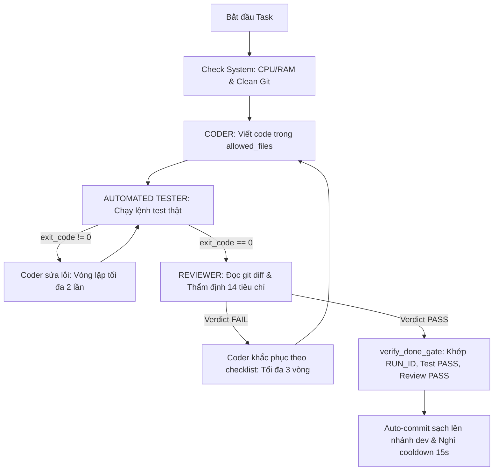

# AGENTS.md — Multi-Agent Roles & Model Routing Specification

> **Dự án:** Hệ thống SaaS Viết Bài Tự Động (Auto-SEO Content SaaS)  
> **Tech Stack:** Backend Laravel 12/13 (PHP 8.3) + Frontend Next.js 16 (React 19, Tailwind CSS v4)  
> **Bộ điều phối:** QLPK Safe Autonomous Framework  

---

## 1. Nguyên Tắc Phân Tách Trách Nhiệm (Separation of Concerns)

Nhằm đảm bảo tính khách quan và ngăn chặn triệt để tình trạng **"Fake Done"** (Agent tự nhận đã xong nhưng chưa kiểm thử thật), hệ thống phân tách nghiêm ngặt 4 vai trò độc lập:

| Vai trò (Role) | Model Khuyến Nghị | Chế độ (--mode) | Trách nhiệm chính | Quyền hạn |
| :--- | :--- | :--- | :--- | :--- |
| **PLANNER** | `gemini-4-argon-medium` | `plan` (Chỉ đọc) | Đọc yêu cầu dự án, chia task nguyên tử, xác định dependencies, ghi `ROADMAP.md` và `PROGRESS.md`. | Chỉ đọc code, không sửa file source. |
| **CODER** | `gemini-3.8-flash-high` | `accept-edits` (Ghi file) | Đọc đặc tả task, viết code đúng phạm vi `allowed_files` bằng `write_file`/`edit_file`. | Sửa file trong danh sách cho phép. **Cấm chạy lệnh shell nguy hiểm**. |
| **AUTOMATED TESTER** | Shell Runner (Bash thật, KHÔNG dùng LLM) | Trực tiếp trong sandbox | Chạy kiểm thử thật bằng lệnh shell (`php artisan test`, `npm run build`, `php artisan pint --test`). Lấy `exit_code == 0` làm bằng chứng. | Thực thi lệnh test, xuất file report `reports/tasks/<task_id>-test.md`. |
| **REVIEWER** | `gemini-4-argon-medium` | `plan` (Chỉ đọc) | Đọc `git diff` và file test report. Kiểm duyệt 14 tiêu chí, chỉ phê duyệt khi đạt chuẩn qua JSON `{"verdict": "PASS"}`. | Chỉ đọc code, xuất file `reports/tasks/<task_id>-review.md`. |
| **DEBUG FALLBACK** | `gemini-3.8-flash-high` -> `Claude Sonnet 5.5` | Theo vai trò | Tự động kích hoạt ngay sau 5s khi Model chính bị lỗi Quota / Rate Limit (429). | Thay thế tức thời để giải cứu pipeline. |

---

## 2. Quy Tắc Hoạt Động Chi Tiết Từng Agent

### 2.1 PLANNER (Kiến trúc sư & Điều phối)
1. **Phân rã Task nguyên tử:** Mỗi task chỉ chạy từ 5 - 15 phút.
2. **Khai báo `allowed_files` tường minh:** Không để Coder tự do sửa toàn bộ repository.
3. **Thứ tự phụ thuộc (Dependencies):** Luôn theo thứ tự: *Khảo sát $\rightarrow$ CSDL/Migration $\rightarrow$ Backend Service/API $\rightarrow$ Frontend UI $\rightarrow$ E2E Test $\rightarrow$ Docs*.
4. **Cập nhật ma trận tiến độ:** Duy trì bảng trạng thái trong `PROGRESS.md`.

### 2.2 CODER (Kỹ sư phần mềm)
1. **Tuyệt đối tuân thủ `allowed_files`:** Bất kỳ file nào ngoài danh sách sẽ bị Reviewer từ chối (REJECT).
2. **Bảo tồn tính toàn vẹn:**
   - Không xóa business logic cốt lõi.
   - Không xóa environment configurations (.env).
   - Giữ strict typing (TypeScript không dùng `any`, PHP có type hint và DTO).
3. **Không chạy lệnh phá hủy:** Không chạy `migrate:fresh`, `db:wipe`, `git reset --hard`.
4. **Báo cáo hoàn thành trung thực:** Bàn giao task bằng cách nộp git diff cho Automated Tester, không tự ý đánh dấu DONE.

### 2.3 AUTOMATED TESTER (Người gác cổng thực tế)
1. **Không dùng LLM để suy đoán kết quả:** Chạy trực tiếp qua subshell bash với lệnh thật:
   - Backend: `cd backend && php artisan test --filter=...` hoặc `./vendor/bin/pint --test`
   - Frontend: `cd frontend && npm run build` hoặc `npm run lint`
2. **Kiểm tra mã thoát (`exit_code`):**
   - `exit_code == 0`: Đạt chuẩn `OVERALL_TEST_RESULT: PASS`.
   - `exit_code != 0`: Đánh giá `OVERALL_TEST_RESULT: FAIL`, trích xuất 50 dòng log lỗi cuối cùng nạp vào báo cáo test.
3. **Đóng dấu RUN_ID:** Gắn mã định danh phiên chạy vào báo cáo test để chống dùng lại báo cáo cũ.

### 2.4 REVIEWER (Giám định viên độc lập)
1. **Kiểm tra 14 tiêu chí vàng** (quy định tại `REVIEWER.md`).
2. **Chỉ chấp thuận khi Test Report PASS:** Nếu `test.md` là FAIL, Reviewer từ chối đánh giá code và yêu cầu Coder sửa lỗi trước.
3. **Định dạng kết quả trả về bắt buộc:**
   ```json
   {
     "task_id": "TASK-XX",
     "run_id": "RUN_XXXXXX",
     "verdict": "PASS",
     "checklist_score": "14/14",
     "notes": "Code meets all strict requirements."
   }
   ```
   Nếu không đạt:
   ```json
   {
     "task_id": "TASK-XX",
     "run_id": "RUN_XXXXXX",
     "verdict": "FAIL",
     "issues": [
       "Scope violation: File X is not in allowed_files",
       "Missing validation in FormRequest"
     ]
   }
   ```

---

## 3. Quy Trình Phối Hợp & Anti-Fake-Done Gate


