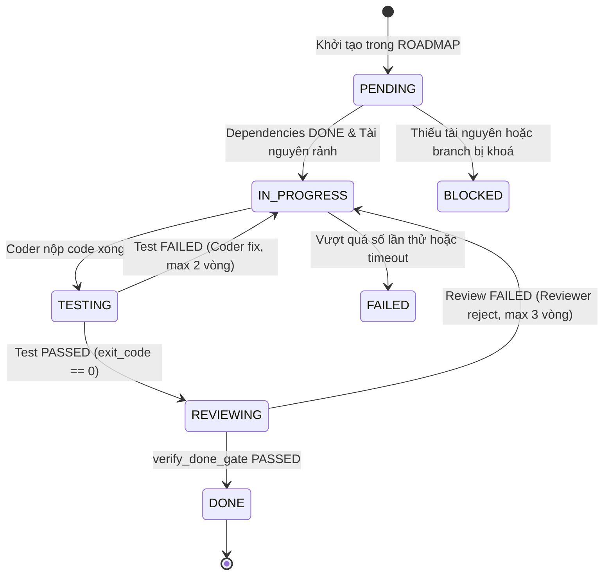

# PLANNER.md — Hướng Dẫn Chia Task & Quản Lý Phụ Thuộc

> **Mục tiêu:** Cung cấp quy chuẩn kiến trúc để PLANNER phân rã các tính năng lớn thành các Task nguyên tử (Atomic Tasks) an toàn, dễ kiểm thử và độc lập.

---

## 1. Nguyên Tắc Chia Task (Task Granularity)

1. **Tính nguyên tử (Atomic):** Mỗi task chỉ giải quyết một khía cạnh cô đọng của hệ thống. Thời gian thực thi lý tưởng từ **5 – 15 phút** cho mỗi vòng gọi model.
2. **Không gộp tính năng:** Tuyệt đối không gom cả Database, Backend API và Frontend UI vào cùng một task.
   - *Sai:* "Xây dựng tính năng thanh toán PayOS".
   - *Đúng:*
     - `TASK-05A`: Database Schema & Models cho Cổng thanh toán (`payment_transactions`, `subscriptions`).
     - `TASK-05B`: DTOs, Service & Webhook Controller xử lý IPN PayOS kèm Test.
     - `TASK-05C`: UI Giao diện Chọn gói cước & Dialog thanh toán QR trên Next.js.
3. **Giới hạn thời gian (Timeouts):**
   - `MODEL_TIMEOUT_SECONDS=900` (15 phút/lời gọi model).
   - `TASK_TIMEOUT_SECONDS=3600` (Tối đa 1 tiếng/task bao gồm cả vòng lặp fix lỗi).

---

## 2. Quy Định Phạm Vi Tệp (allowed_files)

Mỗi task trong `ROADMAP.md` **bắt buộc** phải có danh sách `allowed_files`.
* Coder chỉ được phép tạo mới hoặc chỉnh sửa đúng các file trong danh sách này.
* Mọi file phát sinh ngoài danh sách sẽ bị coi là vi phạm phạm vi (Scope Creep) và bị Reviewer đánh rớt ngay lập tức.
* Nếu trong quá trình code phát hiện cần sửa thêm file phụ trợ (ví dụ `routes/api.php`), PLANNER phải cập nhật lại `allowed_files` trước khi Coder tiến hành.

---

## 3. Thứ Tự Phụ Thuộc (Dependency Graph)

Luồng triển khai chuẩn của một module:
```text
[Khảo sát & Đặc tả]
        │
        ▼
 [CSDL & Migration]
        │
        ▼
[DTO & Service Layer]
        │
        ▼
[API Controller & Request]
        │
        ▼
 [Kiểm Thử Backend Test]
        │
        ▼
 [Frontend API Hook & Types]
        │
        ▼
   [Frontend UI]
        │
        ▼
[E2E / Integration Verification]
```

**Quy tắc:** Task sau chỉ được phép chuyển sang trạng thái `IN_PROGRESS` khi tất cả các task trong `dependencies` đã đạt trạng thái `DONE`.

---

## 4. Máy Trạng Thái Task (Task State Machine)



* **PENDING:** Task đang chờ đến lượt, kiểm tra dependencies.
* **IN_PROGRESS:** Coder đang viết code trong phạm vi `allowed_files`.
* **TESTING:** Automated Tester chạy shell runner kiểm thử thật.
* **REVIEWING:** Reviewer thẩm định git diff và đối chiếu 14 tiêu chí.
* **DONE:** Cả Test Report và Review Report đều PASS, trùng khớp RUN_ID, git commit sạch.
* **FAILED:** Task thất bại sau 3 vòng lặp review/fix, cần con người can thiệp.
* **BLOCKED:** Hệ thống tạm dừng do quá tải CPU/RAM hoặc lỗi quota 429.
